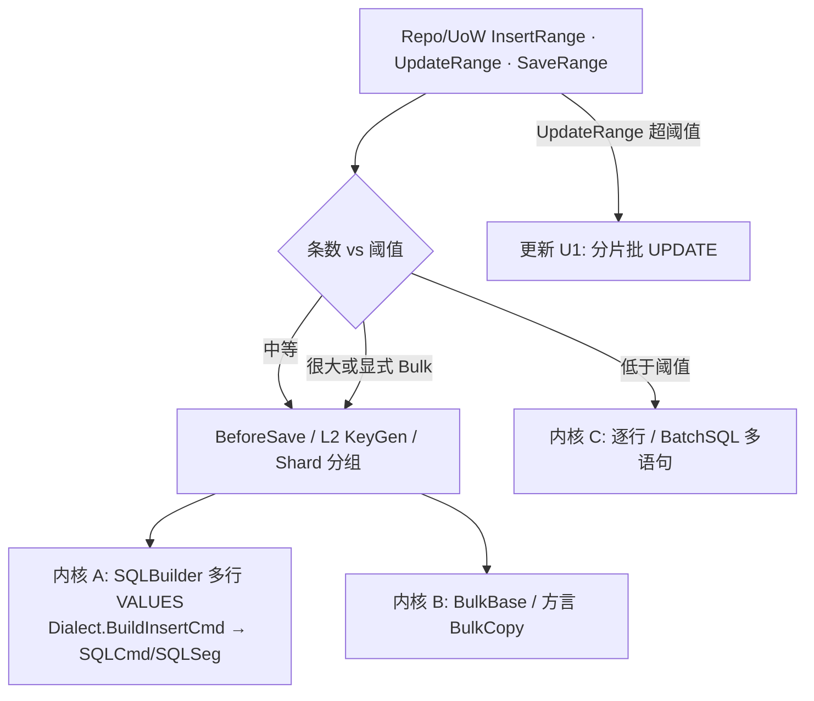

# 仓储批量插入 / 更新 — 性能优化计划

> 面向 **开发人员**（Repo / UoW / Translator / SQLBuilder / Bulk 编排）与 **使用者**（何时自动走批量、阈值与语义差异）。  
> **结论先行**：`InsertRange` / `UpdateRange` / `SaveRange`（及 UoW 同名入口）在数据量较大时，**内核写入应优先走「少往返」路径**——多行 `INSERT … VALUES (…),(…)` / 方言 `BulkCopy` / 分片批更新；**禁止**继续默认「N 次单行 `insertInner`/`updateInner`」作为大批量主路径。  
> **存量小批量语义不变**：条数低于阈值时仍可逐行（或同事务内多语句），保证钩子、分表、L1/L2 主键契约可测可降级。  
> 关联：[`插入主键回填与应用发号.md`](./插入主键回填与应用发号.md)（L1/L2 与 Bulk 边界）、[`BulkCopybase.md`](../../../docs/SQL/basis/BulkCopybase.md)、[`batchSQLbase.md`](../../../docs/SQL/basis/batchSQLbase.md)、方言 Bulk 策略见 [`数据库支持清单.md`](../方言/数据库支持清单.md)。

**落地进度（相对本文计划）**：P0 / P0b / P1 / P1b / **P2（SaveRange S1）已落地**（见 §6、§13）；P2b Client 级默认、P3 方言批更新仍待办。

---

## 1. 概述

| 层 | 职责 | 现状 | 目标 |
|----|------|------|------|
| **Repo 门面** | `InsertRange` / `UpdateRange` / `SaveRange` | **已**按 `BatchWriteOptions` 分流多行 / Bulk / 多语句更新；Save **S1** 批量探活后分流 | P2b Client 默认 Options |
| **UoW** | `InsertRange` / `UpdateRange` / `SaveRange` | Insert 大批量可多段；Save 超阈值探活后分流 InsertRange/UpdateRange | Update 仍多为逐条入队 |
| **SQLBuilder 内核** | `newRow` + `toInsert`/`doInsert` | **已**由方言 `BuildInsertCmd(SqlGoup, …)` 按批切片为多 `SQLSeg` | 保持；避免 Frag 全量投影 |
| **Bulk 内核** | `BulkBase` / `insertList` / 方言 Bulk | Repo 超阈值走 Bulk，失败降级多行 VALUES；Translator 对齐列 | 保持 |
| **主键契约** | L1 / L2 | 与关联文档一致 | Range 默认不取库 Id |



---

## 2. 背景与现状缺口

### 2.1 已有能力

| 能力 | 位置 | 状态 |
|------|------|------|
| 多行 `INSERT … VALUES` + 参数/批切片 | `SqlGoup.newRow`；`StepBuilder.toInsert` → [`Dialect.BuildInsertCmd`](../../../../pure/src/ado/data/dialect/Dialect.insertCmd.cs) | **已接** Repo / UoW Insert |
| `SQLCmd` 多 `SQLSeg` | [`SQLCmd.segments`](../../../../pure/src/ado/builder/rend/SQLPart/SQLCmd.segments.cs)；执行端逐段 NonQuery | **已落地** |
| 方言 BulkCopy | `DbBulkCopy*` 等 | **可用**；Repo 超阈值调用 |
| Fallback 多行插入 | [`DbBulkCopyFallback`](../../../../pure/src/ado/data/dialect/provider/DbBulkCopyFallback.cs) | 无原生 Bulk 时降级 |
| BatchSQL | [`BatchSQL`](../../../../pure/src/ado/data/exstend/BatchSQL.cs) | 更新 U1 / 旁路 |
| `EntityBatchWriter` | [`EntityBatchWriter.cs`](../../../../pure/src/adoext/repository/batch/EntityBatchWriter.cs) | InsertMultiValues / InsertBulk / UpdateMultiStatement |
| `BatchWriteOptions` | [`BatchWriteOptions.cs`](../../../../pure/src/adoext/repository/batch/BatchWriteOptions.cs)；挂 `SooRepository.BatchOptions` | **已落地**（本期未挂 Client） |
| `insertList` | [`SQLBuilderExtensions`](../../../../pure/src/utils/door/SQLBuilderExtensions.cs) | 业务显式 Bulk；与 Range **共存** |

### 2.2 改造前硬伤（已缓解项）

| 问题 | 改造前 | 现状 |
|------|--------|------|
| Insert 往返 O(N) | 逐行 `insertInner` | N ≥ 阈值 → 多行 VALUES / Bulk |
| 命令数 O(N) | 每行一个 `SQLCmd` | 多行可 **一个** `SQLCmd` 含多 `SQLSeg` |
| Bulk 与 Translator 半脱节 | `addList` 跳过 prepare | Bulk 路径经 Translator 对齐（钩子在 Bulk 外） |
| Update 无批内核 | 仅单行 UPDATE | U1 多语句分片（`UpdateMultiStatement`） |
| Save 批量 | 逐条 SaveInner | **S1**：`SplitSaveByExistence` → Insert/Update 内核 |

### 2.3 设计目标

| 目标 | 说明 |
|------|------|
| **默认加速** | `InsertRange` 超阈值自动多行 / Bulk |
| **内核复用** | 多行 VALUES 与 Bulk 共用阈值与 Translator 列语义 |
| **少分配** | 切片在方言侧按批扫 `SetFrag`，**不做**全量 Frag 行投影 |
| **语义对齐** | 列忽略 / L2 发号 / 分表分组 |
| **主键契约** | Range **不**默认取 Identity；需要 Id 用显式 API / L2 |
| **可配置** | `BatchWriteOptions`（Repo）；Client 默认见 P2b |
| **可测** | `SQLCmdSegments*` / `RepoBatchWriteRange*` 等 |

### 2.4 非目标（本期不做或后置）

- 不把 Tracking / 脏列批更新塞进薄仓  
- 不强制所有方言实现 TVP / COPY  
- **不**默认让 `InsertRange` 变成 `InsertReturnIds`  
- 不删除独立 `useBulk` / `insertList`  
- SaveRange Upsert/MERGE（S2）后置  

- 不在本期统一跨库 Bulk 性能数字  

### 2.5 成功判据

1. `InsertRange(N)`（N ≥ 插入阈值）库侧 INSERT 往返 ≪ N（约 `⌈N/BatchSize⌉` 或 Bulk）。  
2. 逐行与批量列集合一致（含 Ignore / L2）。  
3. `UpdateRange(N)` 超阈值往返显著少于 N（U1）。  
4. 低于阈值与改造前兼容（钩子默认 PerEntity）。  
5. UoW 复用同一 Executor / 连接。  
6. 分表组内批量、跨表分组。  
7. Identity + 默认 Range：**不**冒充 Id 列表。  
8. 基准：`InsertRange(1000+)` 相对改造前显著提升。

---

## 3. 写入内核分层

### 3.1 三档内核（插入）

| 档 | 名称 | 机制 | 适用 | 往返 |
|----|------|------|------|------|
| **C** | 逐行 | `insertInner` → 单行 `doInsert` | N &lt; 阈值；强制 Row | O(N) |
| **A** | 多行 VALUES | Translator 填行 → `newRow`… → `toInsert`/`doInsert`；方言按批切 `SQLSeg` | 默认中大批量 | O(⌈N/B⌉) |
| **B** | BulkCopy | Translator 对齐列 → Bulk；失败降级 A | N ≥ Bulk 阈值或 `Mode=Bulk` | O(1～⌈N/B⌉) |

**默认策略（已实现）**：

```text
InsertRange(list):
  空 → 0
  分表 → GroupByTable；各组分别：
    钩子 / L2（按 BatchHook 策略）
    if Mode=Row 或 N < InsertRowThreshold → C
    else if Mode=Bulk 或 N >= InsertBulkThreshold → B（失败 → A）
    else → A
```

| 配置项 | 默认（`BatchWriteOptions`） | 说明 |
|--------|------------------------------|------|
| `InsertRowThreshold` | 32 | 低于此逐行 |
| `InsertBulkThreshold` | 2000 | 达到后优先 Bulk |
| `InsertBatchSize` | 200 | → `StepBuilder.InsertValuesBatchSize` |
| `Mode` | `Auto` | `Auto` / `Row` / `MultiValues` / `Bulk` |

切片公式：

```text
rowsPerBatch = min(InsertBatchSize, floor((paramMaxSize - basePs) / max(1, paramsPerRow)))
InsertBatchSize ≤ 0 → 仅按 paramMaxSize 约束
```

### 3.2 SQLBuilder 多行 VALUES（内核 A）— 主路径（已落地）

#### 3.2.1 调用链

```text
EntityBatchWriter.InsertMultiValues
  → kit.set / newRow / prepareInsert（逐实体）
  → doInsert() → toInsert()
       → Dialect.BuildInsertCmd(SqlGoup, basePs, InsertValuesBatchSize)
            ├─ 单行 / 未超批：SqlGoup.buildInsert() → 单段 SQLCmd（快路径）
            └─ 超批：按 GetInsertRowIndices() 分窗扫 SetFrag
                 → 每窗 Parameterize → expression.buildInsert(Frag 仅本批 insertValues)
                 → 多个 SQLSeg 挂同一 SQLCmd
  → DBExecutor 按段 exeNonQuery，累加行数
```

**设计取舍（相对曾议「Frag 全量结构化投影」）**：

| 方案 | 结论 |
|------|------|
| Frag `insertRows` 全量投影再切 | **不采用**（SQLBuilder 编辑态已偏肥，再叠 \(N×C\) 临时对象） |
| 方言直接读 `SqlGoup`/`SetFrag` 出 `SQLCmd` | **采用**（热路径）；按批参数化，峰值约一批 |
| `string expression.buildInsert(FragSQL)` | **保留**（拼壳 / insert-from / 已是字符串的 VALUES） |

#### 3.2.2 `newRow` 行模型（B-1）

```text
newRow():
  rows 加入当前 setIndex（若尚无）
  setIndex++
  rows 加入新 setIndex（打开下一行占位）
```

- 构建扫 **`GetInsertRowIndices()`**（跳过未 `set` 的空占位），**不再**需要 `SealInsertRows` 补末行。  
- 约定兼容：`set…newRow().set…` 与教程式 `newRow().set…`（含首行）。  
- 超批时 `insertCols` 取**首个有数据行**的列，避免空 `rows[0]`。

#### 3.2.3 实现要点

1. **列对齐**：同批同构；与单行 `prepareInsert` 一致。  
2. **参数袋**：超批每段 `basePs.Copy()` 后追加本批 VALUES；不写回污染分组 `ps`（未超批仍走 `buildInsertRowVal` → group.ps）。  
3. **执行器**：Repo/`getKit()` / UoW 当前 `Executor`。  
4. **返回值**：累计影响行数。  
5. **InsertReturnId**：多段 `SQLCmd` **拒绝**包成 ReturnId（须单行或 L2 / 显式多行 Returning API）。

### 3.3 BulkCopy（内核 B）— 超大吞吐（已落地）

| 步骤 | 说明 |
|------|------|
| 1. 准备实体 | L2、`OnBeforeSave`（在 Bulk 外，按钩子策略） |
| 2. 填表 | 与 Translator 相同忽略列 / `ResolveColumnValue` |
| 3. 写入 | 方言 Bulk；挂事务 Executor |
| 4. 降级 | 失败 → 内核 A，可打日志 |

`insertList` / `useBulk`：**保留**；与 Range 理想上共用服务（已部分收敛到 `EntityBatchWriter`）。

**Bulk 与 L1**：通常不回填 Identity。

### 3.4 更新内核

| 档 | 机制 | 状态 |
|----|------|------|
| **U0** | 逐行 `updateInner` | 低于阈值 / 强制 |
| **U1** | 多语句分片一次（或少次）往返 | **已落地** `UpdateMultiStatement` |
| **U2** | `newRow` → `toUpdateUnion`（UPDATE FROM/JOIN + UNION）；**分桶在 SQLBuilder**（按行 SetFrag） | **已落地（P0/P0b）** → [`批量更新-UpdateUnion计划.md`](./批量更新-UpdateUnion计划.md)（N≥50；不支持方言降级 U1） |
| **U3** | 临时表 / TVP + JOIN | 待办 |

### 3.5 SaveRange

| 阶段 | 策略 | 状态 |
|------|------|------|
| **S0** | 逐条 `SaveInner` | N &lt; `InsertRowThreshold` 或 `Mode=Row` |
| **S1** | 批量探活 PK（`setPKWhereRange` 分片）→ `InsertRangeCore` / `UpdateRangeCore` | **已落地** |
| **S2** | 方言 Upsert / MERGE | 后置 |

空主键：**只判 `null`**（任一侧 PK 为 null → 插入，不做探活）。  
探活键：规范化字符串（单列/联合主键）；实现见 `EntityBatchWriter.SplitSaveByExistence`。  
L2 发号仍由插入内核 `prepareInsert` 负责（空 PK 走插入即可）。

---

## 4. 与 Translator / 钩子 / 主键 的边界

### 4.1 列语义

与单行 `prepareInsert` / `prepareUpdate` 对齐：`IsIgnore` / `IsOnlyIgnoreInsert|Update`、`ResolveColumnValue`、L2 发号写回、Identity 不进 INSERT 列。

### 4.2 L1 / L2

| 场景 | 批量默认 |
|------|----------|
| Identity + `InsertRange` | 只行数；**不**回填 |
| L2 | 批量前发号写回 |
| `InsertReturnIds` | 显式 API；禁止多行 VALUES + 单次 Last_Insert_Id 冒充列表 |
| Bulk | **通常不支持** L1 |

### 4.3 钩子

默认 **PerEntity**（兼容审计）；极致吞吐显式降频 / 关闭。原则：**不默默砍钩子**。

### 4.4 分表 / 导航 / 事务

Shard 组内 A/B；导航子表可复用内核；UoW 必须挂当前事务 Executor。

---

## 5. API 与配置面

### 5.1 对外 API

| API | 变化 |
|-----|------|
| `SooRepository.InsertRange` | 内部分流；签名不变 |
| `UpdateRange` | 超阈值 U1 |
| `SaveRange` | **S1** 探活分流；小批量仍 S0 |
| `SooUnitOfWork.InsertRange` | 大批量少命令（多段 `SQLCmd`） |
| `insertList` / `useBulk` | 保留 |
| `SooRepository.BatchOptions` | **已有** |

### 5.2 `BatchWriteOptions`（已实现）

```csharp
public class BatchWriteOptions
{
    public BatchWriteMode Mode { get; set; } = BatchWriteMode.Auto;
    public int InsertRowThreshold { get; set; } = 32;
    public int InsertBulkThreshold { get; set; } = 2000;
    public int InsertBatchSize { get; set; } = 200;
    public int UpdateRowThreshold { get; set; } = 32;
    public int UpdateBatchSize { get; set; } = 100;
}
```

挂载：当前在 **Repo**；Client 级默认 → P2b。

### 5.3 内部服务落点

```text
pure/src/adoext/repository/batch/
  BatchWriteOptions.cs
  EntityBatchWriter.cs    // InsertMultiValues / InsertBulk / UpdateMultiStatement
```

方言：`Dialect.insertCmd.cs` → `BuildInsertCmd(SqlGoup, Paras, int)`。

---

## 6. 分阶段实施与进度

| 阶段 | 内容 | 状态 |
|------|------|------|
| **P0** | 多行 INSERT：`SQLSeg` 切片 + `newRow`/`toInsert` | **完成** |
| **P0b** | `InsertRange` 阈值分流；分表；UoW | **完成** |
| **P1** | Bulk 阈值 + Translator 对齐 + 降级 A | **完成** |
| **P1b** | `UpdateRange` U1 多语句分片 | **完成** |
| **S0 净化** | 去掉 Builder 侧切片；方言读 `SqlGoup`；`newRow` B-1；去掉 Seal 补丁 | **完成** |
| **P2** | `SaveRange` S1 批量探活 PK → Insert/Update 内核；UoW/`toSaveList` 对齐 | **完成** |
| **P2b** | Client 默认 `BatchWriteOptions` / 钩子模式文档 | 待办 |
| **P3** | Update U2（分桶 UpdateUnion） | **Builder+Repo 已落地** → [`批量更新-UpdateUnion计划.md`](./批量更新-UpdateUnion计划.md)；PG/UoW/基准与 U3 Staging 后置 |
| **P4** | Returning 多行 Id + 基准归档 | 待办 |

---

## 7. 测试与基准要点

### 7.1 正确性（节选 + 已有用例）

| 用例 | 期望 |
|------|------|
| 单行 / 未超批 `toInsert` | 单段 `SQLCmd` |
| 超批 | 多 `SQLSeg`、仍一个 `SQLCmd`；执行写全行 |
| 先 `newRow` 再 `set`（含首行）超批 | 列清单非空；行数正确 |
| N &lt; 阈值 `InsertRange` | 与逐行兼容 |
| L2 / Identity / 忽略列 / 分表 / UoW 回滚 | 见原表 |
| 多段 + `BuildInsertReturnIdCmd` | 抛错 |

相关测试：`SQLCmdSegmentsInsertValuesTests`、`RepoBatchWriteRangeTests`、`InsertReturnIdTests` 等。

### 7.2 性能

`InsertRange(100/1000/10000)` 对照改造前逐行、`insertList`、他库 BatchInsert；Bulk 与多行 VALUES **分列报告**。

---

## 8. 关键代码索引

| 区域 | 路径 |
|------|------|
| Repo Range / `BatchOptions` | [`SooRepository.cs`](../../../../pure/src/adoext/repository/SooRepository.cs) |
| UoW Range | [`SooUnitOfWork.cs`](../../../../pure/src/adoext/repository/SooUnitOfWork.cs) |
| 批量内核 | [`EntityBatchWriter.cs`](../../../../pure/src/adoext/repository/batch/EntityBatchWriter.cs)（含 `SplitSaveByExistence`）、[`BatchWriteOptions.cs`](../../../../pure/src/adoext/repository/batch/BatchWriteOptions.cs) |
| Translator | [`EntityTranslator.cs`](../../../../pure/src/adoext/clip/provider/EntityTranslator.cs) |
| `newRow` / `GetInsertRowIndices` | [`SqlGoup.cs`](../../../../pure/src/ado/builder/rend/SQLPart/SqlGoup.cs) |
| `toInsert` | [`StepBuilder.cs`](../../../../pure/src/ado/builder/stepBuilder/StepBuilder.cs) |
| 方言插入命令 | [`Dialect.insertCmd.cs`](../../../../pure/src/ado/data/dialect/Dialect.insertCmd.cs) |
| `SQLCmd` / `SQLSeg` | [`SQLCmd.cs`](../../../../pure/src/ado/builder/rend/SQLPart/SQLCmd.cs)、[`SQLCmd.segments.cs`](../../../../pure/src/ado/builder/rend/SQLPart/SQLCmd.segments.cs) |
| Bulk | [`BulkBase`](../../../../pure/src/ado/data/exstend/BulkBase.cs)、[`DbBulkCopyFallback`](../../../../pure/src/ado/data/dialect/provider/DbBulkCopyFallback.cs) |
| `insertList` | [`SQLBuilderExtensions.cs`](../../../../pure/src/utils/door/SQLBuilderExtensions.cs) |

---

## 9. 文档与下游

- 使用者文档补充：`InsertRange` 自动批量 / 阈值 / 与 `insertList` 关系；默认不取 Identity。  
- 运维：按库推荐 `InsertBatchSize` / Bulk 阈值。  
- 手写循环 `Insert` 可改为 `InsertRange`；已用 `insertList` 无需被迫迁移。

---

## 10. 风险与副作用

| 风险 | 缓解 |
|------|------|
| 批内一单失败整批失败 | 与多行 INSERT 一致；要部分成功则小片或 Row |
| 钩子依赖落库后读 Id | Identity 默认无 Id；引导 L2 / `InsertReturnIds` |
| 触发器触发次数变化 | `Mode=Row` 逃生 |
| SQLite 锁与长事务 | 控制 BatchSize |
| 多段命令调试条数变化 | 日志片级 SQL；调试可强制 Row |
| `buildInsert` 与方言超批双轨打参 | 未超批快路径有意保留；认知上注意命名区分 `expression.buildInsert` |

---

## 11. 决策摘要

| 项 | 决策 |
|----|------|
| Repo 默认 | 超阈值 **自动**多行 / Bulk |
| 首选内核 | **A（多行 VALUES）**；超大 **B** |
| 切片归属 | **方言** `BuildInsertCmd(SqlGoup, …)`；不经 Frag 全量投影 |
| `newRow` | B-1：封当前 + 开下一行；构建用 `GetInsertRowIndices` |
| `SQLCmd` | 始终 `SQLSeg`；超批多段仍一个命令 |
| Identity | Range **不**默认取 Id |
| Update | U1 已落地；**U2（P0/P0b）已落地** → [UpdateUnion 计划](./批量更新-UpdateUnion计划.md)；U3 后置 |
| Save | **S1 已落地**；Upsert S2 后置 |
| 钩子 | 默认 PerEntity |
| 与 `insertList` | 共存 |

---

## 12. 一页路线图

```text
[完成] P0    多行 VALUES + SQLSeg 切片 + 单测
[完成] P0b   InsertRange / 分表 / UoW
[完成] P1    Bulk 阈值 + Translator 对齐 + 降级
[完成] P1b   UpdateRange U1
[完成] S0净化 方言读 SqlGoup；newRow B-1；去 Seal / 去 Frag 投影
[完成] P2    SaveRange S1 探活分流 + UoW/toSaveList
[待办] P2b   Client 默认 Options / 钩子模式文档
[完成] P3a   Update U2 P0/P0b：toUpdateUnion + Writer 阈值 50 / 降级 U1（见 批量更新-UpdateUnion计划.md）
[规划] P3b   Update U2 余量：PG / UoW / 基准；U3 Staging 后置
[待办] P4    Returning 多行 Id + 基准归档
```

**一句话**：仓储批量写入的性能问题，本质是 **门面逐行打点**；把多行 INSERT（方言切片出 `SQLCmd`）与 BulkCopy **收成内核**接到 `*Range`，即可在不改业务调用的前提下完成大批量加速。Update 侧 **U2（`toUpdateUnion`，N≥50，Builder 自动分桶）已接入 `UpdateRange`**；余量见 UpdateUnion 计划 P1。

---

## 13. 实现备忘（开发向）

| 主题 | 说明 |
|------|------|
| 为何还留 `SqlGoup.buildInsert` | `BuildInsertCmd` 在**单行 / 未超批**退回该快路径；`insert-from` / upsert 等仍用。超批不走它打全表参。 |
| 为何不 Frag 投影 | Builder 已有 `SetFrag×行`；再投影一层抬峰值；热路径改为方言按窗扫 `SetFrag`。 |
| UoW | 大批量 Insert 设置 `InsertValuesBatchSize`，一次 `toInsert` 入队（可多段）。 |
| 测试锚点 | `ToInsert_NewRowFirst_OverBatch_*` 锁定「先 newRow」+ 超批列清单。 |
