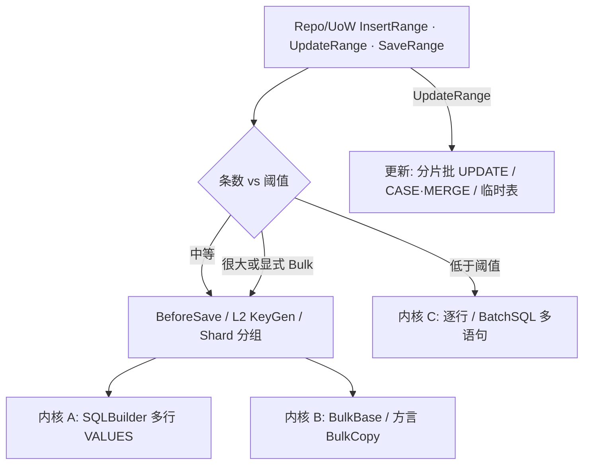

# 仓储批量插入 / 更新 — 性能优化计划

> 面向 **开发人员**（Repo / UoW / Translator / SQLBuilder / Bulk 编排）与 **使用者**（何时自动走批量、阈值与语义差异）。  
> **结论先行**：`InsertRange` / `UpdateRange` / `SaveRange`（及 UoW 同名入口）在数据量较大时，**内核写入应优先走「少往返」路径**——多行 `INSERT … VALUES (…),(…)` / 方言 `BulkCopy` / 分片批更新；**禁止**继续默认「N 次单行 `insertInner`/`updateInner`」作为大批量主路径。  
> **存量小批量语义不变**：条数低于阈值时仍可逐行（或同事务内多语句），保证钩子、分表、L1/L2 主键契约可测可降级。  
> 关联：[`插入主键回填与应用发号.md`](./插入主键回填与应用发号.md)（L1/L2 与 Bulk 边界）、[`BulkCopybase.md`](../../../docs/SQL/basis/BulkCopybase.md)、[`batchSQLbase.md`](../../../docs/SQL/basis/batchSQLbase.md)、方言 Bulk 策略见 [`数据库支持清单.md`](../方言/数据库支持清单.md)。

---

## 1. 概述

| 层 | 职责 | 现状 | 目标 |
|----|------|------|------|
| **Repo 门面** | `InsertRange` / `UpdateRange` / `SaveRange` | 逐实体 `*Inner` 循环 | 按阈值与方言能力分流到批量内核 |
| **UoW** | `InsertRange` / `UpdateRange` / `SaveRange` | 逐条 `toInsert`/`toUpdate` 入队，或 `toSaveList` | 大批量改为少命令 / Bulk；事务复用不变 |
| **SQLBuilder 内核** | 多行 `newRow` + `doInsert`；`exeNonQuery` 批 | 能力已有，Repo **未消费** | 作为「通用多行 INSERT」默认内核 |
| **Bulk 内核** | `BulkBase` / `insertList` / 方言 `DbBulkCopy*` | 独立 API；与 Translator 钩子半脱节 | 超阈值 / 明确 Bulk 时走原生或 Fallback |
| **主键契约** | L1 库回填 / L2 应用发号 | 见关联文档 | 批量路径 **对齐** L2；L1 仅显式 `*ReturnId*` / Returning 方言 |



---

## 2. 背景与现状缺口

### 2.1 已有能力（未接到 Repo 默认路径）

| 能力 | 位置 | 状态 |
|------|------|------|
| 多行 `INSERT … VALUES` | `SQLBuilder.newRow` / `SqlGoup`；`doInsert` 一次提交多行 | **可用**；`DbBulkCopyFallback` 已用；Repo **未用** |
| 方言 BulkCopy | `DbBulkCopy` / `MSSQBulkCopyee` / `MySqlFamilyBulkCopyee` / `NpgBulkCopyee`（COPY）等 | **可用**；`SQLBuilder.insertList` → `useBulk().addList` |
| Fallback 多行插入 | [`DbBulkCopyFallback`](../../../../pure/src/ado/data/dialect/provider/DbBulkCopyFallback.cs)（`BatchSize` + `paramMaxSize` 切片） | 无原生 Bulk 时的正确降级 |
| BatchSQL | [`BatchSQL`](../../../../pure/src/ado/data/exstend/BatchSQL.cs) `addInsert`/`addUpdate`/`exeNonQuery` | 多语句一次往返；仍是 N 条单行 SQL |
| 实体扩展 `insertList` | [`SQLBuilderExtensions.insertList`](../../../../pure/src/utils/door/SQLBuilderExtensions.cs) | 业务可手写高性能插入；**与 `InsertRange` 脱节** |
| `toSaveList` | 扩展方法 | UoW `SaveRange` 用；仍是逐实体 SQLCmd 列表 |

### 2.2 Repo / UoW 硬伤（性能）

[`SooRepository.InsertRange`](../../../../pure/src/adoext/repository/SooRepository.cs) / `UpdateRange` / `SaveRange`：

```text
foreach entity → insertInner / updateInner / SaveInner → 单行 doInsert / doUpdate
```

[`SooUnitOfWork.InsertRange`](../../../../pure/src/adoext/repository/SooUnitOfWork.cs)：

```text
foreach entity → toInsert(entity) → AddSQL → Commit 时 N 条命令
```

| 问题 | 影响 |
|------|------|
| **往返 = O(N)** | 基准与业务大批量（千～万行）时远慢于多行 VALUES / BulkCopy / 手写批插 |
| **分配 = O(N)** 命令与参数集 | GC 与字符串拼接成本高 |
| Bulk / `insertList` 旁路 | 知情用户可走快路径；默认仓储 API 不受益 → 对标 ORM「BatchInsert」落差 |
| `BulkBase.addList` 跳过 Translator | 不跑 `prepareInsert` / L2 发号 / `OnBeforeSave` → 与 Repo 语义不完全等价 |
| 更新无批内核 | `UpdateRange` 无 CASE/临时表/MERGE 选项；只能单行 UPDATE |
| 分表路径 | `InsertRange` 已按物理表分组，但组内仍逐行 |

### 2.3 设计目标

| 目标 | 说明 |
|------|------|
| **默认加速** | `InsertRange` 在超过阈值时自动多行 INSERT（或 Bulk），调用方无需改 API |
| **内核复用** | 优先复用 SQLBuilder 多行 VALUES 与现有 Bulk 栈，不另起第三套拼 SQL |
| **语义对齐** | 批量路径仍经 Translator 准备列（忽略列、默认值、L2 发号写回）；钩子策略见 §4 |
| **方言适配** | 有原生 Bulk → 超大阈值走 Bulk；否则 Fallback 多行；参数上限切片 |
| **更新可预期** | `UpdateRange` 至少做到「分片多语句 / 少往返」；进阶 CASE·MERGE / 临时表为可选 |
| **主键契约** | 与 L1/L2 文档一致：默认 Range **不**取库 Id；L2 批量前发号；Returning 多行取 Id 走显式 API |
| **可配置** | Client / Repo 级阈值、强制策略（AlwaysRow / MultiValues / Bulk）、BatchSize |
| **可测** | 小批量与大批量结果一致（行数、列值、L2 PK）；基准可对比 |

### 2.4 非目标（本期不做或后置）

- 不把 Tracking / 脏列批更新塞进薄仓（仍属富仓储；见特性计划）
- 不强制所有方言实现 TVP / COPY；无能力则 Fallback
- **不**默认让 `InsertRange` 变成 `InsertReturnIds`（避免静默往返与语义变化）
- 不删除 / 替换独立 `useBulk` / `insertList` API（业务显式 Bulk 仍保留）
- 不在本期统一「跨库同一套 Bulk 性能数字」（仅要求正确降级）
- SaveRange「存在性检查」批量化（先插后更 / 先查 PK 集）可分期，见 §6

### 2.5 成功判据

1. `InsertRange(N)` 在 N ≥ 插入阈值时，数据库侧观察到 **远少于 N** 次 INSERT 往返（切片后约 `⌈N / BatchSize⌉` 或 Bulk 一次）。  
2. 同实体、同数据，逐行与批量路径写入列集合一致（含 `IsOnlyIgnoreInsert`、L2 发号后实体 PK 非空）。  
3. `UpdateRange(N)` 在 N ≥ 更新阈值时，往返显著少于 N（至少 BatchSQL / 多语句分片；进阶路径另测）。  
4. 低于阈值行为与今日一致（含钩子调用次数策略见 §4.3，默认兼容）。  
5. UoW 事务内批量写入复用同一 `Executor` / 连接，不新开连接破坏事务。  
6. 分表：组内走批量内核；跨物理表仍分组。  
7. Identity + 默认 `InsertRange`：**不**冒充 Id 列表；需要 Id 用 `InsertReturnIds` / L2。  
8. 基准（SQLite / 至少一种服务器库）：`InsertRange(1000+)` 相对改造前有数量级或显著倍数提升。

---

## 3. 写入内核分层

### 3.1 三档内核（插入）

| 档 | 名称 | 机制 | 适用 | 往返 |
|----|------|------|------|------|
| **C** | 逐行 | `insertInner` → 单行 `doInsert` | N &lt; 阈值；需逐条钩子；取单行 Id | O(N) |
| **A** | 多行 VALUES | Translator 填行 → `kit.newRow()`… → `doInsert()`；按 `BatchSize` / `paramMaxSize` 切片 | 默认「中大批量」 | O(⌈N/B⌉) |
| **B** | BulkCopy | 实体 → `DataTable` / Reader → 方言 `WriteToServer`；无原生则 Fallback≈A | N ≥ Bulk 阈值或 `WriteMode=Bulk` | O(1～⌈N/B⌉) |

**推荐默认策略**：

```text
InsertRange(list):
  若 list 空 → 0
  若分表激活 → GroupByTable；各组分别执行下列逻辑
  对每组:
    跑批量前钩子 / L2 发号（§4）
    if N < InsertRowThreshold → 内核 C
    else if N >= InsertBulkThreshold 且方言 Bulk 可用（或 Forced Bulk）
         → 内核 B（失败可降级 A）
    else → 内核 A
```

| 配置项（概念） | 建议默认 | 说明 |
|----------------|----------|------|
| `InsertRowThreshold` | **16～32** | 低于此用逐行，减少小批拼 SQL 开销 |
| `InsertBulkThreshold` | **2000～5000** | 达到后优先方言 Bulk；可按库调 |
| `InsertBatchSize` | **100～500** | 多行 VALUES 每片行数；受 `paramMaxSize` 约束 |
| `WriteMode` | `Auto` | `Auto` / `Row` / `MultiValues` / `Bulk` |

参数上限：每行列数 × 行数 ≤ 方言 `paramMaxSize`（如 SQLite/SQL Server 常见上限）；切片公式：

```text
rowsPerBatch = min(InsertBatchSize, floor(paramMaxSize / max(1, columnCount)))
```

### 3.2 SQLBuilder 多行 VALUES（内核 A）— 主路径

这是 **Repo 批量插入的首选内核**：不依赖驱动专用 Bulk，跨库行为一致，SQL 可见。

```text
kit.setTable(table)
foreach chunk:
  foreach entity in chunk:
    prepareInsertFields(kit, entity)   // 与单行列语义一致，不立即执行
    kit.newRow()
  kit.doInsert()                       // 一次 INSERT 多 VALUES
  kit.clear() / 重置表名
```

实现要点：

1. **列对齐**：同一批内列集合应一致（实体同构）；缺列用 SQL `DEFAULT` / 省略策略与单行 `prepareInsert` 对齐，禁止批内「行列错位」。  
2. **复用 Fallback 切片逻辑**：与 `DbBulkCopyFallback` 同一套 BatchSize / MaxPara 规则，避免两套阈值。  
3. **执行器**：走当前 Repo/`getKit()` 的 `Executor`（UoW 事务）。  
4. **返回值**：累计影响行数（与今日 `InsertRange` 返回 `int` 一致）。

可选抽取：`EntityTranslator.prepareInsertRange(kit, IEnumerable)` 或内部 `AppendInsertRow`，避免 N 次完整 `prepareInsert` 重复解析表名。

### 3.3 BulkCopy（内核 B）— 超大吞吐

| 步骤 | 说明 |
|------|------|
| 1. 准备实体 | L2 发号、`OnBeforeSave`（批量策略见 §4） |
| 2. 填表 | 对齐 `BulkBase.addList`，但 **必须**走与 Translator 相同的忽略列 / `ResolveColumnValue` |
| 3. 写入 | `dialect.GetBulkCopy` → `WriteToServer`；继承 `useTransaction(Executor)` |
| 4. 降级 | 驱动失败或未实现 → 内核 A，并可选日志一次 |

与现有 `insertList` 关系：

- 业务显式 `kit.insertList(list)`：**保持**；可逐步改为调用同一「批量插入服务」。  
- Repo `InsertRange`：**默认**在超阈值时调用同一服务，而不是要求用户改调 `insertList`。

**Bulk 与 L1**：Bulk / 多行 Fallback **通常不**回填 Identity（与主键文档 §10.1.1 一致）。需要 Id → L2 或 `InsertReturnIds`（Returning 方言）。

### 3.4 更新内核

单行 `UPDATE … WHERE pk=@id` 的 N 次往返是 `UpdateRange` 的主瓶颈。分档：

| 档 | 机制 | 适用 | 复杂度 |
|----|------|------|--------|
| **U0** | 逐行 `updateInner` | N &lt; 更新阈值 | 已有 |
| **U1** | BatchSQL / 多语句包：每片 K 条单行 UPDATE，一次 `exeNonQuery` | 全方言；默认大批量 | 低 |
| **U2** | 方言批更新：`UPDATE … FROM` / `CASE WHEN pk` 设列 / MERGE…USING | 中等 N、列少 | 中 |
| **U3** | 临时表 / TVP 灌入 + `UPDATE JOIN` / MERGE | 很大 N、列多 | 高；MSSQL/PG 优先 |

**本期建议**：

- **P1**：U1（分片多语句）作为 `UpdateRange` 超阈值默认。  
- **P2**：U2 对「全列更新、单主键」提供可选 `UpdateMode=CaseWhen`（方言能力检测）。  
- **P3**：U3 与插入 Bulk 阈值对齐，显式 `UpdateMode=Staging`。

富仓储脏更新批量：不在本计划把 Tracking 下沉薄仓；`UpdateRange` 仍是全列（或 Translator 约定列）更新。

### 3.5 SaveRange

`Save` 需按主键是否存在分流 insert/update，批量更难：

| 阶段 | 策略 |
|------|------|
| **S0（现状）** | 逐条 `SaveInner`（存在性查询 + 写） |
| **S1** | 批量加载已存在 PK 集合（`WHERE pk IN (…)`` 分片）→ 内存分流 → `InsertRange` 内核 + `UpdateRange` 内核 |
| **S2** | 方言 Upsert / MERGE（与 RichRepo `InsertOrUpdate` 对齐，薄仓可选开关） |

**建议**：P1 先做 Insert/Update Range 内核；P2 做 S1（一次读 PK 集 + 复用 A/B/U1）；S2 与富仓储 Upsert 共用方言零件，避免双实现。

空主键约定：**只判 `null`**（与主键文档 §4.2 一致）；L2 发号在分流 **之前** 完成，避免「发号后被误判为 Update」。

---

## 4. 与 Translator / 钩子 / 主键 的边界

### 4.1 必须对齐的列语义

批量路径生成的列集合须与单行 `prepareInsert` / `prepareUpdate` 一致：

| 规则 | 插入 | 更新 |
|------|------|------|
| `IsIgnore` / `IsOnlyIgnoreInsert` | 跳过 | — |
| `IsOnlyIgnoreUpdate` | — | 跳过 |
| `ResolveColumnValue` | 是 | 是 |
| L2 `AutoKey` / `KeyGeneratorType` | 插入前发号并 **SetValue** | 不发号 |
| Identity | 不进 INSERT 列 | 作 WHERE，不进 SET（除非业务显式） |

### 4.2 L1 / L2（与关联文档一致）

| 场景 | 批量默认 |
|------|----------|
| Identity + `InsertRange` | 只行数；**不**回填；**禁止** Last_Insert_Id 推算冒充列表 |
| 应用主键 L2 | 批量前对空主键发号写回，再进 A/B |
| `InsertReturnIds` | 显式 API；Returning/OUTPUT → Reader；否则逐行降级（主键文档 §3.3） |
| Bulk | **通常不支持** L1 |

### 4.3 钩子调用策略

| 钩子 | 建议 |
|------|------|
| `OnBeforeSave` / `fireBeforeInsert` | **默认逐实体仍调用**（兼容审计字段赋值）；可用 `BatchHookMode=Once` 降频（文档警示） |
| `OnAfterSave` | 批量成功后逐实体或按批一次；默认与今日「每行一次」对齐，避免静默少调 |
| 性能敏感 | 提供 `SkipPerEntityHook`（知情关闭），此时仅依赖列默认值 / L2 |

**原则**：性能优化 **不默默砍钩子**；要极致吞吐用显式选项或直接 `insertList`/Bulk。

### 4.4 分表 / 导航 / 事务

| 场景 | 行为 |
|------|------|
| Shard | 先 `GroupByTable`，组内走 A/B；跨表不混批 |
| `useNavSaveRange` | 仍按导航图编排；子表插入可复用同一批量内核 |
| UoW | 批量内核必须挂当前事务 Executor；Commit 前不另借连接 |
| 嵌套 UoW | 与今日一致，复用外层事务 |

---

## 5. API 与配置面

### 5.1 对外 API（尽量不增概念）

| API | 变化 |
|-----|------|
| `SooRepository.InsertRange` | **内部**改分流；签名与返回 `int` 不变 |
| `UpdateRange` / `SaveRange` | 同上（Save 分期） |
| `SooUnitOfWork.*Range` | 大批量改为少命令或执行期走批量服务，而非 N 条独立 SQLCmd（或生成「片」级 SQLCmd） |
| `insertList` / `useBulk` | 保留；实现与 Repo 共用内核 |
| 可选显式 | `InsertRange(list, BatchWriteOptions)` 或 Repo 属性 `BatchOptions` |

### 5.2 `BatchWriteOptions`（概念）

```csharp
public class BatchWriteOptions
{
    public BatchWriteMode Mode { get; set; } = BatchWriteMode.Auto; // Auto/Row/MultiValues/Bulk
    public int InsertRowThreshold { get; set; } = 32;
    public int InsertBulkThreshold { get; set; } = 2000;
    public int InsertBatchSize { get; set; } = 200;
    public int UpdateRowThreshold { get; set; } = 32;
    public int UpdateBatchSize { get; set; } = 100;
    public BatchUpdateMode UpdateMode { get; set; } = BatchUpdateMode.Auto; // Auto/Row/MultiStatement/CaseWhen/Staging
    public BatchHookMode HookMode { get; set; } = BatchHookMode.PerEntity;
}
```

挂载：`MooClient` 默认 → `SooRepository` 可覆盖 → 单次调用 options 优先。

### 5.3 内部服务（建议落点）

```text
pure/src/adoext/repository/ 或 adoext/batch/
  BatchWriteService / EntityBatchInserter
    Insert(IEnumerable, EntityInfo, options, Executor)
    Update(...)
    Save(...)          // 分期
```

- Translator：提供 `AppendInsertRow` / 批量 prepare，避免重复。  
- **不**把 Bulk 细节泄漏到业务文档首页；使用者仍写 `InsertRange`。

---

## 6. 分阶段实施建议

| 阶段 | 内容 | 产出 |
|------|------|------|
| **P0** | 抽「多行 INSERT」内核：实体列表 → 切片 → `newRow`+`doInsert`；单测列对齐 / 参数上限 | 可被 Repo 调用的 `InsertMultiValues` |
| **P0b** | `InsertRange`：N ≥ 阈值走 P0；分表组内生效；UoW 事务复用；阈值可配 | Repo 默认加速（插入） |
| **P1** | 超 Bulk 阈值接 `BulkBase`/方言 Bulk；`addList` 与 Translator 列语义对齐（含 L2）；失败降级 P0 | 插入完整 Auto 策略 |
| **P1b** | `UpdateRange` → U1 多语句分片；BatchSize / 阈值 | 更新默认加速 |
| **P2** | `SaveRange` S1：批量查已存在 PK → 分流插入/更新内核 | Save 大批量可用 |
| **P2b** | 钩子模式 / `BatchWriteOptions` 文档与 Client 默认 | 可运维调参 |
| **P3** | Update U2/U3（CASE / Staging）；与 RichRepo Upsert 零件共享 | 服务器库极致更新 |
| **P4** | 与主键文档 P4 衔接：Returning 多行 `InsertReturnIds`；基准报告入库 | Id + 吞吐双闭环 |

建议落地顺序：**P0 → P0b → P1 → P1b**（先插入再更新），再 Save / 进阶更新。

---

## 7. 测试与基准要点

### 7.1 正确性

| 用例 | 期望 |
|------|------|
| N &lt; 阈值 `InsertRange` | 与改造前一致（含钩子次数默认） |
| N = 100 / 1000 / 10000 | 行数正确；抽查列值；无重复/漏行 |
| L2 `AutoKey=Guid` 批量 | 实体 PK 均非 null；库中可见 |
| Identity 批量 | 成功；实体 Id 默认仍空 |
| 忽略插入列 | Identity / Ignore 列不出现在 VALUES |
| 分表两组 | 各物理表行数正确 |
| UoW + 回滚 | 批量插入全部回滚 |
| 参数上限边界 | 列多时自动减小片大小，不抛驱动「参数过多」 |
| `UpdateRange` 分片 | 每行更新结果与逐行一致 |
| `SaveRange` S1 | 已存在→更新，新→插入；与逐条 Save 分流一致 |

### 7.2 性能（BenchmarkDotNet / dbTest 写场景）

| 场景 | 对照 |
|------|------|
| `InsertRange(100/1000/10000)` | 改造前逐行；`insertList`；Dapper 多行 VALUES；LiteOrm BatchInsert |
| `UpdateRange` 同规模 | 改造前；可选 U2 |
| 分配 | Gen0 / Allocated 应随往返下降明显下降 |

口径：与 [`dbTest` 说明](../../../test/dbTest/README.md) 一致时，**原生 BulkCopy 与多行 INSERT 分列报告**，避免把驱动专有能力与 ORM 拼 SQL 混谈。

---

## 8. 关键代码索引

| 区域 | 路径 |
|------|------|
| Repo Range | [`SooRepository.cs`](../../../../pure/src/adoext/repository/SooRepository.cs)（`InsertRange` / `UpdateRange` / `SaveRange`） |
| UoW Range | [`SooUnitOfWork.cs`](../../../../pure/src/adoext/repository/SooUnitOfWork.cs) |
| Translator | [`EntityTranslator.cs`](../../../../pure/src/adoext/clip/provider/EntityTranslator.cs) |
| 多行 INSERT | [`SqlGoup.newRow`](../../../../pure/src/ado/builder/rend/SQLPart/SqlGoup.cs)、[`StepBuilderSave`](../../../../pure/src/ado/builder/stepBuilder/StepBuilderSave.cs) |
| Bulk | [`BulkBase`](../../../../pure/src/ado/data/exstend/BulkBase.cs)、[`DbBulkCopy`](../../../../pure/src/ado/data/dialect/provider/DbBulkCopy.cs)、[`DbBulkCopyFallback`](../../../../pure/src/ado/data/dialect/provider/DbBulkCopyFallback.cs) |
| `insertList` | [`SQLBuilderExtensions.cs`](../../../../pure/src/utils/door/SQLBuilderExtensions.cs) |
| BatchSQL | [`BatchSQL.cs`](../../../../pure/src/ado/data/exstend/BatchSQL.cs) |
| 基准写路径 | `Tests/TestFast/dbTest/items/MooSqlWriteOps.cs`、`Orm.Benchmark` |

---

## 9. 文档与下游

- 实现后：使用者文档（`repository.md`）补充「`InsertRange` 自动批量 / 阈值 / 与 `insertList` 关系」；强调默认不取 Identity。  
- 运维：按库给出推荐 `InsertBatchSize` / Bulk 阈值表（SQLite vs SQL Server vs MySQL vs PG）。  
- 下游已手写循环 `Insert` 的：可改为 `InsertRange` 享受加速；已用 `insertList` 的无需被迫迁移。

---

## 10. 风险与副作用

| 风险 | 缓解 |
|------|------|
| 批内一单失败整批失败 | 与多行 INSERT 语义一致；需要部分成功则显式逐行或小片 |
| 钩子依赖「每行已落库」读 Id | Identity 默认无 Id；文档 + 引导 L2 / `InsertReturnIds` |
| 触发器 / 逐行审计 | 多行 VALUES 可能改变触发器触发次数语义；提供 `WriteMode=Row` 逃生 |
| SQLite 锁与长事务 | 控制 BatchSize；大导入建议独立连接与事务策略 |
| Bulk 与实体默认值不一致 | P1 强制 Translator 对齐；单测锁列集合 |
| UoW 改为少命令后调试 SQL 条数变化 | 日志打印片级 SQL；调试模式可强制 Row |

---

## 11. 决策摘要（已拍板倾向）

| 项 | 决策 |
|----|------|
| Repo 默认 | 超阈值 **自动**多行插入，无需改业务 API |
| 首选内核 | **SQLBuilder 多行 VALUES（A）**；超大再 Bulk（B） |
| 小批量 | 低于阈值保持逐行，兼容钩子与简单场景 |
| Identity | Range **不**默认取 Id |
| L2 | 批量前发号写回 |
| Update | 先 U1 多语句分片，再方言进阶 |
| Save | 第二期：批量探活 PK + 复用 Insert/Update 内核 |
| 钩子 | 默认仍 PerEntity；极致性能显式关闭 |
| 与 `insertList` | 共存；内部理想收敛为同一服务 |

---

## 12. 一页路线图

```text
P0   多行 VALUES 内核 + 单测
P0b  InsertRange / 分表 / UoW 接入
P1   Bulk 阈值 + Translator 对齐 + 降级
P1b  UpdateRange 多语句分片
P2   SaveRange 批量探活 + 分流
P3   方言批更新 / Staging
P4   Returning 多行 Id + 基准归档
```

**一句话**：仓储批量写入的性能问题，本质是 **门面仍在逐行打点**；把已有的多行 INSERT 与 BulkCopy **收成内核**，按阈值接到 `*Range`，即可在不改业务调用的前提下完成大批量写入加速。
)
