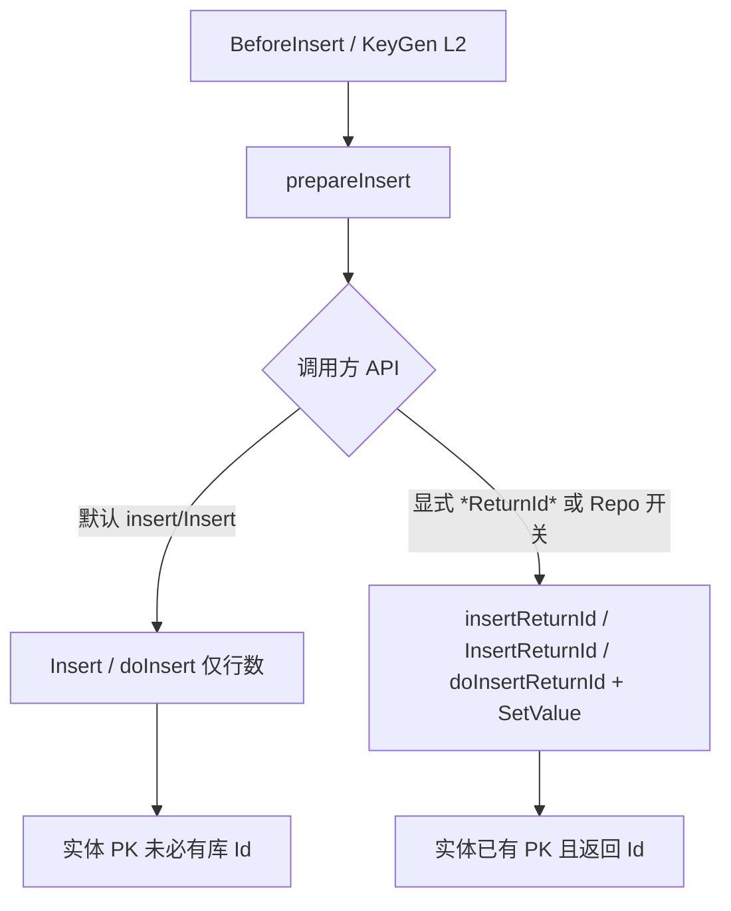
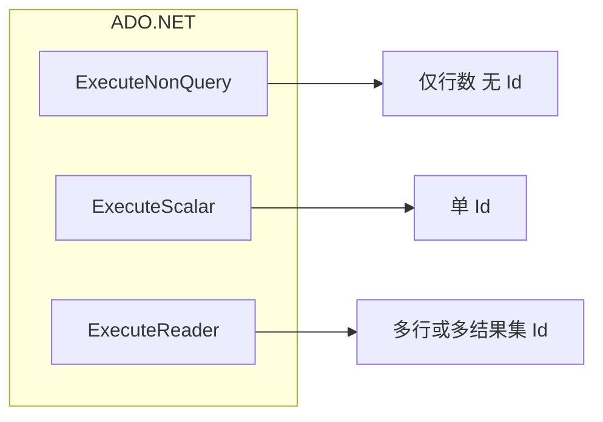
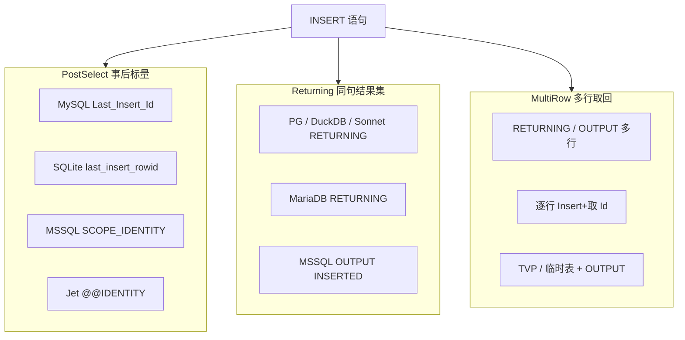

# 插入主键回填与应用发号

> 面向 **使用者**（何时取回自增 Id、Guid/雪花如何配置）与 **开发人员**（SQLBuilder 取 Id API、方言策略、EntityTranslator / Repo 编排）。  
> **结论先行**：主键获得分 **两层**——**(1) 数据库自增回填**（方言拼 **`toInsertReturnId` → `SQLCmd`**，经 **`doInsertReturnId*`** / 扩展 **`insertReturnId*`** / Repo **`InsertReturnId*`** 或 **`SQLCmd.run(db)`** 知情执行）与 **(2) 应用侧发号**（`AutoKey` / `KeyGeneratorType` + Client **`RegisterKeyGenerator`**，插入前写回实体）。  
> **存量行为不变**：`Insert` / `insert` / `insertInner` / `doInsert` / **`exeNonQuery`** **默认不**取库 Id；`exeNonQuery` **保持纯粹**（不按 `QueryType` 守卫/改道）。取 Id 走 `*ReturnId*` / `run`。禁止用单一 API 吞掉 L1/L2。  
> 关联：[`MooEntityAnalyser` 标志映射](../../../../pure/src/ado/SQL/DBmodel/dialect/impl/MooEntityAnalyser.cs)（`IsIdentity` → `IsOnlyIgnoreInsert`）已落地，为本特性的列语义前提。

---

## 1. 概述

| 层 | 时机 | 谁产 Id | 列特征 | 落点 |
|----|------|---------|--------|------|
| **L1 库回填** | Insert **后** | 数据库 | `IsIdentity`（通常 `IsOnlyIgnoreInsert`） | `doInsertReturnId*`（手写 set）/ 扩展 **`insertReturnId*`**（实体）/ Repo **`InsertReturnId*`** → `SetValue` 并 **返回 Id** |
| **L2 应用发号** | Insert **前** | 应用 | 非 Identity；Guid / 雪花 / 业务号等 | 通用主键生成钩子；赋值后 **写回实体** 再进 INSERT（走普通 `Insert`/`doInsert` 即可） |



**勿混用模型**：对 Guid/雪花实体调用任意 `*ReturnId*` 会误查 `last_insert_rowid`；对自增实体又在插入前乱填 Id。L1 仅服务 Identity；L2 仅服务应用主键。

---

## 2. 背景与现状缺口

### 2.1 已有碎片（未接线或半截）

| 能力 | 位置 | 状态 |
|------|------|------|
| `_selectAutoIncrement` / `selectAutoIncrement` | 各方言 `*Express`（如 SQLite `last_insert_rowid`、MySQL `Last_Insert_Id`、MSSQL `Scope_Identity`） | **仅赋值，Repo/`doInsert` 路径几乎无消费** |
| `IsInsertReturningSupported` | `SqlProviderFlags`；MariaDB 等为 true | LINQ/方言标志已有；SQLBuilder 执行面未统一 |
| `InsertClause.WithIdentity` / `GetIdentityExpression` / `InsertWithIdentity` | LINQ 插入路径 | 与 `SooRepository` / `doInsert` **脱节** |
| `EntityTranslator.OnLoadPKValue` | [`EntityTranslator.config.cs`](../../../../pure/src/adoext/clip/provider/EntityTranslator.config.cs) | 有钩子；见 §2.2 |
| `whenBeforeInsert` | 同 Translator | 可手写发号，无统一约定 |
| `SooRepository<T,K>.InsertReturnId` | [`SooRepository.PK.cs`](../../../../pure/src/adoext/repository/SooRepository.PK.cs) | 与 SQLBuilder `doInsertReturnId` 对齐；Identity 取库 Id，应用发号读实体 PK。旧名 `InsertWithPK` 已 Obsolete |
| `doInsert` | `StepBuilder` / Prepare | `exeNonQuery(toInsert())`，只返回影响行数 |

### 2.2 `OnLoadPKValue` 现状硬伤

[`prepareInsert`](../../../../pure/src/adoext/clip/provider/EntityTranslator.cs) 片段逻辑：

```text
val = Property.GetValue(entity)
if (IsPrimarykey && val == null)
    val = loadPKValue(col)
→ ResolveColumnValue → setInsertFieldValue   // 仅写入 SQL，无 SetValue 回实体
```

| 问题 | 影响 |
|------|------|
| 只认 `val == null` | 与本期约定一致（可空主键）；非可空 `Guid`/`int` 的 `Empty`/`0` **故意不**当空（§4.2） |
| 生成值不写回实体 | `InsertWithPK` / 后续业务读实体仍可能为空 → L2 必须 `SetValue` |
| Translator 实例级 | 无 `MooClient` 级默认策略，难以「所有实体统一 Guid」→ 用 `RegisterKeyGenerator` |

### 2.3 设计目标

| 目标 | 说明 |
|------|------|
| L1 方言统一取 Id | Returning 单句，或 PostSelect **同 CommandText** `INSERT; SELECT last_id`；优先单查询/单命令可读结果集；见 §3.0–3.3、§3.9 |
| L1 不滥用 NonQuery | `exeNonQuery` **纯粹**只行数、**不**按 type 抛错改道；取 Id 走 Scalar/Reader（`doInsertReturnId` / `SQLCmd.run`） |
| L1 默认不改存量 | `doInsert` / `Insert` / `insertInner` **行为与今日一致**（仅行数，不回填 PK） |
| L1 SQLCmd 统一 | `toInsertReturnId()` → `QueryType.InsertReturnId`；Returning 与 PostSelect（多语句）均可落成 **一个** SQLCmd，再 `run(db)` |
| L1 显式 API | `doInsertReturnId*` / **`insertReturnId*`** / **`InsertReturnId*`**；可选 BatchSQL **`addInsertReturnId`**；返回 Id（或集合）并 `SetValue` |
| L1 可选开关 | Repo/Client 级开关可让业务 **知情启用**「普通 Insert 也走取 Id」（见 §3.7）；默认关闭 |
| L2 / Save 空主键 | **只判 `null`**（业务主键用 `int?`/`long?`/`Guid?` 等可空类型；见 §4.2） |
| L2 写回实体 | 发号结果必须 `SetValue`，再进 SQL |
| L2 列注解 | `AutoKey` 字符串；`"Guid"` 可免注册内置；其它 key 走 Client 注册表（`SooColumn` 仅增可选属性，兼容） |
| L2 注册表 | `RegisterKeyGenerator<T>(string key, Func<T> generate)`；另支持 `KeyGeneratorType` + `IKeyGenerator` |
| 两层不混用 | Identity → 仅 L1；应用主键 → 仅 L2 |

### 2.4 非目标（本期不做或后置）

- **实现分期**：多行一次 `RETURNING`/`OUTPUT` 取全 Id 与 TVP 路径属 **P4**；架构与降级策略（逐行）见 §3.3，默认 **不**用 MySQL「首 Id 推算」
- 不强制统一雪花算法实现（业务通过 `RegisterKeyGenerator(key, Func)` 或自定义 `IKeyGenerator` 接入 Yitter 等）
- 特性内不承载 `Func` / 生成器实例（仅 `AutoKey` 字符串与 `KeyGeneratorType`）
- **不**把「插入后取库 Id」做成 `Insert`/`insertInner` 的默认副作用（避免静默改变存量调用与批量往返成本）
- 不改变 LINQ `InsertWithIdentity` 语义（可复用方言零件，但不以 LINQ 替代 Repo 路径）
- 不做「连接打开后」PRAGMA 钩子（另项）
- 不删除下游业务的 `EnsureIdentitySkip` / `TryFillIdentity`（升级后由下游自行移除）

### 2.5 成功判据

1. `toInsertReturnId()` 生成带 `QueryType.InsertReturnId` 的 `SQLCmd`；`doInsertReturnId` / `SQLCmd.run(db)` 用 Scalar/Reader 取 Id（非 `exeNonQuery`）；覆盖 Returning 与 PostSelect（`INSERT; selectAutoIncrement`，驱动允许多语句时）。  
2. `exeNonQuery` **不**因 InsertReturnId 改语义或抛错（执行器保持纯粹）；多行取全 Id 用 Returning Reader 或逐行；**禁止**多行 VALUES + 单次 Last_Insert_Id 冒充列表。  
3. `SooRepository.Insert` / `insertInner` **默认**仍只返回行数语义（`bool`/`int`），**不**自动回填 Identity。  
4. Repo **`InsertReturnId*`** 与扩展 **`insertReturnId*`** 均与 `doInsertReturnId*` 对齐：Identity 实体回填属性，**返回值是 Id 或其集合**（失败语义明确，禁止用 `0`/`default` 冒充成功）。  
5. 可选开关开启后，业务明确知情：`Insert` 路径可改为取 Id 回填（如 SQL Server `OUTPUT` 一趟可接受）；**默认关闭**。  
6. `AutoKey="Guid"` 未注册即可发号写回；自定义 key + `RegisterKeyGenerator` 可发号；未注册非 Guid key 抛错。  
7. 仅设 `KeyGeneratorType`（无 AutoKey）时可发号；**同列既有 AutoKey 又有 Type 时仅 AutoKey 生效**。  
8. `SaveInner` / L2 空主键均 **只认 `null`**（与可空主键约定一致）；不把 `0` / `Guid.Empty` 当空。  
9. Identity 实体不会走应用发号；带 AutoKey 的 Guid 实体调用 `InsertReturnId` 应 **明确失败或拒绝**（不跑 `selectAutoIncrement`）。  
10. 单测：方言取 Id + `Insert` 默认无回填 + `*ReturnId*` + 开关 + Save（`null`→插 / 有值→存在性检查）+ AutoKey/注册表/Type；P4 补多行 Returning。

---

## 3. L1 — 数据库回填（SQLBuilder / 方言）

### 3.0 ADO.NET 基础约束（设计前提）

ADO.NET 标准路径：

| API | 返回值 | 与主键的关系 |
|-----|--------|--------------|
| `DbCommand.ExecuteNonQuery()` | **受影响行数 `int`**（批内多为合计） | **不包含**生成列 / 自增 Id；**丢弃**结果集 |
| `ExecuteScalar()` | **第一个结果集**第一行第一列 | 可用于 `RETURNING` 单值，或批 `INSERT; SELECT last_id` |
| `ExecuteReader()` | 结果集游标；多结果集用 `NextResult` | `OUTPUT` / `RETURNING` 多行；或多段 `SELECT id` |

#### 3.0.1 分号批（`INSERT; SELECT id`）据实行为

对 `CommandText = "INSERT …; SELECT SCOPE_IDENTITY()"`（或 `Last_Insert_Id()` / `last_insert_rowid()`）这类**单命令多语句**：

| API | 实际得到 |
|-----|----------|
| **`ExecuteNonQuery` / mooSQL `exeNonQuery`** | 典型为 INSERT 影响行数（或合计 / `-1`）；**没有主键**；SELECT 结果被丢弃。SqlClient 文档：多语句时返回各 DML 影响行数之和。 |
| **`ExecuteReader`** | 读到的是 **SELECT 的结果集**（通常一行一列 Id）；纯 INSERT 一般不贡献数据网格（除非 `OUTPUT`）。多段 SELECT 需 `NextResult`。 |
| **`ExecuteScalar`** | 落到**第一个有行的结果集**的第一格——对上述批通常就是 Id（前提：驱动执行整批且允许多语句）。 |

因此：**不能**指望 `exeNonQuery` 取 Id；PostSelect 若拼成**一个** SQLCmd，执行必须走 **Scalar/Reader**（与 Returning 同属「读结果集」路径）。

| 驱动注意 | 说明 |
|----------|------|
| SQL Server | 批处理常态；`SET NOCOUNT` 影响行数统计，不消灭 SELECT 结果集 |
| MySQL | 多语句**常可**但依赖驱动/连接串；实现与文档须标明；参数宜只在 INSERT 段 |
| SQLite | 多语句行为因提供程序而异——**须对所用驱动实测**后再承诺统一 SQLCmd |
| 多行 VALUES + 一次 `Last_Insert_Id` | **仍只有一个 Id**，禁止冒充 Id 列表 |

#### 3.0.2 对 mooSQL 的推论

1. 现有 `doInsert()` → `exeNonQuery(toInsert())` **无法**带回主键；`exeNonQuery` **保持纯粹**，不为此改语义、不在执行器内按 type 抛错守卫。  
2. 取 Id：`toInsertReturnId()` → `SQLCmd`（`QueryType.InsertReturnId`）→ `doInsertReturnId` / **`SQLCmd.run(db)`** 走 Scalar/Reader。  
3. PostSelect 与 Returning **均可**落成统一 `toInsertReturnId`（见 §3.9）；差异在 SQL 文本，不在「能不能 SQLCmd」。  
4. 事后标量只保证会话内「最近插入」的**单个** Id；多行取全量另议（§3.3）。



---

### 3.1 取 Id 策略族（IdentityFetchMode）



| 模式 | ADO.NET 调用 | 单行 | 多行一次取全 Id | 代表引擎 |
|------|--------------|------|-----------------|----------|
| **PostSelect** | `NonQuery` + 同连接 `Scalar(selectAutoIncrement)` | 适合 | **不适合**（通常仅最后一行） | MySQL 族、SQLite、经典 MSSQL、Jet、GBase8a、TiDB、OB-MySQL |
| **Returning** | 改写 SQL 后 `Scalar`（单列单行）或 `Reader` | 适合 | **适合**（多行结果集） | PostgreSQL / openGauss / DuckDB / SonnetDB；MariaDB（`IsInsertReturningSupported`）；MSSQL `OUTPUT` |
| **Unsupported** | — | 抛错 | 抛错 | `_selectAutoIncrement` 空且无 RETURNING/OUTPUT（如部分 ClickHouse / 需序列显式的场景） |

优先复用已有：`selectAutoIncrement`、`IsInsertReturningSupported`、LINQ `GetIdentityExpression`；**收口到方言可覆盖的策略**，业务不拼 SQL。

---

### 3.2 单行插入取 Id — 分引擎实施方式

#### 3.2.1 PostSelect（优先单命令批；同连接）

**主路径（已拍板，与 §3.0.1 / §3.9 对齐）：**

```text
SQLCmd = INSERT … ; + selectAutoIncrement
type   = InsertReturnId
执行   = ExecuteScalar / ExecuteReader（同一 DbCommand）→ id
硬约束：整批同一连接/会话；禁止拆成两连接。
```

**降级（驱动拒绝多语句时）：**

```text
1) ExecuteNonQuery(toInsert())     → rows
2) 同连接 ExecuteScalar(selectAutoIncrement) → id
```

| 方言（现有 Express） | `selectAutoIncrement` 示意 | 注意 |
|----------------------|----------------------------|------|
| MySQL / TiDB / OB-MySQL / GBase8a | `SELECT Last_Insert_Id()` | 连接级；多语句依赖驱动；触发器警示 |
| SQLite | `SELECT last_insert_rowid()` | **实测**多语句后再承诺主路径 |
| MSSQL | `SELECT Scope_Identity()` | 批处理可用；优先 Scope；或改 Returning/`OUTPUT` |
| Jet | `SELECT @@IDENTITY` | 能力弱，单行够用 |

**SQLBuilder 实现要点：**

- `toInsertReturnId` / `doInsertReturnId`：优先单 SQLCmd + Scalar；**不要**用 `exeNonQuery` 跑该 cmd。  
- 禁止「插入用连接 A、取 Id 用连接 B」。

#### 3.2.2 Returning / OUTPUT（一趟、带结果集）

| 引擎 | SQL 形态（示意） | ADO.NET |
|------|------------------|---------|
| PostgreSQL / DuckDB / Sonnet / 兼容 PG | `INSERT INTO t (…) VALUES (…) RETURNING id` | 单行 → `ExecuteScalar`；需多列时用 Reader |
| MariaDB 10.5+ | 同上（`IsInsertReturningSupported=true`） | 同左；MySQL 官方族多为 false，走 PostSelect |
| SQL Server | `INSERT INTO t (…) OUTPUT INSERTED.id VALUES (…)` | Scalar / Reader；注意触发器、视图限制 |

**SQLBuilder 实现要点：**

- 方言 `RewriteInsertForIdentity(SQLCmd insert, identityColumn)` → 带 RETURNING/OUTPUT 的新 SQLCmd。  
- **不能**再对该语句 `ExecuteNonQuery`（多数驱动下结果集被丢弃或行为未定义）；应走 `queryScalar` / `query`。  
- 影响行数：可用 Reader 行数，或方言允许时另取；API 可返回 `(rows, id)` 或仅 Id（Repo 以 Id 为准）。

#### 3.2.3 序列 / 无连接级 LAST_INSERT_ID

| 场景 | 做法 |
|------|------|
| Oracle / 达梦等序列 | 插入前 `nextval` 写入列（偏应用/SQL 侧发号），或 `RETURNING`/`OUTPUT` 等价物；`_selectAutoIncrement` 常为空 |
| 仅 SEQUENCE、无 RETURNING | L1 标 Unsupported，或走「插入前取序列」扩展（可归 L2/SQL 表达式，不硬塞 PostSelect） |

---

### 3.3 多行插入取全部生成 Id — 实施方式

目标：`INSERT` 一次写入 N 行，拿到 **长度为 N 的 Id 列表**（顺序与插入行对应，除非方言文档另有说明）。

#### 3.3.1 能力对照

| 手段 | 能否一次取回全部 Id | 适用 | 缺点 |
|------|---------------------|------|------|
| **A. `RETURNING` / `OUTPUT` 多行** | 能 | PG 族、DuckDB、Sonnet、MariaDB RETURNING、MSSQL OUTPUT | MySQL 官方 / SQLite 经典路径无等价「多行 Id 结果集」 |
| **B. 多行 VALUES + PostSelect** | **不能**（通常只有最后一行 Id） | — | **禁止**作为「取全量 Id」实现 |
| **C. 逐行循环**：每行 `doInsertReturnId` | 能 | 全方言兜底 | N 次往返；事务内可接受 |
| **D. 临时表 / TVP + OUTPUT** | 能 | 主要为 MSSQL | 实现重；适合大批量 |
| **E. 应用侧发号后批量 INSERT** | Id 已知 | Guid/雪花（L2） | 非库自增 |

#### 3.3.2 推荐产品策略（mooSQL）

```text
doInsertReturnIds() / Repo InsertReturnIds：
  if 方言支持 Returning/OUTPUT 多行
      → 单语句 INSERT…RETURNING/OUTPUT → ExecuteReader → List<object>
  else
      → 降级：逐行 doInsertReturnId（同一事务/连接）
  禁止：多行 VALUES + 一次 Last_Insert_Id 冒充列表
```

| API（概念） | 语义 |
|-------------|------|
| `doInsertReturnId()` / `doInsertReturnIds*` | Builder 已 `setTable/set` 后取 Id；返回 Id / 列表 |
| 扩展 `insertReturnId` / `insertReturnIds` | 实体路径：`prepareInsert` + `doInsertReturnId*`；回填并返回 Id（见 §3.7.4） |
| Repo `InsertReturnId` / `InsertReturnIds` | 与上对齐；回填实体并 **返回 Id / Id 集合**（见 §3.7） |
| `insert` / `Insert` / `InsertRange` | **默认不变**：仅行数；不取库 Id（Repo 可开 §3.7.3 开关） |

MySQL 多行自增补充说明（实现可选优化，非必须）：

- 单连接上 `INSERT` N 行后，`LAST_INSERT_ID()` 为 **第一行** 生成值，且同语句内 Id 连续（在未改 `auto_increment_increment` 等前提下）时，可用「首 Id + 推算」——**依赖服务器变量与复制模式，文档必须标风险**；默认仍建议 **逐行** 或推动业务用 L2 发号。  
- **默认实现不采用推算**，避免静默错 Id。

SQLite：多行插入后 `last_insert_rowid()` 为最后一行；取全量 → **逐行** 或应用发号。

#### 3.3.3 MSSQL 多行示例形态

```sql
INSERT INTO dbo.T (Name)
OUTPUT INSERTED.Id
VALUES (@n0), (@n1), (@n2);
-- ExecuteReader → 多行 Id
```

大批量：TVP / 暂存表插入 + `OUTPUT INTO @ids` / `OUTPUT INSERTED`，再读回；可作为方言高级路径，P4+。

#### 3.3.4 PostgreSQL / DuckDB / Sonnet 多行示例形态

```sql
INSERT INTO t (name)
VALUES ($1), ($2), ($3)
RETURNING id;
-- ExecuteReader → 多行
```

与单行共用 Rewrite；仅执行端从 Scalar 换成 Reader + 列表。

---

### 3.4 会话 / 事务 / 连接池硬规则

| 规则 | 原因 |
|------|------|
| PostSelect 批内 INSERT 与 SELECT **同命令/同连接**（或降级两趟同连接） | 否则 Id 错乱或空 |
| 优先同事务 | 未提交可见性、回滚一致性 |
| 取 Id 完成前不要把连接还回池 | 池化会切断「会话级 last id」 |
| 触发器内二次插入 | MySQL/MSSQL 事后标量语义变化；文档警示；MSSQL 用 `SCOPE_IDENTITY`/`OUTPUT` 优于 `@@IDENTITY` |
| 并发 | 事后标量为 **会话隔离**，非全局锁；多连接各算各的 |

ExeSession / `LiveTransaction` 已持有连接时，L1 必须复用该 session，禁止 `DBInsCash` 再借新连接跑第二条 SQL。

---

### 3.5 SQLBuilder API（在 3.0–3.3 之上）

```text
// 生成（可 toSQLCmd）
SQLCmd toInsertReturnId()                 // type = InsertReturnId；见 §3.9
SQLCmd toInsertReturnIds()                // P4 多行；Returning 方言

// 执行（与 doInsert 并列）
object / long doInsertReturnId()          // 内部 toInsertReturnId + Scalar/Reader（或 .run）
TKey doInsertReturnKey<TKey>()
IList<object> / IList<TKey> doInsertReturnIds()   // P4
```

约束：

- `doInsert` / `exeNonQuery`：**不改变**——仅行数；**不**识别 InsertReturnId 改道或抛错。  
- `doInsertReturnId` ≡ 对 `toInsertReturnId()` 的结果走读结果集路径（可用 `cmd.run(db)`）。  
- Unsupported：`toInsertReturnId` 失败或 `run`/`doInsertReturnId` **抛明确异常**，禁止 `0`/`default` 冒充成功。  
- 命名即契约：接受取 Id 成本（单命令批或 Returning；知情往返）。

---

### 3.6 方言策略接口（示意）

```text
enum IdentityFetchMode { PostSelect, Returning, Unsupported }

Dialect / IInsertIdentitySupport:
  IdentityFetchMode GetInsertIdentityMode()
  string selectAutoIncrement
  bool IsInsertReturningSupported
  SQLCmd BuildInsertReturnIdCmd(SQLCmd insert, string identityColumn)
      // Returning → Rewrite INSERT…RETURNING/OUTPUT
      // PostSelect → insert.sql + ";" + selectAutoIncrement（同一 SQLCmd）
      // Unsupported → throw / 空
```

| Mode | `toInsertReturnId` SQL 形态 | `doInsertReturnId` / `run` |
|------|----------------------------|----------------------------|
| Returning | 单句 INSERT…RETURNING/OUTPUT | Scalar 或 Reader |
| PostSelect | `INSERT; SELECT last_id`（驱动允许多语句） | **同一命令** Scalar/Reader（**不是** exeNonQuery） |
| Unsupported | 不生成可跑 cmd | throw |

优先单查询/单命令可读结果集：有 RETURNING/OUTPUT 用 Returning；否则 PostSelect 拼批。**默认不用**「两趟独立 Command 换连接」。若驱动拒绝多语句，方言可降级为同连接两趟编排，并文档标明——仍不污染 `exeNonQuery`。

---

### 3.7 Repo 接线（L1）

**原则：与 SQLBuilder 同构——存量 `Insert` 不动；取 Id 用独立同名方法；开关为知情启用。**

#### 3.7.1 默认路径（不变）

| API | 行为 |
|-----|------|
| `Insert` / `InsertRange` / `insertInner` | 仍 `prepareInsert` + `doInsert`；返回 `bool`/`int`（行数语义）；**不** `SetValue` 库生成 Id |
| `Save` / `SaveRange` / UoW 内上述插入 | 同上，不因本特性自动取 Id |

#### 3.7.2 显式 API（主推荐）

与 `doInsertReturnId*` **同名对齐**（概念签名，实现时挂 `SooRepository` / `SooRepository<T,K>`）：

```text
// 单行：返回 Id；成功时 SetValue 回实体
TKey InsertReturnId(T entity)                    // SooRepository<T,K>
object / long InsertReturnId(T entity)           // 非泛型 K 时的形态（实现二选一写死）

// 批量：返回 Id 集合；按序回填各实体
IList<TKey> InsertReturnIds(IEnumerable<T> entities)
```

编排：

```text
InsertReturnId(entity):
  prepareInsert（Identity 列仍 IsOnlyIgnoreInsert，不进 set）
  id = kit.doInsertReturnId() / doInsertReturnKey<TKey>()
  PropertyInfo.SetValue(entity, convertedId)
  return id

InsertReturnIds(list):
  if 方言 Returning/OUTPUT 多行
      → 可选：拼多行 INSERT + doInsertReturnIds，按序 SetValue，返回列表
  else
      → 循环 InsertReturnId（同一事务/连接）
  禁止：一次多行 INSERT + 单次 Last_Insert_Id 填所有实体
```

约束：

- **返回值是 Id（或集合）**，不是 `bool`/`影响行数`；插入失败 / Unsupported：**抛明确异常或约定失败哨兵**，禁止静默 `default(TKey)` 冒充成功（与现有 `InsertWithPK` 在失败时返回 `default` 的旧习惯区分开，新 API 从一开始写严）。  
- 实体 **无** Identity 主键、或带 `AutoKey` 的应用主键：调用 `InsertReturnId*` → **明确异常**（引导走普通 `Insert` + L2），禁止误跑 `selectAutoIncrement`。  
- 与标志映射对齐：`IsIdentity` 默认 `IsOnlyIgnoreInsert`；`SkipOnInsert=false` 且已赋值 → **跳过回填**，返回实体上已有 Id（或文档规定抛「无需 ReturnId」）。

与现有 `InsertWithPK`：

- `InsertWithPK`：**保持**「插完读实体已有 PK」语义，**不**暗中改成取库 Id（避免静默改变依赖方）。  
- Identity 场景若要用库回填，业务应改调 **`InsertReturnId`**；L2 发号写回后，`InsertWithPK` 仍可读实体 PK。

#### 3.7.3 可选开关（知情启用）

业务若希望「继续写 `Insert`，但 Identity 也回填」（例如 SQL Server `OUTPUT` 一趟、可接受成本），提供 **默认关闭** 的开关（名称以实现为准，文档称）：

```text
// 概念：Repo 实例级 和/或 MooClient 默认
repo.EnableInsertReturnId = true;
// 或 client.Options.EnableInsertReturnId = true;
```

| 开关 | `Insert` / `InsertRange` |
|------|--------------------------|
| **false（默认）** | 仅 `doInsert`，不回填 |
| **true** | Identity 且需回填时内部走与 `InsertReturnId` 相同的取 Id + `SetValue`；**返回类型仍为原 `bool`/`int`**（行数语义不变）；Id 只写在实体上 |

文档必须写清：开启即 **改变可观察行为**（实体 PK 被写入、PostSelect 方言多一趟 SQL）。返回 Id 给调用方时仍应优先用显式 **`*ReturnId*`**。

#### 3.7.4 实体扩展 `insertReturnId*`（与 `insert` 并列）

覆盖「不用 Repo、走 `SQLBuilder` 实体扩展」时的全方位取 Id——与 `insert` / `doInsertReturnId` / Repo `InsertReturnId` **同名分层**：

```text
// 概念：挂 SQLBuilderExtensions（与现有 insert 同文件风格）
TKey / object / long insertReturnId<T>(this SQLBuilder kit, T entity, string tbname = null)
IList<TKey> insertReturnIds<T,TKey>(this SQLBuilder kit, IEnumerable<T> entities, ...)
```

编排（与 Repo 同构，底层只调一次方言策略）：

```text
insertReturnId(entity):
  builder = 可执行会话上的 Builder（须能复用 kit 事务/连接，见下）
  prepareInsert(builder, entity, ...)   // L2 逻辑 Id 仍等效回写
  id = builder.doInsertReturnId() / doInsertReturnKey
  SetValue(entity, id)
  return id
```

| 对比 | `insert` | `insertReturnId` |
|------|----------|------------------|
| 默认 / 存量 | 仅行数；**无** SQL Id 回写 | 显式；返回 Id + 回填 |
| L2 逻辑 Id | 有（全路径等效） | 有（同 `prepareInsert`） |
| L1 自增 Id | 无 | **有**（知情往返） |
| 非 Identity / AutoKey 实体 | 正常插入 | **明确异常**（同 Repo） |

**同连接硬约束**：现有 `insert` 常 `kit.useSQL()` 开独立环境——`insertReturnId` **不得**在「插入用连接 A、取 Id 用连接 B」上实现。须复用调用方 `kit` 已绑定的 `Executor` / 事务会话执行 `doInsertReturnId*`（或与 `insert` 相同的独立环境内 **同会话完成两趟**）。单测负例同 §3.4。

三层分工（业务选型）：

```text
手写 setTable/set     → doInsertReturnId*
实体 + SQLBuilder 扩展 → insertReturnId*
实体 + 仓储             → InsertReturnId*（或 EnableInsertReturnId）
```

---

### 3.8 与现有碎片的映射表

| 现有能力 | 落入 |
|----------|------|
| `selectAutoIncrement` | PostSelect 批中第二句；或同连接降级第二趟 |
| `IsInsertReturningSupported` | Mode=Returning |
| `doInsert` / `exeNonQuery` | **仅行数**；保持纯粹，不跑 L1 |
| `queryScalar` / Reader | `doInsertReturnId` / `SQLCmd.run` |
| `QueryType` | 增 `InsertReturnId`；今日主要用于路由，**run** 用其选举执行形态 |
| LINQ `WithIdentity` | 可与 BuildInsertReturnIdCmd 共享零件；Repo 不依赖 LINQ |

---

### 3.9 SQLCmd、`run(db)`、执行器纯粹性与 BatchSQL（评审拍板）

#### 3.9.1 `QueryType.InsertReturnId` + `toInsertReturnId`

- 在 [`QueryType`](../../../../pure/src/ado/SQL/define/enums/enums/QueryType.cs) 增加 **`InsertReturnId`**（名称以实现为准）。  
- `toInsertReturnId()` / `geneCmd(..., InsertReturnId)` 打标；路由上仍视为 **写**（与 Insert 同类，须写入 `RouteOperation.IsWriteType`）。  
- 方言 `BuildInsertReturnIdCmd`：Returning 单句，或 PostSelect `INSERT; SELECT …` **一个** `SQLCmd`（§3.0.1）。

#### 3.9.2 `exeNonQuery` 保持纯粹（不堆逻辑进执行器）

已拍板：

- `DBExecutor.ExeNonQuery` / `SQLBuilder.exeNonQuery`：**不**根据 `QueryType` 改走 Scalar、**不**对 InsertReturnId **抛错守卫**。  
- 误把 InsertReturnId cmd 丢进 `exeNonQuery` → 与原生 ADO 一致：可能只有行数、**静默无 Id**；责任在调用方。  
- 心智负担由 **`doInsertReturnId` / `SQLCmd.run(db)`** 消化，不由执行器判定消化。

#### 3.9.3 新执行链路：`toInsertReturnId().run(db)`（设想落地为正式能力）

```text
cmd = builder.toInsertReturnId()     // 或业务持有 SQLCmd
id  = cmd.run(db) / db.run(cmd)      // 按 cmd.type 选举：
                                     //   InsertReturnId → Scalar（单 Id）或 Reader
                                     //   Insert/Update/… → 可约定转 NonQuery 或仅文档说明
```

- 解决「用户既要关心 QueryType 又不敢 exeNonQuery」：在乎 Id 的人只记 **`run` / `*ReturnId*`**。  
- `run` 须绑定 `DBInstance`/`Executor`，复用事务会话（§3.4）。  
- `doInsertReturnId()` 可内部即 `toInsertReturnId().run(当前会话)`。

#### 3.9.4 BatchSQL：`addInsertReturnId` + 内部 Id 集合

现有 [`BatchSQL`](../../../../pure/src/ado/data/exstend/BatchSQL.cs)：`addInsert` → `toInsert`，`exeNonQuery` 累加行数——与取 Id **不兼容**若硬塞进同一语义。

已拍板方向：

| API | 行为 |
|-----|------|
| `addInsert()` | 不变；普通 Insert |
| **`addInsertReturnId()`** | 入队 InsertReturnId 语义项（`toInsertReturnId`） |
| **`exeNonQuery()`** | **保持**「跑写命令、返回总行数」；**不**负责填 Id 集合（避免 NonQuery 名不副实）。若队列含未用专用 exe 消费的 ReturnId 项：实现二选一写死——**忽略取 Id 当普通 Insert**、或 **Batch 门面提示/失败**（仍不是 DBExecutor 内核逻辑） |
| **`exeWithIds()` / `exeReturnIds()`**（名称实现定） | 执行队列；对 ReturnId 项走 Scalar/Reader；Id **按序写入内部集合**（如 `ReturnedIds`）供业务读取；然后 clear |

约束：同连接/事务沿用 Batch 已有 `useTrans`/`Executor`；P4 前逐条取 Id 可接受；TVP/临时表大批量见 §3.3.3，须定数据量边界。混队（`addInsert` + `addInsertReturnId`）时仅 `exeWithIds` 保证 Id 集合完整。

#### 3.9.5 与「方言差异大」的关系

- **差异收在拼 SQL**（BuildInsertReturnIdCmd），**执行面统一**为读结果集（`run` / `doInsertReturnId`）。  
- 不再默认「PostSelect 不能 toSqlCmd」；仅当驱动不支持多语句时降级两趟，属方言例外。  
- SQL Server TVP/临时表：**P4+**，按数据量边界选用，不作为单行主路径。

---

## 4. L2 — 应用侧主键发号

### 4.1 职责

- **仅**处理非 Identity（或不跳过插入的）主键。  
- 在 `prepareInsert` 写字段循环之前或之中：判定「空主键」→ 调用生成器 → **`SetValue` 写回实体** → 再 `setInsertFieldValue`。

### 4.2 空值判定（已拍板：**只判 `null`**）

业务约定主键使用 **可空类型**（`int?`、`long?`、`Guid?` 等）：未赋值即为 `null`，无需把数值 `0` / `Guid.Empty` 当成「空主键」。

| 场景 | 「空」判定 |
|------|------------|
| **`SaveInner` 路由** | **仅 `val == null`** → 走插入；非 null → 存在性检查再 update/insert（**保持现状语义**） |
| **L2 发号**（`AutoKey` / `KeyGeneratorType`） | **仅 `val == null`** 时发号并 `SetValue`；已有非 null 值不覆盖 |
| Identity（L1） | 不发号；Save 同样只看 `null`（可空自增如 `long?` 未赋 → 插入） |

```text
// SaveInner / L2 共用语义（概念）
bool IsEmptyPrimaryKey(object val) => val == null;
```

**不把下列值当空（已拍板）：** `0`、`Guid.Empty`、`""`（字符串主键空串视为已赋值；若业务要空串当未赋，自行赋值前规范或走钩子）。

#### 4.2.1 与「非可空值类型主键」的边界

若实体仍用非可空 `int` / `Guid` 作主键：

| 后果 | 说明 |
|------|------|
| `Save` | `Id=0` / `Empty` **不是 null** → 走存在性检查，可能误 Update（与今日一致） |
| L2 AutoKey | `0`/`Empty` **不触发**发号；须业务改用 `int?`/`Guid?`，或插入前自行赋值 |

本期 **不**为兼容非可空主键扩展「`0`/`Empty` 为空」——避免合法 `0` 主键与误伤；文档与示例统一推荐可空主键。见 §10.4。

其它约束：

- L2 放在 `prepareInsert` 内：Save 先按 `null` 选 insert，再发号写回——顺序正确。  
- **禁止**在 `SaveInner` 判路由之前全局抢先发号。  
- `Save` **默认仍不**调用 `InsertReturnId`。

### 4.3 已定方案：列注解 + Client 注册表 + 强类型生成器

特性 **不能** 承载 `Func` / 实例；本特性采用 **字符串键 / `Type`** 声明，**委托与实现挂在 `MooClient` 注册表**。与主流 ORM（EF Fluent `HasValueGenerator`、NH `generator class=`）一致：注解只指名，解析走注册表。

#### 4.3.1 方式 A — `AutoKey` 字符串（主路径）

在列特性上增加字符串属性（名称以实现为准，文档称 **`AutoKey`**）：

```csharp
[SooColumn(IsPrimaryKey = true, AutoKey = "Guid")]
public Guid? Id { get; set; }   // 推荐可空；未赋 = null → L2/Save 认空

[SooColumn(IsPrimaryKey = true, AutoKey = "order-snowflake")]
public long? Id { get; set; }
```

**解析规则：**

| `AutoKey` 值 | 行为 |
|--------------|------|
| 空 / 未设 | 不按本机制发号（仍可走 Translator 钩子等兜底） |
| `"Guid"`（建议大小写不敏感） | 先查 Client 注册表 key=`"Guid"`；**未注册则内置** `Guid.NewGuid()`（或等价） |
| 其它任意字符串 | **必须**在 Client 注册表用同名 key 找到生成器；找不到 → 明确异常（禁止静默跳过） |

内置仅保证 **`Guid`** 这一约定名可无注册即用；雪花、业务号等一律走注册表，避免框架绑死第三方算法。

#### 4.3.2 Client 注册表 — `RegisterKeyGenerator` + `Func`

**期望注册形态（雪花等）**：启动 `Init` 一次后，Func **只调单例**（库内部处理并发）：

```csharp
client.RegisterKeyGenerator<long>("order-snowflake", () => IdHelper.NextId());
```

**实现硬性要求**：`RegisterKeyGenerator` 的 **方法 XML**（`<summary>` / `<remarks>` / `<example>`）必须写明推荐写法与反模式，IDE 悬停即可见：

```csharp
/// <summary>
/// 按字符串 key 注册主键生成委托；列 AutoKey 命中该 key 时调用并写回实体。
/// </summary>
/// <remarks>
/// <para>
/// 有状态发号（雪花等）：请先进程内 Init 单例，再注册无状态委托，例如
/// <c>RegisterKeyGenerator&lt;long&gt;("sf", () =&gt; IdHelper.NextId())</c>。
/// 线程安全由 IdHelper（或等价单例）内部保证；本方法不对 generate 加锁。
/// </para>
/// <para>
/// <b>反模式（极易撞号）</b>：
/// <c>RegisterKeyGenerator("sf", () =&gt; new MySnowflake(1).Next())</c>
/// —— 禁止在委托内每次 new 雪花/序列实例。
/// </para>
/// </remarks>
/// <example>
/// IdHelper.InitIdGenerator(opts);
/// client.RegisterKeyGenerator&lt;long&gt;("order-snowflake", () =&gt; IdHelper.NextId());
/// </example>
public void RegisterKeyGenerator<T>(string key, Func<T> generate) { ... }
```

其它约定：按 key 存工厂；重复注册策略实现写死；`T` 与属性可赋值；生命周期随 `MooClient`；框架**不对**任意 `Func` 加全局锁。

#### 4.3.2.1 雪花 / 有状态生成器的线程安全

| 做法 | 说明 |
|------|------|
| **1. 单例 + `() => IdHelper.NextId()`（首选）** | 与方法 XML 推荐一致 |
| **2. `IKeyGenerator` Client 单例** | 禁止每次 Activator 新建 |
| **3. 闭包 `lock`（次选）** | 自研非线程安全生成器 |
| **4. 框架不代劳** | 不内置雪花、不统一 lock |

```csharp
// ✅
IdHelper.InitIdGenerator(opts);
client.RegisterKeyGenerator<long>("order-snowflake", () => IdHelper.NextId());

// ❌ 反模式 — 必须出现在 RegisterKeyGenerator 的 XML 中
client.RegisterKeyGenerator<long>("sf", () => new MySnowflake(workerId: 1).Next());
```

解析优先级（列已设 `AutoKey` 时）：

```text
Client.RegisterKeyGenerator(key) 命中
  ?? (key 约定为 Guid → 内置 NewGuid)
  ?? 抛 KeyGeneratorNotFoundException
```

`OnLoadPKValue` / `whenBeforeInsert` 仍保留为 **无 AutoKey 时的高级兜底**；有 `AutoKey` 时以注册表为准，避免双路径打架（实现时可规定：AutoKey 优先，钩子不覆盖已生成值）。

#### 4.3.3 方式 B — 强类型 `KeyGeneratorType`（方式 3）

内置少量 **强类型生成器接口 / 基类**（名称示意）：

```text
IKeyGenerator                  // object Next(KeyGenContext ctx)
IKeyGenerator<T> : IKeyGenerator   // T Next(...)
```

列特性可写 **`Type`**：

```csharp
[SooColumn(IsPrimaryKey = true, KeyGeneratorType = typeof(SequentialGuidGenerator))]
public Guid? Id { get; set; }
```

行为：

- `KeyGeneratorType` 必须实现 `IKeyGenerator`（或 `IKeyGenerator<T>` 且 T 与属性兼容）。  
- 解析：Client 可对 Type **单例缓存**；无参 `Activator.CreateInstance`，或先查 `RegisterKeyGenerator(Type, …)` / DI 式工厂。  
- 框架可提供内置实现类型：`GuidKeyGenerator`、`SequentialGuidKeyGenerator` 等，供直接 `typeof(...)`。  
- **与 `AutoKey` 双配置（已拍板）**：**`AutoKey` 优先**。列上 `AutoKey` 非空时走字符串注册表路径，**忽略**同列 `KeyGeneratorType`（可不告警；实现可选 Debug 日志）。仅当 `AutoKey` 未设/为空时，才解析 `KeyGeneratorType`。

强类型注册（可选，与字符串表并列）：

```csharp
client.RegisterKeyGenerator(typeof(MyGen), () => new MyGen(dep));
// 或
client.RegisterKeyGenerator<MyGen>();  // 无参类型快捷注册
```

#### 4.3.4 分析器写入元数据

`MooEntityAnalyser.ParseColumn` 将 `AutoKey` / `KeyGeneratorType` 写入 `EntityColumn`（新增字段，如 `AutoKey`、`KeyGeneratorType`）。  
`prepareInsert` 在主键值 **`== null`** 时调用统一解析器：

```text
若 AutoKey 非空 → RegisterKeyGenerator(key) ?? Guid 内置 ?? throw
否则若 KeyGeneratorType 有值 → 激活 IKeyGenerator → Next
否则 → 钩子 OnLoadPKValue 等兜底（仍建议写回实体，见实现）
→ SetValue 写回实体 → setInsertFieldValue
```

#### 4.3.5 与 Identity（L1）边界

| 列标记 | L2 AutoKey / Type | L1（仅 `InsertReturnId*` 或开关开启） |
|--------|-------------------|----------------------------------------|
| `IsIdentity` | **忽略**应用发号 | 取库 Id + 回填 + 返回 Id |
| 非 Identity + AutoKey/Type | 插入前发号；普通 `Insert` 即可 | **禁止**走 `InsertReturnId*` |
| 二者皆无 | 不发号 / 仅钩子兜底 | 不回填 |

Identity 与 AutoKey **同时标注**：分析期/插入前 **告警或抛错**（勿静默忽略一侧），避免误配置难排查。  
`AutoKey` + `KeyGeneratorType` 同列：见上，**AutoKey 生效，Type 忽略**（不是互斥抛错）。

---

### 4.4 与 `InsertWithPK` / `InsertReturnId` 的关系

| API | 职责 |
|-----|------|
| `Insert` | 插入；L2 可写回应用主键；**默认不**取库 Id |
| `InsertReturnId*` | **仅 Identity**：取库 Id、回填实体、**返回 Id** |
| `InsertWithPK` | 插完 `GetPKValue(entity)`；依赖实体上 **已有** PK（L2 发号后自然正确；Identity 需先 `InsertReturnId` 或开开关） |

在 L1 显式 API 落地前，`InsertWithPK` 对 Identity **仍不可依赖**（与今日一致）。

### 4.5 配置面对照（已拍板）

| 配置面 | 形态 | 用途 |
|--------|------|------|
| **`AutoKey` 字符串** | `SooColumn` 可选属性 | 主路径；声明注册表 key；`"Guid"` 可免注册；**与 Type 同列时优先** |
| **`RegisterKeyGenerator<T>(key, Func<T>)`** | Client | 真正挂委托；特性无法承载 Func |
| **`KeyGeneratorType`** | `SooColumn` + `Type` | 仅当未设 `AutoKey` 时生效 |
| Translator 钩子 | 代码 | 无 AutoKey/Type 时的兜底 / 高级扩展 |
| **`EnableInsertReturnId`** | Repo / Client，默认 false | 知情启用：普通 `Insert` 也对 Identity 回填（返回类型仍为行数） |
| **空主键** | 运行时 | L2 / `SaveInner` **仅 `null`**（可空主键约定） |

**不做**：特性内嵌 `Func`、特性内嵌生成器实例、Client 裸名 `Register(key, Func)`。

---

## 5. Repo 编排总览

```text
OnBeforeSave
fireBeforeInsert / KeyGen（L2，非 Identity 空主键；普通 Insert 与 InsertReturnId 均可）
prepareInsert
  ├─ Identity 列：IsOnlyIgnoreInsert → 不进 set
  └─ 应用主键：已有值（含 L2）进 set
执行分流
  ├─ InsertReturnId*（或 EnableInsertReturnId=true 且 Identity）
  │     → doInsertReturnId* + SetValue；API 返回 Id / 集合（开关路径仍返回行数）
  └─ 默认 Insert / insertInner
        → doInsert；不回填库 Id
OnAfterSave
```

`Save` / `SaveRange` / UoW：**默认**仍走 `insertInner` + `doInsert`，**不**自动取库 Id；空主键路由 **保持只判 `null`**（§4.2）。需要库生成 Id 时业务显式 `InsertReturnId` 或开开关。勿在门面再复制一套取 Id——统一委托 `doInsertReturnId*`。

---

## 6. 分阶段实施建议

| 阶段 | 内容 | 产出 |
|------|------|------|
| **P0** | §3.0 / 3.5–3.6 / **3.9**：`QueryType.InsertReturnId`；`toInsertReturnId`；`doInsertReturnId` / **`SQLCmd.run`**；PostSelect 单命令批优先；`exeNonQuery` 纯粹不动 | 手写 set 可 toCmd + 取单行 Id |
| **P0b** | BatchSQL **`addInsertReturnId`** + `exeWithIds` / 内部 `ReturnedIds`（§3.9.4） | 批插可选取 Id |
| **P1** | Repo **`InsertReturnId*`** + 扩展 **`insertReturnId*`**；`Insert`/`insert` 原样；可选 `EnableInsertReturnId` | 三层显式 API；存量零行为变化 |
| **P2** | L2 空主键只判 `null` + 写回；`AutoKey` + `RegisterKeyGenerator`；`"Guid"` 内置；`SaveInner` **维持只判 null** | 可空主键 + 字符串 AutoKey 闭环 |
| **P3** | `IKeyGenerator` + `KeyGeneratorType`（无 AutoKey 时）；双配置 AutoKey 优先忽略 Type；Identity+AutoKey 冲突检测 | 强类型生成器 |
| **P4** | §3.3：`doInsertReturnIds`；Returning/OUTPUT 多行 Reader；MSSQL TVP 可选；与 LINQ Identity 共享 Rewrite | 多行一次取全 Id |

建议优先 **P0 → P1**（库回填基础 + 显式 Repo API）；**P2 → P3** 应用发号；**P4** 在 Returning 方言上消除批量逐行往返。

---

## 7. 测试要点

| 用例 | 期望 |
|------|------|
| Identity 实体默认 `Insert` | 成功且 **实体 Id 仍为默认空**（与今日一致）；不跑取 Id |
| SQLite Identity `InsertReturnId` / 扩展 `insertReturnId` | 返回值 = `last_insert_rowid`；实体 Id 已回填 |
| MySQL / MSSQL 同构（有环境时） | 同左；MSSQL 用 Scope/OUTPUT 而非误用跨连接 |
| `EnableInsertReturnId=true` 后 `Insert` | 实体 Id 回填；返回类型仍为 `bool`/`int` |
| PostSelect 换连接取 Id（负例） | 失败或断言同 session（实现守卫） |
| RETURNING / PostSelect 单行 `toInsertReturnId` + Scalar/`run` | 取回 Id；**非** `exeNonQuery` |
| `exeNonQuery(toInsertReturnId())`（负例） | 不抛（执行器纯粹）；**无**可靠 Id |
| `SQLCmd.run(db)` InsertReturnId | 与 `doInsertReturnId` 等价取 Id |
| BatchSQL `addInsertReturnId` + `exeWithIds` | `ReturnedIds` 有序；`exeNonQuery` 不填 Id 集合 |
| RETURNING 多行 `doInsertReturnIds`（P4） | Reader 行数 = 插入行数，顺序对齐 |
| PostSelect 多行取全 Id | 逐行降级；**不得**单次 Last_Insert_Id 填列表 |
| Unsupported 方言调用 `*ReturnId*` | 明确异常，非 `0` |
| 非 Identity / AutoKey 实体调用 `InsertReturnId` | 明确异常，不跑 auto-increment |
| `IsIdentity` + 显式 `SkipOnInsert=false` 且已赋值 | 不二次回填覆盖 |
| `AutoKey="Guid"` 未 `RegisterKeyGenerator`（`Guid? Id`） | 普通 `Insert` 后实体非 null，SQL 含 Guid |
| `AutoKey="Guid"` + `RegisterKeyGenerator("Guid", …)` | 使用注册 Func，可覆盖内置 |
| `AutoKey="x"` + `RegisterKeyGenerator("x", …)` | 使用注册值写回实体 |
| `AutoKey="x"` 未注册 | 抛明确异常 |
| `KeyGeneratorType=typeof(内置/自定义)`（无 AutoKey） | 经 `IKeyGenerator` 发号写回 |
| 同列 `AutoKey` + `KeyGeneratorType` | 仅 AutoKey 路径；Type 不调用 |
| Identity 列带 AutoKey | 分析期/运行期冲突检测（告警或抛），不静默 |
| `Save`：`int?`/`Guid?` 为 `null` | 走插入 |
| `Save`：可空 PK 已有非 null 且库中有行 | 走更新 |
| `Save`：非可空 `int Id=0`（非推荐） | **不**当空（只判 null）；行为与今日一致，见 §10.4 |

---

## 8. 关键代码索引

| 区域 | 路径 |
|------|------|
| Repo 插入 | [`SooRepository.core.cs`](../../../../pure/src/adoext/repository/SooRepository.core.cs)、[`SooRepository.PK.cs`](../../../../pure/src/adoext/repository/SooRepository.PK.cs) |
| 实体扩展 insert | [`SQLBuilderExtensions.cs`](../../../../pure/src/utils/door/SQLBuilderExtensions.cs)（`insert` / 拟增 `insertReturnId`） |
| 实体准备 | [`EntityTranslator.cs`](../../../../pure/src/adoext/clip/provider/EntityTranslator.cs)、[`EntityTranslator.config.cs`](../../../../pure/src/adoext/clip/provider/EntityTranslator.config.cs) |
| doInsert / exeNonQuery | [`StepBuilderDymatic.cs`](../../../../pure/src/ado/builder/stepBuilder/StepBuilderDymatic.cs)、[`SQLBuilder`](../../../../pure/src/ado/builder/basis/SQLBuilder.cs) |
| SQLCmd / QueryType | [`SQLCmd.cs`](../../../../pure/src/ado/builder/rend/SQLPart/SQLCmd.cs)、[`QueryType.cs`](../../../../pure/src/ado/SQL/define/enums/enums/QueryType.cs) |
| BatchSQL | [`BatchSQL.cs`](../../../../pure/src/ado/data/exstend/BatchSQL.cs) |
| 方言自增 SQL | [`SQLExpression.common.cs`](../../../../pure/src/ado/data/dialect/SQLExpression.common.cs)、`ext/src/provides/dialect/**/**Express.cs` |
| RETURNING 标志 | [`SqlProviderFlags.cs`](../../../../pure/src/ado/data/dialect/SqlProviderFlags.cs) |
| LINQ Identity | [`ClauseTranslateVisitor.save.cs`](../../../../pure/src/ado/SQL/visitors/parts/ClauseTranslateVisitor.save.cs)、[`InsertContext.cs`](../../../../ext/src/linq/src/linq/builder/clauseContext/InsertContext.cs) |
| 列标志解析 | [`MooEntityAnalyser.cs`](../../../../pure/src/ado/SQL/DBmodel/dialect/impl/MooEntityAnalyser.cs) |

---

## 9. 文档与下游

- 实现落地后：使用文档覆盖 `toInsertReturnId` / `run`、三层 `*ReturnId*`、BatchSQL `addInsertReturnId`、`RegisterKeyGenerator`（含雪花 XML 样例）、`AutoKey`、`Save` 只判 null；强调默认不取库 Id、`exeNonQuery` 不取 Id。  
- 下游曾用的 `TryFillIdentity` / `EnsureIdentitySkip`：在升级到含本特性的 mooSQL 版本后可删除；**本仓库实现阶段不负责改外部业务仓**。

---

## 10. 副作用与已知疑虑（实施须知）

> 本章收录评审中**未并入默认契约、但实现与业务必须知情**的副作用、旁路不一致与误用面。  
> **已拍板见正文 / §11**：默认不取 Id；三层 `*ReturnId*`；`toInsertReturnId`+`run`；`exeNonQuery` 纯粹；BatchSQL `addInsertReturnId`；`RegisterKeyGenerator` XML；AutoKey 优先；空主键只判 `null`；自增/逻辑 Id/联合主键契约等。  
> 其余条目：实现时至少文档警示。

### 10.1 插完实体是否带主键（产品契约）

「插入完成后实体上有没有 PK」**按主键模型分流**，不按「所有 Insert 入口行为一致」幻想：

| 主键模型 | 插完实体是否有 PK | 业务须知 |
|----------|-------------------|----------|
| **自增（Identity）** | **默认无**。须显式 `doInsertReturnId*` / 扩展 `insertReturnId*` / Repo `InsertReturnId*`，或知情开启 `EnableInsertReturnId` | 取库 Id 可能 **增加数据库往返**（PostSelect 两趟；Returning/OUTPUT 可一趟）。未调用时不要读实体 Id |
| **逻辑 Id（`AutoKey` / 仅 `KeyGeneratorType`）** | **始终回写**实体（插入前 L2 发号 + `SetValue`） | 走普通 `Insert`/`doInsert` 即可；**禁止**再调 `*ReturnId*`（会误查自增） |
| **联合主键（复合 PK，列数 ≥ 2）** | 框架 **不**自动发号、**不**自动取库 Id | **始终由业务手动赋值** 后再插入；`InsertReturnId*` / AutoKey 均不承诺联合键 |

补充：

- 单列、非 Identity、也未配 AutoKey/Type：框架不保证插完有值（钩子兜底除外）；业务自行赋值或挂 `OnLoadPKValue`。  
- 自增 + 已显式取 Id：实体有 PK，且调用方已接受往返成本。  
- **逻辑 Id：在所有「实体插入」路径上等效**——凡插入实体（经 `prepareInsert` / Translator），有 `AutoKey`/`KeyGeneratorType` 即插入前发号并回写实体；与是否开启 ReturnId、用哪个门面无关（见 §10.2）。  
- 自增取库 Id：**仅**显式 L1 API / 开关路径；入口之间本来就不对齐（见 §10.1.1）。

#### 10.1.1 自增（L1）入口落差——逻辑 Id 不在此列

下表只描述 **自增 SQL Id 回写** 是否可得；**逻辑 Id 全路径等效，不按入口分裂**。

| 入口 | 自增取库 Id（L1） |
|------|-------------------|
| `SooRepository.Insert` | 仅 `EnableInsertReturnId` 或改调 `InsertReturnId` |
| `SooRepository.InsertReturnId*` | **有**（知情往返） |
| `SQLBuilder.insert` / `insertByType` | **默认无**（见 §10.2） |
| 扩展 **`insertReturnId*`** | **有**（与 Repo 同契约，§3.7.4） |
| `doInsertReturnId*`（手写 set 后） | **有** |
| `toInsert` | 不执行，无取库 Id |
| Bulk / `insertList` | **通常不支持** L1 |
| RichRepo 原生 Upsert | **不支持** L1 |
| RichRepo select-write → `Insert` | 同 Repo Insert 的开关策略 |

**使用要点**：自增要 Id → 三层任选显式 `*ReturnId*`（或 Repo 开关）并接受可能多往返；逻辑 Id → 任意实体插入入口都应已回写；联合主键 → 插入前手动赋全部分量。

### 10.2 扩展 `insert` / `insertReturnId`：默认无 SQL Id；显式 API 补齐

| API | 自增 SQL Id（L1） | 逻辑 Id（L2） |
|-----|-------------------|---------------|
| **`insert` / `insertByType`** | **无**。存量只 `prepareInsert` + `doInsert`（行数）；不提供「默认回写库 Id」配置 | **有**，且与 Repo 等 **全路径等效** |
| **`insertReturnId` / `insertReturnIds`** | **有**。与 `doInsertReturnId*` / Repo `InsertReturnId*` 对齐：回填实体并 **返回 Id**；知情往返（§3.7.4） | **有**（同一 `prepareInsert`） |

因此：

- 默认 `insert`：**不是漏配 L1**，而是与 `Insert`/`doInsert` 一样「只行数」；要库 Id → 调 **`insertReturnId`**（实体扩展）、`doInsertReturnId`（手写 set）或 `InsertReturnId`（仓储），三层覆盖全方位。  
- 逻辑 Id：不依赖是否 `*ReturnId*`；所有实体插入经 `prepareInsert` 即回写（实现红线：不得绕过 Translator 却声称支持 AutoKey；原生 Upsert 绕过则须补 L2 或标明例外）。  
- `insertReturnId` 实现须满足 §3.4 **同连接**（禁止插入与取 Id 分属两连接）；这是扩展 L1 的硬约束，不是「扩展永远不做 L1」。

### 10.3 `EnableInsertReturnId` 的可观察变化

开关默认 false；一旦开启：

- 实体 PK 被写入（调用方若依赖「插完 Id 仍为 0」会破）。  
- PostSelect：单命令批或降级两趟，仍有额外成本；批量 `InsertRange` 更明显。  
- Returning/OUTPUT 一趟可接受，仍属**行为变更**，须业务知情。  
- 返回类型仍是 `bool`/`int`，Id 只在实体上——需要返回值时仍应用 `InsertReturnId*`。

### 10.4 `Save` / 空主键：只判 `null`（可空类型约定）

已拍板 **不**把 `0` / `Guid.Empty` 当空（§4.2）。业务侧实际使用 `int?`、`long?`、`Guid?` 等，未赋值即为 `null`，与 `SaveInner` / L2 现状判定一致，也避免「合法主键为 0」被误伤。

| 疑虑 | 说明 |
|------|------|
| 非可空 `int`/`Guid` 主键 | `0`/`Empty` 不会走「新实体插入」短路，也不会触发 AutoKey；**推荐改为可空类型** |
| 库中 `Id=0` 脏行 + 非可空实体 | 与今日相同，可能误 Update；治理数据或改可空模型 |
| 联合主键 | 「任一 PK 为 `null` → 插入」；分量手赋（§10.1） |
| 可空 PK 值为 `0` | **已赋值**（非 null）→ Save 走存在性检查；L2 不覆盖——合法 |

使用文档写明：应用发号 / Save 新实体请用可空主键；勿依赖「`0` 表示未赋值」。

### 10.5 钩子与下游双路径

| 残留 | 风险 |
|------|------|
| `OnLoadPKValue` / `whenBeforeInsert` + AutoKey | 已规定 AutoKey 优先且钩子不覆盖已生成值；无 AutoKey 时钩子仍只认旧逻辑则继续半残，升级期混用易懵 |
| 下游 `TryFillIdentity` / `EnsureIdentitySkip` | 本仓不删；与框架 L1/L2 重叠窗口可能**双重回填或双重跳过** |
| `InsertWithPK` 失败返回 `default(K)` | 旧 API 保留；易把 `0`/`Empty` 当成成功 Id。新 API `InsertReturnId` 从一开始禁止静默 default |

### 10.6 RichRepo / Upsert / 分表 / 批量

| 场景 | 疑虑 |
|------|------|
| 原生 Upsert | 不支持 L1；若绕过 `prepareInsert` 则破坏「逻辑 Id 全路径等效」，实现须补 L2 或标明例外 |
| Shard 分组插入 | 仍逐条；开开关或 `InsertReturnIds` 后延迟更明显 |
| `InsertReturnIds` P1 逐行降级 | 正确优先于吞吐；P4 Returning 再优化 |
| 禁止的「首 Id 推算」 | 若方言层私自优化 MySQL 多行，会大面积错关联——代码审查红线 |

### 10.7 方言与会话误用（静默错 Id）

| 误用 | 后果 |
|------|------|
| 触发器内再 Insert | MySQL/MSSQL 事后标量语义变化；回填错 Id 且可能不报错；MSSQL 坚持 Scope/OUTPUT |
| 连接还池后再查 last id | 错 Id / 空 |
| Unsupported 方言返回 `0` | 禁止；回归即污染关联 |
| 对 Guid/雪花实体调 `*ReturnId*` | 应硬失败；若守卫漏网则误查 rowid |

### 10.8 注册表与生成器误用

| 误用 | 后果 |
|------|------|
| `RegisterKeyGenerator("Guid", …)` 覆盖 | **Client 全局**影响所有 `AutoKey=Guid` |
| 雪花 Func 每次 `new` | 极易撞号 → 正确：`() => IdHelper.NextId()`；反模式：`() => new MySnowflake(1).Next()` —— **须写进 `RegisterKeyGenerator` 方法 XML**（§4.3.2） |
| `KeyGeneratorType` 每次 `Activator` 新建 | 有状态生成器必炸；实现须 **Type→单例缓存** |
| Identity + AutoKey | 正文要求告警/抛；若实现改成静默则难排查 |
| `AutoKey` + `KeyGeneratorType` | Type **被忽略**——开发者以为 Type 生效时会懵；文档与可选 Debug 日志 |

框架侧可选增强（非必须）：使用文档给 Yitter/自研各一段注册样例；Debug 下检测「同一 key 的 Func 目标是否明显每次分配新对象」成本高，**不做**运行时猜测，靠约定与样例。

### 10.9 范围外 / 分期缺口

| 项 | 说明 |
|----|------|
| 联合主键 | 已拍板：始终手动赋值（§10.1）；不提供联合键 AutoKey / ReturnId；`GetPKValue` 多主键仍返回 default |
| Oracle / 达梦序列 | 偏插入前 `nextval` 或 RETURNING；勿硬塞 PostSelect；归属 L2/SQL 扩展另项 |
| LINQ `InsertWithIdentity` | 不改语义；与 Repo 双路径长期并存，文档区分 |
| P0 仅 Builder、P1 才有 Repo API | 中间版本勿让业务抢先依赖「Insert 必有 Id」 |
| SQLBuilder 实体扩展 L1 | 默认 `insert` 不做；显式 **`insertReturnId*`** 补齐（§3.7.4 / §10.2），须同连接 |

### 10.10 实施检查清单（防副作用漏网）

- [ ] 默认 `Insert`/`doInsert`/`exeNonQuery` 与升级前一致（执行器不因 ReturnId 改道/抛错）  
- [ ] `toInsertReturnId` + `doInsertReturnId` / `SQLCmd.run`：Scalar/Reader 取 Id；MySQL/SQLite 多语句实测  
- [ ] `doInsertReturnId*` / `insertReturnId*` / `InsertReturnId*` 同连接单测 + 换连接负例  
- [ ] BatchSQL：`addInsertReturnId` + `exeWithIds`/`ReturnedIds`；`exeNonQuery` 不偷偷填 Id  
- [ ] `Save` / L2：仅 `null` 为空  
- [ ] `AutoKey`+`KeyGeneratorType`：仅前者；Identity+AutoKey：冲突失败  
- [ ] 非 Identity 调任意 `*ReturnId*`：明确异常  
- [ ] `RegisterKeyGenerator` XML 含 `IdHelper.NextId` 推荐与 `new MySnowflake(1).Next()` 反模式  
- [ ] 使用文档：§10.1 三模型；§3.9 执行链路；逻辑 Id 全路径等效  
- [ ] 代码审查禁止 MySQL 多行首 Id 推算冒充列表  

---

## 11. 评审讨论纪要（追加归档）

> 本章汇总后续讨论中已拍板或据实澄清的结论，与正文交叉引用；实施以 §3 / §4 / §10 为准。

### 11.1 产品与 API（已拍板）

| 议题 | 结论 |
|------|------|
| 默认改 `insertInner` 回填 | **否**；显式 `*ReturnId*` + 可选 `EnableInsertReturnId` |
| 三层同名 | `doInsertReturnId*` / `insertReturnId*` / `InsertReturnId*` |
| 注册命名 | `RegisterKeyGenerator`；XML 必写雪花推荐与反模式 |
| AutoKey vs KeyGeneratorType | **AutoKey 优先**，同列忽略 Type |
| Save / L2 空主键 | **只判 `null`**；推荐 `int?`/`long?`/`Guid?` |
| 插完是否有 PK | 自增须显式取 Id；逻辑 Id 全路径回写；联合主键手赋 |
| 扩展 `insert` | 无 L1；有 L2；补 `insertReturnId` |

### 11.2 执行链路与 SQLCmd（已拍板）

| 议题 | 结论 |
|------|------|
| `QueryType.InsertReturnId` | 生成侧打标；路由当写 |
| `exeNonQuery` | **纯粹**；不按 type 抛错/改道；误用可能静默无 Id |
| `SQLCmd.run(db)` | 新链路，按 type 选举 Scalar/Reader；消化 QueryType 心智 |
| 统一 `toInsertReturnId` | Returning 与 PostSelect（`INSERT; SELECT id`）均可一个 SQLCmd |
| ADO 分号批 | NonQuery → 仅行数；Reader/Scalar → 可读 Id（§3.0.1） |
| BatchSQL | `addInsertReturnId` + 执行期 Id 集合；应用 `exeWithIds` 类 API，勿污化 `exeNonQuery` 语义 |
| TVP/临时表 | P4+；考虑数据量边界 |
| 方言差异 | 差异在拼 SQL；执行统一读结果集；多语句不可用时方言降级两趟 |

### 11.3 ADO.NET 据实要点（讨论澄清）

```text
INSERT; SELECT last_id
  → ExecuteNonQuery  = 行数，无 Id
  → ExecuteReader    = SELECT 结果集中的 Id
  → ExecuteScalar    = 通常即该 Id（驱动允许多语句时）
```

MySQL 在驱动允许多语句时可与 MSSQL 一样走「单 SQLCmd + Scalar」；SQLite 须实测。此结论支撑 §3.9「统一 toSQLCmd 再 run」，修正早先「PostSelect 必然不能 SQLCmd」的过严判断。
