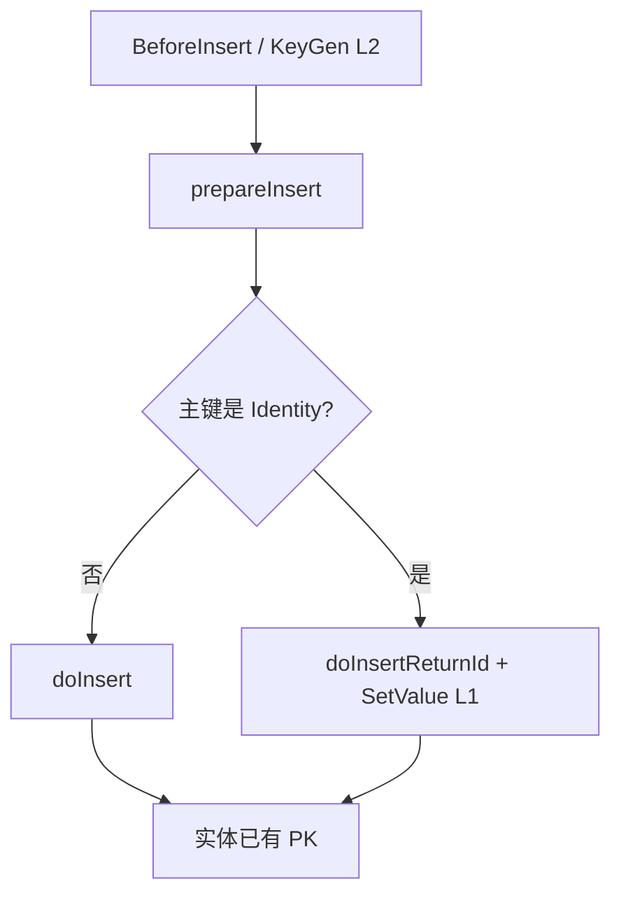
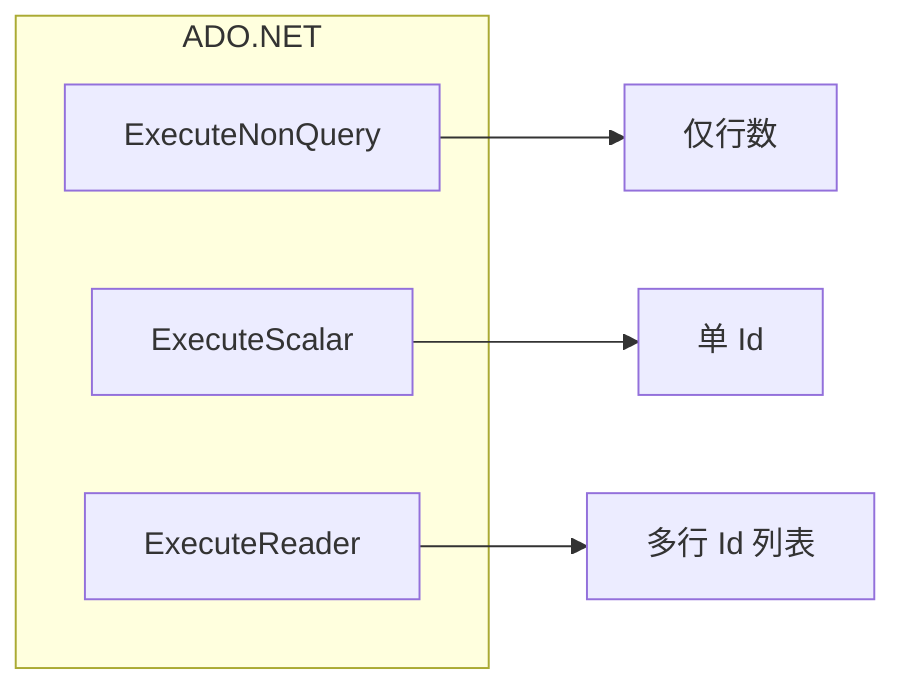
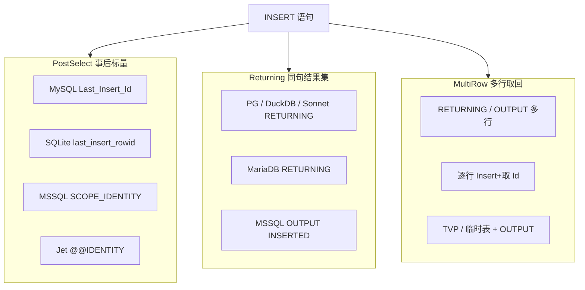

# 插入主键回填与应用发号

> 面向 **使用者**（Insert 后实体是否带 Id、Guid/雪花如何配置）与 **开发人员**（SQLBuilder 取 Id API、方言策略、EntityTranslator / Repo 编排）。  
> **结论先行**：主键获得分 **两层**——**(1) 数据库自增回填**（方言 + `doInsertReturnId*`）与 **(2) 应用侧发号**（`AutoKey` / `KeyGeneratorType` + Client `Register`，插入前写回实体）。Repo 只做编排，禁止用单一 API 吞掉两种模型。  
> 关联：[`MooEntityAnalyser` 标志映射](../../../../pure/src/ado/SQL/DBmodel/dialect/impl/MooEntityAnalyser.cs)（`IsIdentity` → `IsOnlyIgnoreInsert`）已落地，为本特性的列语义前提。

---

## 1. 概述

| 层 | 时机 | 谁产 Id | 列特征 | 落点 |
|----|------|---------|--------|------|
| **L1 库回填** | Insert **后** | 数据库 | `IsIdentity`（通常 `IsOnlyIgnoreInsert`） | 方言策略 + `SQLBuilder.doInsertReturnId*`；Repo `SetValue` 回实体 |
| **L2 应用发号** | Insert **前** | 应用 | 非 Identity；Guid / 雪花 / 业务号等 | 通用主键生成钩子；赋值后 **写回实体** 再进 INSERT |



混成一个「InsertReturnId」的风险：Guid 实体误查 `last_insert_rowid`；自增实体又在插入前乱填 Id。

---

## 2. 背景与现状缺口

### 2.1 已有碎片（未接线或半截）

| 能力 | 位置 | 状态 |
|------|------|------|
| `_selectAutoIncrement` / `selectAutoIncrement` | 各方言 `*Express`（如 SQLite `last_insert_rowid`、MySQL `Last_Insert_Id`、MSSQL `Scope_Identity`） | **仅赋值，Repo/`doInsert` 路径几乎无消费** |
| `IsInsertReturningSupported` | `SqlProviderFlags`；MariaDB 等为 true | LINQ/方言标志已有；SQLBuilder 执行面未统一 |
| `InsertClause.WithIdentity` / `GetIdentityExpression` / `InsertWithIdentity` | LINQ 插入路径 | 与 `SooRepository` / `doInsert` **脱节** |
| `EntityTranslator.OnLoadPKValue` | [`EntityTranslator.config.cs`](../../../../pure/src/adoext/clip/provider/EntityTranslator.config.cs) | 有钩子；见 §2.2 |
| `whenBeforeInsert` | 同 Translator | 可手写发号，无统一约定 |
| `SooRepository<T,K>.InsertWithPK` | [`SooRepository.PK.cs`](../../../../pure/src/adoext/repository/SooRepository.PK.cs) | 插完读实体已有 PK；**不发号、不取库 Id** |
| `doInsert` | `StepBuilder` / Prepare | `exeNonQuery(toInsert())`，只返回影响行数 |

### 2.2 `OnLoadPKValue` 现状硬伤

[`prepareInsert`](../../../../pure/src/adoext/clip/provider/EntityTranslator.cs) 片段逻辑：

```text
val = Property.GetValue(entity)
if (IsPrimarykey && val == null)
    val = loadPKValue(col)
→ ResolveColumnValue → setInsertFieldValue   // 仅写入 SQL，无 SetValue 回实体
```

| 问题 | 影响 |
|------|------|
| 只认 `val == null` | `Guid` / `int` 等值类型默认 `Empty` / `0`，**不进钩子** |
| 生成值不写回实体 | `InsertWithPK` / 后续业务读实体仍可能为空 |
| Translator 实例级 | 无 `MooClient` 级默认策略，难以「所有实体统一 Guid」 |

### 2.3 设计目标

| 目标 | 说明 |
|------|------|
| L1 方言统一取 Id | 事后标量 vs `RETURNING`/`OUTPUT`；单行 / 多行分 API；见 §3.0–3.3 |
| L1 不滥用 NonQuery | `ExecuteNonQuery` 只表行数；取 Id 走 Scalar/Reader 或同连接第二趟 |
| L1 Repo 接线 | Identity 列插入后回填实体；批量 Returning 或逐行降级；禁止伪列表 |
| L2 空值判定可配置 | `null` / `default` / `Guid.Empty` / `0` 等「空主键」语义明确 |
| L2 写回实体 | 发号结果必须 `SetValue`，再进 SQL |
| L2 列注解 | `AutoKey` 字符串；`"Guid"` 可免注册内置；其它 key 走 Client 注册表 |
| L2 注册表 | `Register<T>(string key, Func<T> generate)`；另支持 `KeyGeneratorType` + `IKeyGenerator` |
| 两层不混用 | Identity → 仅 L1；应用主键 → 仅 L2 |

### 2.4 非目标（本期不做或后置）

- **实现分期**：多行一次 `RETURNING`/`OUTPUT` 取全 Id 与 TVP 路径属 **P4**；架构与降级策略（逐行）见 §3.3，默认 **不**用 MySQL「首 Id 推算」
- 不强制统一雪花算法实现（业务通过 `Register(key, Func)` 或自定义 `IKeyGenerator` 接入 Yitter 等）
- 特性内不承载 `Func` / 生成器实例（仅 `AutoKey` 字符串与 `KeyGeneratorType`）
- 不改变 LINQ `InsertWithIdentity` 语义（可复用方言零件，但不以 LINQ 替代 Repo 路径）
- 不做「连接打开后」PRAGMA 钩子（另项）
- 不删除下游业务的 `EnsureIdentitySkip` / `TryFillIdentity`（升级后由下游自行移除）

### 2.5 成功判据

1. `SQLBuilder` 提供可文档化的 `doInsertReturnId`（或等价）API；至少覆盖 SQLite / MySQL / MSSQL 事后标量，以及标志为 true 的 RETURNING 方言；取 Id 与 insert **同连接**。  
2. 文档与方言策略明确：多行取全 Id 用 Returning Reader 或逐行降级；**禁止**多行 VALUES + 单次 PostSelect 冒充列表。  
3. `SooRepository.Insert`（或明确的 `Insert`/`InsertWithPK` 路径）对 `IsIdentity` 主键回填实体属性。  
4. `AutoKey="Guid"` 未注册即可发号写回；自定义 key + `Register` 可发号；未注册非 Guid key 抛错。  
5. `KeyGeneratorType` 指向内置/自定义 `IKeyGenerator` 时可发号。  
6. Identity 实体不会走应用发号；带 AutoKey 的 Guid 实体不会执行 `selectAutoIncrement`。  
7. 单测：方言取 Id（含同连接约束）+ AutoKey/注册表/Type 三条 L2 路径 + Repo 编排分岔；P4 补多行 Returning / 逐行降级。

---

## 3. L1 — 数据库回填（SQLBuilder / 方言）

### 3.0 ADO.NET 基础约束（设计前提）

ADO.NET 标准路径：

| API | 返回值 | 与主键的关系 |
|-----|--------|--------------|
| `DbCommand.ExecuteNonQuery()` | **受影响行数 `int`** | **不包含**生成列 / 自增 Id |
| `ExecuteScalar()` | 结果集第一行第一列 | 可用于「事后标量」或 `RETURNING` 单值 |
| `ExecuteReader()` | 结果集游标 | 可用于 `OUTPUT` / `RETURNING` **多行多列** |

因此：

1. 现有 `doInsert()` → `exeNonQuery(toInsert())` **在架构上无法**带回主键；必须另开「带结果集的插入」或「同会话二次查询」路径。  
2. **一次性插入多行并取回全部生成 Id**，不能依赖 `ExecuteNonQuery`；必须按引擎选用特定 SQL / 协议，并由方言封装差异。  
3. 事后标量（`LAST_INSERT_ID` / `last_insert_rowid` / `SCOPE_IDENTITY`）通常只保证 **本连接、本会话上「最近一次」插入的单个 Id**（或引擎文档定义的窄语义）；**多行 VALUES 时往往只得到最后一个 Id**，不能当作 Id 列表。



mooSQL 抽象必须把「执行形态」升到方言策略层，而不是在业务里手写第二种 Command。

---

### 3.1 取 Id 策略族（IdentityFetchMode）



| 模式 | ADO.NET 调用 | 单行 | 多行一次取全 Id | 代表引擎 |
|------|--------------|------|-----------------|----------|
| **PostSelect** | `NonQuery` + 同连接 `Scalar(selectAutoIncrement)` | 适合 | **不适合**（通常仅最后一行） | MySQL 族、SQLite、经典 MSSQL、Jet、GBase8a、TiDB、OB-MySQL |
| **Returning** | 改写 SQL 后 `Scalar`（单列单行）或 `Reader` | 适合 | **适合**（多行结果集） | PostgreSQL / openGauss / DuckDB / SonnetDB；MariaDB（`IsInsertReturningSupported`）；MSSQL `OUTPUT` |
| **Unsupported** | — | 抛错 | 抛错 | `_selectAutoIncrement` 空且无 RETURNING/OUTPUT（如部分 ClickHouse / 需序列显式的场景） |

优先复用已有：`selectAutoIncrement`、`IsInsertReturningSupported`、LINQ `GetIdentityExpression`；**收口到方言可覆盖的策略**，业务不拼 SQL。

---

### 3.2 单行插入取 Id — 分引擎实施方式

#### 3.2.1 PostSelect（两趟、同连接）

```text
1) cmd1 = toInsert()          → ExecuteNonQuery  → rows
2) cmd2 = selectAutoIncrement → ExecuteScalar    → id
硬约束：cmd1 / cmd2 必须同一 DbConnection（且通常同一事务）；连接池换连接会拿错 Id。
```

| 方言（现有 Express） | `selectAutoIncrement` 示意 | 注意 |
|----------------------|----------------------------|------|
| MySQL / TiDB / OB-MySQL / GBase8a | `SELECT Last_Insert_Id()` | 连接级；触发器内再插入会影响「最后 Id」语义，需文档警示 |
| SQLite | `SELECT last_insert_rowid()` | 连接级；与表 AUTOINCREMENT / INTEGER PRIMARY KEY 约定一致 |
| MSSQL | `SELECT Scope_Identity()` | **优先 Scope**，避免 `@@IDENTITY` 被触发器污染；Output 见下 |
| Jet | `SELECT @@IDENTITY` | 能力弱，单行够用即可 |

**SQLBuilder 实现要点：**

- `doInsertReturnId`：内部 `exeNonQuery` + 用 **当前 ExeSession 已打开连接** 再 `queryScalar`（或 Dialect 提供的第二条 SQLCmd）。  
- 禁止「插入用连接 A、取 Id 用连接 B」。  
- Prepare 路径 Flush 后仍须保证两条命令落在同一 session。

#### 3.2.2 Returning / OUTPUT（一趟、带结果集）

| 引擎 | SQL 形态（示意） | ADO.NET |
|------|------------------|---------|
| PostgreSQL / DuckDB / Sonnet / 兼容 PG | `INSERT INTO t (…) VALUES (…) RETURNING id` | 单行 → `ExecuteScalar`；需多列时用 Reader |
| MariaDB 10.5+ | 同上（`IsInsertReturningSupported=true`） | 同左；MySQL 官方族多为 false，走 PostSelect |
| SQL Server | `INSERT INTO t (…) OUTPUT INSERTED.id VALUES (…)` | Scalar / Reader；注意触发器、视图限制 |

**SQLBuilder 实现要点：**

- 方言 `RewriteInsertForIdentity(SQLCmd insert, identityColumn)` → 带 RETURNING/OUTPUT 的新 SQLCmd。  
- **不能**再对该语句 `ExecuteNonQuery`（多数驱动下结果集被丢弃或行为未定义）；应走 `queryScalar` / `query`。  
- 影响行数：可用 Reader 行数，或方言允许时另取；API 可返回 `(rows, id)` 或仅 Id（Repo 以 Id 为准）。

#### 3.2.3 序列 / 无连接级 LAST_INSERT_ID

| 场景 | 做法 |
|------|------|
| Oracle / 达梦等序列 | 插入前 `nextval` 写入列（偏应用/SQL 侧发号），或 `RETURNING`/`OUTPUT` 等价物；`_selectAutoIncrement` 常为空 |
| 仅 SEQUENCE、无 RETURNING | L1 标 Unsupported，或走「插入前取序列」扩展（可归 L2/SQL 表达式，不硬塞 PostSelect） |

---

### 3.3 多行插入取全部生成 Id — 实施方式

目标：`INSERT` 一次写入 N 行，拿到 **长度为 N 的 Id 列表**（顺序与插入行对应，除非方言文档另有说明）。

#### 3.3.1 能力对照

| 手段 | 能否一次取回全部 Id | 适用 | 缺点 |
|------|---------------------|------|------|
| **A. `RETURNING` / `OUTPUT` 多行** | 能 | PG 族、DuckDB、Sonnet、MariaDB RETURNING、MSSQL OUTPUT | MySQL 官方 / SQLite 经典路径无等价「多行 Id 结果集」 |
| **B. 多行 VALUES + PostSelect** | **不能**（通常只有最后一行 Id） | — | **禁止**作为「取全量 Id」实现 |
| **C. 逐行循环**：每行 `doInsertReturnId` | 能 | 全方言兜底 | N 次往返；事务内可接受 |
| **D. 临时表 / TVP + OUTPUT** | 能 | 主要为 MSSQL | 实现重；适合大批量 |
| **E. 应用侧发号后批量 INSERT** | Id 已知 | Guid/雪花（L2） | 非库自增 |

#### 3.3.2 推荐产品策略（mooSQL）

```text
doInsertReturnIds() / InsertRange 回填：
  if 方言支持 Returning/OUTPUT 多行
      → 单语句 INSERT…RETURNING/OUTPUT → ExecuteReader → List<object>
  else
      → 降级：逐行 doInsertReturnId（同一事务/连接）
  禁止：多行 VALUES + 一次 Last_Insert_Id 冒充列表
```

| API（概念） | 语义 |
|-------------|------|
| `doInsertReturnId()` | **单行**；PostSelect 或 Returning Scalar |
| `IList&lt;TKey&gt; doInsertReturnIds&lt;TKey&gt;()` | **当前 Builder 上的多行插入**（多 VALUES / 批 set）；返回 Id 列表 |
| Repo `InsertRange` + Identity | 有 Returning → 批量 SQL + 按序回填；否则循环 `insertInner`（每行取 Id） |

MySQL 多行自增补充说明（实现可选优化，非必须）：

- 单连接上 `INSERT` N 行后，`LAST_INSERT_ID()` 为 **第一行** 生成值，且同语句内 Id 连续（在未改 `auto_increment_increment` 等前提下）时，可用「首 Id + 推算」——**依赖服务器变量与复制模式，文档必须标风险**；默认仍建议 **逐行** 或推动业务用 L2 发号。  
- **默认实现不采用推算**，避免静默错 Id。

SQLite：多行插入后 `last_insert_rowid()` 为最后一行；取全量 → **逐行** 或应用发号。

#### 3.3.3 MSSQL 多行示例形态

```sql
INSERT INTO dbo.T (Name)
OUTPUT INSERTED.Id
VALUES (@n0), (@n1), (@n2);
-- ExecuteReader → 多行 Id
```

大批量：TVP / 暂存表插入 + `OUTPUT INTO @ids` / `OUTPUT INSERTED`，再读回；可作为方言高级路径，P4+。

#### 3.3.4 PostgreSQL / DuckDB / Sonnet 多行示例形态

```sql
INSERT INTO t (name)
VALUES ($1), ($2), ($3)
RETURNING id;
-- ExecuteReader → 多行
```

与单行共用 Rewrite；仅执行端从 Scalar 换成 Reader + 列表。

---

### 3.4 会话 / 事务 / 连接池硬规则

| 规则 | 原因 |
|------|------|
| PostSelect 的 insert 与 selectAutoIncrement **同连接** | 否则 Id 错乱或空 |
| 优先同事务 | 未提交可见性、回滚一致性 |
| 取 Id 完成前不要把连接还回池 | 池化会切断「会话级 last id」 |
| 触发器内二次插入 | MySQL/MSSQL 事后标量语义变化；文档警示；MSSQL 用 `SCOPE_IDENTITY`/`OUTPUT` 优于 `@@IDENTITY` |
| 并发 | 事后标量为 **会话隔离**，非全局锁；多连接各算各的 |

ExeSession / `LiveTransaction` 已持有连接时，L1 必须复用该 session，禁止 `DBInsCash` 再借新连接跑第二条 SQL。

---

### 3.5 SQLBuilder API（在 3.0–3.3 之上）

```text
// 单行（P0）
object / long doInsertReturnId()
TKey doInsertReturnKey<TKey>()
(int rows, object id) doInsertWithId()          // 可选

// 多行（P4，架构先定）
IList<object> doInsertReturnIds()
IList<TKey> doInsertReturnIds<TKey>()
```

约束：

- 与现有 `doInsert` 并列；**不改变** `doInsert` → 仅 `exeNonQuery` 行数语义。  
- Step / Prepare 双路径实现。  
- 无表名 / 未 set 字段：与 `doInsert` 相同失败语义。  
- Unsupported 方言：**抛明确异常**，禁止返回 `0` / `default` 冒充成功。

---

### 3.6 方言策略接口（示意）

```text
enum IdentityFetchMode { PostSelect, Returning, Unsupported }

Dialect / IInsertIdentitySupport:
  IdentityFetchMode GetInsertIdentityMode()
  string selectAutoIncrement                          // 已有
  bool IsInsertReturningSupported                     // 已有标志，可并入 Mode
  SQLCmd RewriteInsertReturning(SQLCmd insert, string identityColumn)
  // 多行：同上 Rewrite；执行层选 Reader
```

| Mode | `doInsertReturnId` | `doInsertReturnIds` |
|------|--------------------|---------------------|
| PostSelect | NonQuery + Scalar | **降级逐行**（或文档声明不支持批量一次取回） |
| Returning | Rewrite + Scalar | Rewrite + Reader → List |
| Unsupported | throw | throw |

---

### 3.7 Repo 接线（L1）

**单行 `insertInner`：**

```text
若实体存在 IsIdentity 主键列（且本次未显式带 Id 插入）
  → kit.doInsertReturnId() / doInsertReturnKey
  → PropertyInfo.SetValue(entity, convertedId)
否则
  → 现有 doInsert()
```

**批量 `InsertRange`（Identity）：**

```text
若方言 Returning/OUTPUT
  → 可选：拼多行 INSERT + doInsertReturnIds，按序 SetValue
否则
  → 循环 insertInner（每行 PostSelect / Returning 单行）
禁止
  → 一次多行 INSERT + 单次 Last_Insert_Id 填所有实体
```

与标志映射对齐：`IsIdentity` 默认 `IsOnlyIgnoreInsert`；`SkipOnInsert=false` 且已赋值 → **跳过回填**。

---

### 3.8 与现有碎片的映射表

| 现有能力 | 落入 |
|----------|------|
| `selectAutoIncrement` | PostSelect 第二趟 SQL |
| `IsInsertReturningSupported` | Mode=Returning 的开关之一 |
| `doInsert` / `exeNonQuery` | 仅行数；L1 **不**单独使用 |
| `queryScalar` / query+Reader | Returning 单行 / 多行 |
| LINQ `WithIdentity` / `GetIdentityExpression` | 可与 Rewrite 共享方言零件；Repo 不依赖 LINQ 管道 |

---

## 4. L2 — 应用侧主键发号

### 4.1 职责

- **仅**处理非 Identity（或不跳过插入的）主键。  
- 在 `prepareInsert` 写字段循环之前或之中：判定「空主键」→ 调用生成器 → **`SetValue` 写回实体** → 再 `setInsertFieldValue`。

### 4.2 空值判定（建议）

| 类型倾向 | 「空」示例 |
|----------|------------|
| 引用类型 | `null` |
| `Guid` | `Guid.Empty` |
| 数值 | `0`（可配置是否视为空；默认对「主键 + 非 Identity」可开启） |
| 字符串 | `null` / `""`（可配置） |

禁止仅用 `== null`（当前实现缺陷）。

### 4.3 已定方案：列注解 + Client 注册表 + 强类型生成器

特性 **不能** 承载 `Func` / 实例；本特性采用 **字符串键 / `Type`** 声明，**委托与实现挂在 `MooClient` 注册表**。与主流 ORM（EF Fluent `HasValueGenerator`、NH `generator class=`）一致：注解只指名，解析走注册表。

#### 4.3.1 方式 A — `AutoKey` 字符串（主路径）

在列特性上增加字符串属性（名称以实现为准，文档称 **`AutoKey`**）：

```csharp
[SooColumn(IsPrimaryKey = true, AutoKey = "Guid")]
public Guid Id { get; set; }

[SooColumn(IsPrimaryKey = true, AutoKey = "order-snowflake")]
public long Id { get; set; }
```

**解析规则：**

| `AutoKey` 值 | 行为 |
|--------------|------|
| 空 / 未设 | 不按本机制发号（仍可走 Translator 钩子等兜底） |
| `"Guid"`（建议大小写不敏感） | 先查 Client 注册表 key=`"Guid"`；**未注册则内置** `Guid.NewGuid()`（或等价） |
| 其它任意字符串 | **必须**在 Client 注册表用同名 key 找到生成器；找不到 → 明确异常（禁止静默跳过） |

内置仅保证 **`Guid`** 这一约定名可无注册即用；雪花、业务号等一律走注册表，避免框架绑死第三方算法。

#### 4.3.2 Client 注册表 — `Register` + `Func`

```csharp
// 概念 API（实现时挂 MooClient / 专用 KeyGen 门面）
client.Register<Guid>("Guid", () => Guid.NewGuid());           // 可覆盖内置
client.Register<long>("order-snowflake", () => Yitter.NextId());
client.Register<string>("biz-code", () => "ORD-" + ...);
```

约定：

- `Register<T>(string key, Func<T> generate)`：按 **key** 存工厂；插入时按列 `AutoKey` 取 Func，得到 `object` 再赋给属性。  
- 同一 key 重复注册：后注册覆盖（或文档规定抛错，实现二选一并写死）。  
- `T` 应与属性类型可赋值兼容；不兼容 → 插入前抛清晰类型错误。  
- 注册表生命周期随 `MooClient`（或明确的 Scoped 文档）；**不**进特性。

解析优先级（列已设 `AutoKey` 时）：

```text
Client.Register(key) 命中
  ?? (key 约定为 Guid → 内置 NewGuid)
  ?? 抛 KeyGeneratorNotFoundException
```

`OnLoadPKValue` / `whenBeforeInsert` 仍保留为 **无 AutoKey 时的高级兜底**；有 `AutoKey` 时以注册表为准，避免双路径打架（实现时可规定：AutoKey 优先，钩子不覆盖已生成值）。

#### 4.3.3 方式 B — 强类型 `KeyGeneratorType`（方式 3）

内置少量 **强类型生成器接口 / 基类**（名称示意）：

```text
IKeyGenerator                  // object Next(KeyGenContext ctx)
IKeyGenerator<T> : IKeyGenerator   // T Next(...)
```

列特性可写 **`Type`**：

```csharp
[SooColumn(IsPrimaryKey = true, KeyGeneratorType = typeof(SequentialGuidGenerator))]
public Guid Id { get; set; }
```

行为：

- `KeyGeneratorType` 必须实现 `IKeyGenerator`（或 `IKeyGenerator<T>` 且 T 与属性兼容）。  
- 解析：Client 可对 Type **单例缓存**；无参 `Activator.CreateInstance`，或先查 `Register(Type, …)` / DI 式工厂。  
- 框架可提供内置实现类型：`GuidKeyGenerator`、`SequentialGuidKeyGenerator` 等，供直接 `typeof(...)`。  
- **与 `AutoKey` 同时出现时**：建议 **`KeyGeneratorType` 优先**（更具体）；或解析期断言互斥——实现时二选一写死并单测。

强类型注册（可选，与字符串表并列）：

```csharp
client.Register<IKeyGenerator>(typeof(MyGen), () => new MyGen(dep));
// 或
client.RegisterKeyGenerator<MyGen>();  // 无参类型快捷注册
```

#### 4.3.4 分析器写入元数据

`MooEntityAnalyser.ParseColumn` 将 `AutoKey` / `KeyGeneratorType` 写入 `EntityColumn`（新增字段，如 `AutoKey`、`KeyGeneratorType`）。  
`prepareInsert` 在空主键判定通过后调用统一解析器（Client 注册表 + 内置 Guid + Type 激活），**`SetValue` 写回实体** 再 `set`。

#### 4.3.5 与 Identity（L1）边界

| 列标记 | L2 AutoKey / Type | L1 回填 |
|--------|-------------------|--------|
| `IsIdentity` | **忽略**应用发号 | Insert 后取库 Id |
| 非 Identity + AutoKey/Type | 插入前发号 | 不跑 auto-increment |
| 二者皆无 | 不发号 / 仅钩子兜底 | 不回填 |

---

### 4.4 与 `InsertWithPK` 的关系

L2 写回实体后，现有 `InsertWithPK` → `GetPKValue(entity)` **自然正确**。  
L1 回填后同样成立。  
在两层完成前，`InsertWithPK` 对 Identity / 未发号 Guid **不可依赖**。

### 4.5 配置面对照（已拍板）

| 配置面 | 形态 | 用途 |
|--------|------|------|
| **`AutoKey` 字符串** | 特性 | 声明用哪把注册表 key；`"Guid"` 可免注册 |
| **`Register<T>(key, Func<T>)`** | Client | 真正挂委托；特性无法承载 Func |
| **`KeyGeneratorType`** | 特性 + `Type` | 强类型生成器类；可配内置 `IKeyGenerator` 实现 |
| Translator 钩子 | 代码 | 无注解时的兜底 / 高级扩展 |

**不做**：特性内嵌 `Func`、特性内嵌生成器实例。

---

## 5. Repo 编排总览

```text
OnBeforeSave
fireBeforeInsert / KeyGen（L2，非 Identity 空主键）
prepareInsert
  ├─ Identity 列：IsOnlyIgnoreInsert → 不进 set
  └─ 应用主键：已有值进 set
执行
  ├─ 有待回填 Identity → doInsertReturnId + SetValue（L1）
  └─ 否则 → doInsert
OnAfterSave
```

`Save` / `SaveRange` / UoW 走同一 `insertInner` 时自动受益；勿在门面再复制一套取 Id。

---

## 6. 分阶段实施建议

| 阶段 | 内容 | 产出 |
|------|------|------|
| **P0** | §3.0–3.2 / 3.4–3.6：`IdentityFetchMode` + `doInsertReturnId*`（PostSelect / Returning 单行）；同连接硬约束 | 手写 `setTable/set` 可取单行 Id |
| **P1** | Repo `insertInner` Identity 回填；InsertRange **先逐行**取 Id | 单行/批量实体均有 Id（批量走降级） |
| **P2** | 空值判定 + 写回；`AutoKey` + `Register<T>(key, Func)`；`"Guid"` 内置 | 字符串 AutoKey 闭环 |
| **P3** | `IKeyGenerator` + `KeyGeneratorType`；分析器映射 | 强类型生成器 |
| **P4** | §3.3：`doInsertReturnIds`；Returning/OUTPUT 多行 Reader；MSSQL TVP 可选；与 LINQ Identity 共享 Rewrite | 多行一次取全 Id |

建议优先 **P0 → P1**（库回填基础架构）；**P2 → P3** 应用发号；**P4** 在 Returning 方言上消除批量逐行往返。

---

## 7. 测试要点

| 用例 | 期望 |
|------|------|
| SQLite Identity 实体 `Insert` | 实体 Id 为 `last_insert_rowid` 结果 |
| MySQL / MSSQL 同构（有环境时） | 同左；MSSQL 用 Scope/OUTPUT 而非误用跨连接 |
| PostSelect 换连接取 Id（负例） | 失败或断言同 session（实现守卫） |
| RETURNING 方言单行 | 一趟 Scalar 取回 Id；非 NonQuery |
| RETURNING 多行 `doInsertReturnIds`（P4） | Reader 行数 = 插入行数，顺序对齐 |
| PostSelect 方言多行取全 Id | 逐行降级成功；**不得**用单次 Last_Insert_Id 填满列表 |
| Unsupported 方言调用 `doInsertReturnId` | 明确异常，非 `0` |
| `IsIdentity` + 显式 `SkipOnInsert=false` 且已赋值 | 不二次回填覆盖 |
| `AutoKey="Guid"` 未 `Register` | 插入前实体非 `Empty`，SQL 含 Guid |
| `AutoKey="Guid"` + `Register("Guid", …)` | 使用注册 Func，可覆盖内置 |
| `AutoKey="x"` + `Register("x", …)` | 使用注册值写回实体 |
| `AutoKey="x"` 未注册 | 抛明确异常 |
| `KeyGeneratorType=typeof(内置/自定义)` | 经 `IKeyGenerator` 发号写回 |
| Identity 列带 AutoKey | **不**走 L2 发号，走 L1 回填 |
| 带 AutoKey 的 Guid 实体 | Repo 走 `doInsert`，不跑 auto-increment |

---

## 8. 关键代码索引

| 区域 | 路径 |
|------|------|
| Repo 插入 | [`SooRepository.core.cs`](../../../../pure/src/adoext/repository/SooRepository.core.cs)、[`SooRepository.PK.cs`](../../../../pure/src/adoext/repository/SooRepository.PK.cs) |
| 实体准备 | [`EntityTranslator.cs`](../../../../pure/src/adoext/clip/provider/EntityTranslator.cs)、[`EntityTranslator.config.cs`](../../../../pure/src/adoext/clip/provider/EntityTranslator.config.cs) |
| doInsert | [`StepBuilderDymatic.cs`](../../../../pure/src/ado/builder/stepBuilder/StepBuilderDymatic.cs)、抽象 [`SQLBuilder`](../../../../pure/src/ado/builder/basis/SQLBuilder.cs) |
| 方言自增 SQL | [`SQLExpression.common.cs`](../../../../pure/src/ado/data/dialect/SQLExpression.common.cs)、`ext/src/provides/dialect/**/**Express.cs` |
| RETURNING 标志 | [`SqlProviderFlags.cs`](../../../../pure/src/ado/data/dialect/SqlProviderFlags.cs) |
| LINQ Identity | [`ClauseTranslateVisitor.save.cs`](../../../../pure/src/ado/SQL/visitors/parts/ClauseTranslateVisitor.save.cs)、[`InsertContext.cs`](../../../../ext/src/linq/src/linq/builder/clauseContext/InsertContext.cs) |
| 列标志解析 | [`MooEntityAnalyser.cs`](../../../../pure/src/ado/SQL/DBmodel/dialect/impl/MooEntityAnalyser.cs) |

---

## 9. 文档与下游

- 实现落地后：补充使用文档（`doc/docs` 仓储 / SQLBuilder 章节）示例：`Insert` 自增回填、`AutoKey="Guid"`、`Register(key, Func)`、`KeyGeneratorType`。  
- 下游曾用的 `TryFillIdentity` / `EnsureIdentitySkip`：在升级到含本特性的 mooSQL 版本后可删除；**本仓库实现阶段不负责改外部业务仓**。
