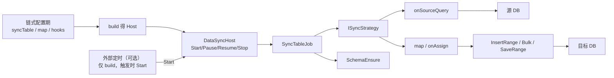
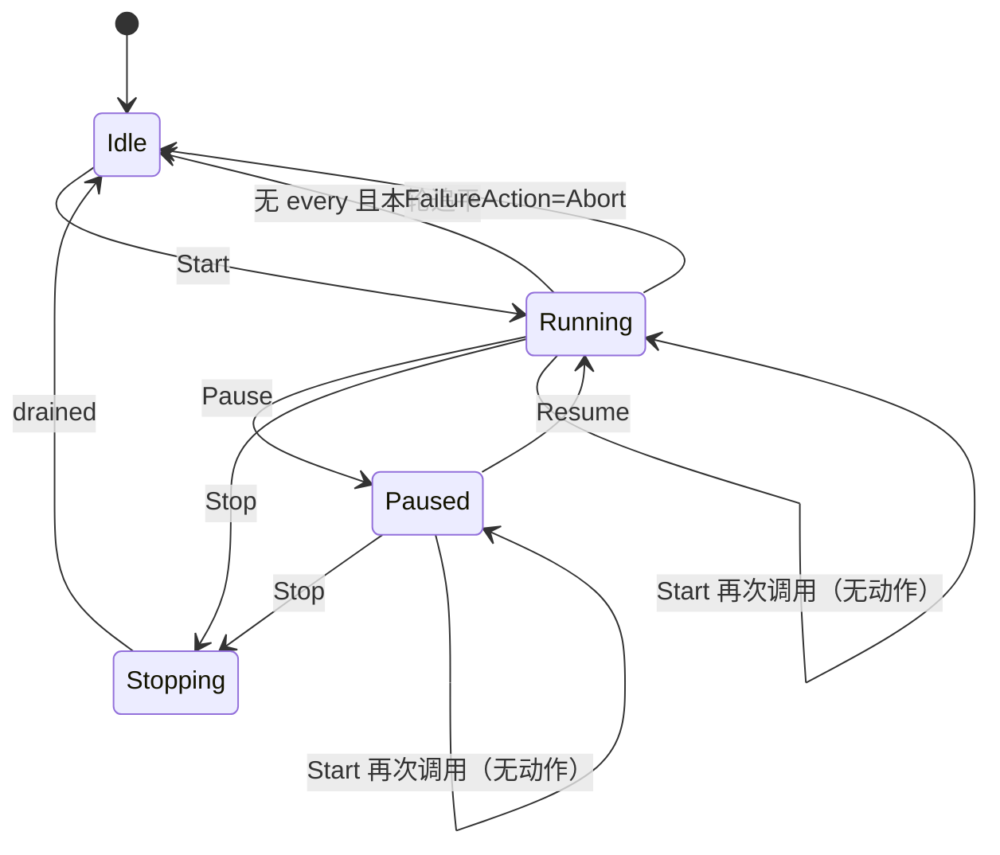
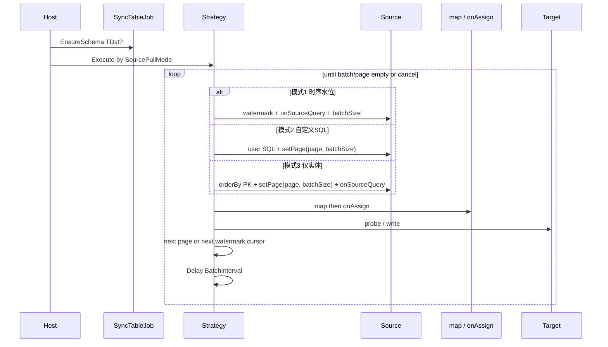

# 数据同步基类（DataSync）设计

> 面向 **使用者**（链式注册表、启停权柄）与 **开发人员**（同步策略、水位、写入内核、Host 生命周期）。  
> **结论先行**：在业务侧 `ContructDataSync`（建设库 1→3 增量 append）之上，于 mooSQL 建立 **通用数据同步基类 / 编排器**，保留「连接位 + 链式 `syncTable`」心智；**配置与执行分离**（`build` 后仅 **`Start`**，**废除 `run`/`RunOnce`**）；`Start` 按 **批大小 + 批次间歇**（或定制 `every`）连续跑；支持同构/异构 map、源读/写入钩子；**不做**双向 Sync/CDC；**零新增 NuGet**。  
> **依赖硬约束（本特性）**：**不得向 mooSQL 工程新增任何 NuGet 包**；凡能力需新依赖者，须在文档中 **显式决策（自研 / 复用存量 / 外置）或直接拒绝**。cron、AutoMapper、ETL 框架、调度框架等一律按此处理。  
> 样板参考：`bidaibuddy/.../Sync/ContructDataSync.cs`、`ContructSyncTool.cs`；结构同步复用 [`SyncMode`](../../../../pure/src/adoext/richRepo/schema/SyncMode.cs) / `SchemaEnsure`；写入复用 [`批量写入性能优化`](../仓储/批量写入性能优化.md) / Bulk。

**状态**：P0–P4 已落地（`pure/src/zoom/sync`，`net8.0` 可编译）· **命名空间**：`mooSQL.data`（门面 `DataSync`）/ `mooSQL.data.sync`（Host/Builder/Runners）

---

## 1. 概述

| 项 | 说明 |
|----|------|
| **定位** | 库表 → 库表的 **单向** 同步编排；**同构 `T` 为主**，**异构 `TSrc`→`TDst` 经映射 Func** |
| **入口风格** | 对齐 `DBTableCreator.createTable<T>()`：链式注册、过程日志、小写方法名 |
| **连接模型** | 复用 mooSQL **连接位 position**（`DBCash` / `MooClient`），不新造连接字符串体系 |
| **核心抽象** | Builder 配置 → `build()` → `DataSyncHost`；Job + Strategy；可选 map / 钩子 |
| **生命周期** | **仅** `Start` / `Pause` / `Resume` / `Stop`；**无** `run` / `RunOnce` / 注册即跑 |
| **读写自由度** | 源：追加条件钩子；`orderBy` **仅当查询尚未排序时由框架补上**；写：`onAssign` |
| **连续运行** | `Start` 后按批大小（Host 默认或表覆盖）+ BatchInterval；可选 `every`；Running 再 Start 无动作 |
| **调度边界** | 富定时外置：可只 `build`，触发时再 `Start`；库内不做 cron |
| **依赖边界** | **零新增 NuGet**；钩子只暴露已有 SQLBuilder / SQLClip / Repo kit |
| **非目标** | 新增包；`run`/`Eager`；cron 内置；列名映射 DSL；双向/CT/HTTP/CDC；**本期改造建设库已有同步代码** |

### 1.1 依赖策略（硬约束）

> **规则**：本功能规划与落地 **禁止** 为 mooSQL（`pure` / `ext` 等相关 csproj）**新增 NuGet 引用**。调研中的开源库仅作语义对标，**不**作为实现依赖引入。

| 诉求 | 若引入新包 | **决策** |
|------|------------|----------|
| cron 表达式 | Cronos / NCrontab / Quartz | **拒绝**；富定时外置；内置仅 `TimeSpan` + `Task.Delay` |
| 作业调度宿主 | Hangfire / Quartz.NET | **拒绝**入库；业务侧自选，对已 `build` 的 Host 调 `Start` / `Stop` |
| 对象映射 | AutoMapper / Mapster | **拒绝**；异构用调用方注册的 `Func` / `mapBatch` |
| ETL / Sync 框架 | EtlKit / ETLBox / Dotmim.Sync | **拒绝**引入；只借鉴模式，自研薄编排 |
| 并行管道 | TPL Dataflow 额外包（视 TFM） | **拒绝**新包；用 `SemaphoreSlim` + `Task` / 已有并行 API |
| CDC | MsSqlCdc 等 | **拒绝**本期；后置若做须再开依赖评审 |
| 实现手段 | — | **只允许**：BCL、现有 mooSQL 程序集与其 **已引用** 的包 |

发现「不做某能力就几乎必须加包」时：**砍能力或外置到业务工程**，不在库内开例外。业务工程自行引用 Hangfire 等 **不** 算违反本约束（只要 mooSQL 包图不变）。



---

## 2. 背景与现状

### 2.1 业务样板：`ContructDataSync`

建设库当前实现要点：

| 能力 | 现状 |
|------|------|
| 来源/目标 | 构造时固定 `sourcePosition` / `targetPosition` |
| 链式 API | `Create(...).syncTable<T>(orderByColumn)...`，**注册即同步** |
| 增量语义 | 目标 `max(orderCol)` 作水位；`(time, pk)` 复合游标拉批；目标侧按 PK 探活后 **仅插入缺失行** |
| 批大小 | 默认 2000；`InsertRange` 写入 |
| 建表 | **不负责**（依赖 `ContructDBInitTool.createTable` 预建） |
| 启停/调度 | 无；由外部定时调用 `ContructSyncTool.SyncDB()` |
| 并行/异步 | 无；表间串行、批内同步 |
| 更新/覆盖 | 无；已存在 PK **跳过**（append-only + 判重） |

痛点：能力绑死在业务工程；策略单一；无启停权柄；大数据量未强制 Bulk；无自动建表与覆盖式同步。

### 2.2 mooSQL 已可复用积木

| 积木 | 用途 |
|------|------|
| 连接位 / `useRepo` / `useSQL` | 源读、目标写 |
| `DBTableCreator` / `SchemaEnsure` + `SyncMode` | 目标自动建表 / 补列（与数据同步的 `SyncMode` **不同概念**，见 §4.3 命名） |
| `InsertRange` / Bulk / `BatchWriteOptions` | 高性能插入 |
| `SaveRange`（探活分流） | 按主键存在则更新、否则插入（Upsert 雏形） |
| 主从 `SlaveCmdWorker` 队列模型 | **参考**异步队列与消费者，**不**把本功能混入主从复制 |

> 注意：现有枚举 `mooSQL.data.SyncMode` 表示 **表结构** 同步模式。数据同步策略建议使用 **`DataSyncMode`**（或 `RowSyncMode`），避免同名冲突。

---

## 3. 开源能力调研（对标与取舍）

| 项目 | 定位 | 可借鉴（语义） | 决策（§1.1） |
|------|------|-----------------|--------------|
| **[EtlKit](https://www.etlkit.org/)**（原 ETLBox Classic 开源线） | 代码优先 ETL；`DbMerge`；Checkpoint | **MergeMode**、批写、水位思路 | **拒绝引入包**；自研薄编排 |
| **ETLBox 2.x DbMerge** | 商业续作 | Full / Delta / InsertsOnly 等模式名 | **拒绝**（许可 + 新依赖） |
| **[Dotmim.Sync](https://dotmimsync.readthedocs.io/)** | 多端双向同步 | 批、方向、`SynchronizeAsync` 心智 | **拒绝引入包**；不做双向/CT |
| **[sql-bulk-copy-merge](https://github.com/stevekirks/sql-bulk-copy-merge)** | SQL Server Bulk+MERGE / CopyLatest | 水位追加、临时表+MERGE 思路 | **拒绝引入包**；用自有 Bulk/方言 |
| **MsSqlCdc / CDC 工具** | 引擎级变更捕获 | 「变更源」扩展点构想 | **拒绝本期**；若未来要做须依赖评审 |

**对标结论**：

1. 业务样板 ≈ EtlKit/sql-bulk-copy-merge 的 **InsertsOnly + watermark（CopyLatest）**。  
2. 增强点中的「按修改时间更新或插入」≈ **Delta / Upsert by key + modified column**。  
3. 「覆盖更新（替换式）」≈ **Full / Truncate+Bulk** 或 **staging MERGE**。  
4. 调度外置；库内 **仅 `Start` + BatchInterval / 可选 `every`**；**拒绝 cron 与新 NuGet**（§1.1）。对标只借语义。

---

## 4. 设计目标与能力矩阵

### 4.1 目标

1. **配置来源/目标连接位**（可全局默认，可 per-table 覆盖）。  
2. **链式配置 → `build()` → Host**（**非**注册即跑）。  
3. **唯一启动口 `Start`**（废除 `run` / `RunOnce`）；另有 `Pause` / `Resume` / `Stop`。  
4. **连续运行**：`Start` 后按批大小 + **BatchInterval** 拉写；可选 **`every(TimeSpan)`** 作为轮次间歇。  
5. **多线程 / 异步**：表间可并行；批循环可 async；写入走现有批量内核。  
6. **结构同步 → 直至 Upsert**：`EnsureSchema` + 行策略做到 **`UpsertByModified`**（`ReplaceFull` 后置）。  
7. **多种行同步策略**（见下表；本期主路径含 Append / Upsert）。  
8. **高性能插入**（Bulk / 多行 VALUES，阈值可配）。  
9. **可观测**：Host 持有 `WorkingProgress`；日志钩子对齐 SQLBuilder **`print(Action<string>)`**，注册一个 Action 即可。  
10. **失败行为**：枚举可配；**默认跳过该批次并继续**；可选 **中断** 整次 `Start`。  
11. **异构映射**：`syncTable<TSrc, TDst>(…, map)` 等。  
12. **源读三模式**：时序水位 / 自定义 SQL 翻页 / 仅实体按 PK 翻页。  
13. **源读钩子**：模式 1/3 可 `onSourceQuery`；**orderBy 未加才自动补**。  
14. **写入自由度**：`onAssign` 等。

### 4.1.1 配置 / 启动 / 调度（已决）

| 层 | 职责 | 不做 |
|----|------|------|
| **配置期** | `Create` → 链式 `syncTable` / 钩子 / `every` → **`build()`** 得到 Host | 配置期执行任何同步 |
| **DataSyncHost** | **`Start`** 连续运行；`Pause`/`Resume`/`Stop` | **`run` / `RunOnce` / Eager** |
| **连续节奏** | Host **默认 BatchSize**（可改）+ **BatchInterval**；或 **`every`** 轮次间歇 | cron / 每表独立调度表 |
| **批大小** | Host 实例默认一份；**每个 `syncTable` 映射可覆盖** | — |
| **再次 Start** | 已在 Running/Paused 时再 `Start` → **无额外动作**（忽略） | 开第二套循环 |
| **外部托管** | 可只 `build`，触发时 `Start`（Idle 时可再次 Start） | 库内引用调度框架 |
| **mooSQL 包图** | 零新增 | 新增 PackageReference → 违规 |

### 4.2 行同步策略 `DataSyncMode`

| 模式 | 语义 | 典型实现 | 对应开源概念 |
|------|------|----------|--------------|
| `AppendOnly` | 仅插入目标不存在的 PK；可配水位游标 | 现 `ContructDataSync` | InsertsOnly + CopyLatest |
| `AppendWatermark` | 严格按水位拉取，**目标不做 PK 探活**（假设源单调追加且目标干净） | `max(order)+pk` 游标 + InsertRange/Bulk | CopyLatest 极简版 |
| `UpsertByModified` | 按 PK：不存在插入；存在且源修改时间 **≥** 目标则更新 | 批探活 + InsertRange/UpdateRange 或方言 MERGE | Delta / Upsert |
| `ReplaceFull` | 先清空目标范围，再全量拉源 + Bulk 写入（见 §6.3） | TRUNCATE/DELETE → 批拉 → Bulk | Full / UseTruncateMethod |
| `MirrorKeys` | 键集补齐缺失行后，删除目标中源不存在的主键（需破坏性闸门） | 源/目标键集扫描 + Insert + DELETE | Full merge deletes |

默认建议：`AppendOnly`（语义对齐样板；**不**要求本期改建设库代码）。

### 4.2.1 失败行为 `DataSyncFailureAction`（已决）

批处理过程中（拉源、map、探活、写入等）发生异常时的策略：

| 枚举值 | 语义 |
|--------|------|
| **`SkipBatch`（默认）** | 记录本批失败（进度/日志）；**跳过该批次**，推进游标越过本批末行后继续后续批次 / 后续表 |
| **`Abort`** | 记录失败后 **中断** 当前 `Start`（进入 Stopping→Idle 或 Faulted）；不再开新批 |

```csharp
public enum DataSyncFailureAction
{
    /// <summary>默认：本批失败则跳过并继续。</summary>
    SkipBatch = 0,

    /// <summary>本批失败则中断本次 Start。</summary>
    Abort = 1
}
```

约定：

- 作用粒度：**一批**（一次 pull→write 循环），不是单行（单行 map 返回 null 仍算 skipped，不算失败策略）。  
- 可 Host 全局默认，表级可覆盖（`SyncTableOptions.FailureAction`）。  
- `SkipBatch` 为避免毒批死循环，**仍推进游标**越过失败批；该批数据可能暂不同步，依赖日志排查（不在本期做自动重试队列）。  
- `Abort` 时已成功提交的批次不回滚（无跨批大事务，除非单批写入本身在事务内——沿用仓储/写入内核语义）。  
- 与 `Pause`/`Stop` 区分：失败策略是异常路径；Pause/Stop 是主动权柄。

### 4.3 与结构 `SyncMode` 的关系

| 层 | 类型 | 何时 |
|----|------|------|
| 结构 | `SchemaEnsure` + `SyncMode`（CreateIfMissing / AddMissingColumns…） | 任务开始前可选 `EnsureTargetSchema=true`（**目标**实体） |
| 数据 | `DataSyncMode` | 每批拉取与写入 |

**能力上界**：结构同步（EnsureSchema）与行同步含 **`UpsertByModified` / `ReplaceFull` / `MirrorKeys`**。结构默认可用 `CreateIfMissing`，需要补列时显式 `AddMissingColumns`。CDC / staging 换表仍后置。

### 4.4 同构与异构

| 形态 | API | 拉取 / 水位 / 源 PK 游标 | 建表 / 探活 / 写入 |
|------|-----|-------------------------|-------------------|
| **同构** | `syncTable<T>(…)` | `T` | `T`（`map = Identity`） |
| **异构** | `syncTable<TSrc, TDst>(…, map)` | **源** `TSrc` | **目标** `TDst`（映射后） |

职责拆分：

- **源侧**：按 **§4.5 三种拉源模式** 取数；模式 1/3 可再挂 **`onSourceQuery` 追加条件**。  
- **映射 / onAssign / 目标写入**：同前（map → onAssign → 探活/写入）。

**不做（本期）**：纯字符串列映射表；**拒绝** AutoMapper/Mapster。

### 4.5 来源读取：三种模式（已决）

> 曾出现的「`onSourceSql` 钩子 vs P4 `fromSql`」易混淆——**废止该二分**。自定义 SQL 就是下面的 **模式 2**，与「实体 + 时序水位」并列，不是后期另开一条旁路。

| 模式 | 用户怎么配 | 进度 /「水位」谁管 | 批怎么切 |
|------|------------|-------------------|----------|
| **1. 时序字段** | 配置了 `orderBy`（时序/修改时间列） | **框架**：读目标 `max(该列)`（+PK 复合游标）往后追 | 每批 `BatchSize` 条，按游标连续拉 |
| **2. 自定义 SQL** | **未**配时序字段，提供 **`fromSql` / 自定义查询**（SQLBuilder 或 SQL 文本） | **业务**：范围写在 SQL 里（如当月）；框架**不**用目标 max 做增量水位 | 框架自动加 **翻页**（`setPage`/`skipTake`）；**1 页 = 1 批**，按 `BatchInterval` 翻页直到空页 |
| **3. 仅实体** | 只有实体类型：无时序字段、无自定义 SQL | 无业务时间水位；按 **主键排序翻页** | 同模式 2：按 PK 排序 + 翻页，`BatchSize` 为页大小 |

判定优先级（配置期）：**有自定义 SQL → 模式 2**；否则 **有 orderBy 时序列 → 模式 1**；否则 → **模式 3**。

#### 模式 1 补充

- 可选 `onSourceQuery` **追加** where（租户、软删等）。  
- **orderBy**：若钩子未排序，框架按配置列 + PK 补上；钩子已排序则不补。  
- 「水位」口语 = 目标表上已同步到的最新时序值，下次从其后继续。

```csharp
.syncTable<Order>(cfg => cfg
    .orderBy("ModifiedAt")
    .onSourceQuery(kit =>
    {
        kit.where("TenantId", tenantId);
        kit.whereIsOrNull("IsDeleted", false);
    }))
```

#### 模式 2 补充

- 业务在 SQL 中限定集合（当月、某状态等）；**每次 Start 是否重复扫同一窗口由业务 SQL 决定**（可与目标 AppendOnly 探活配合去重）。  
- 框架只负责：在用户查询上叠加分页、按页执行、页间 `BatchInterval`。  
- 映射：查询结果落到 `TSrc`（或直接 `TDst`）；异构仍用 `map`。  
- API 示意：`.fromSql(b => b.select(...).from(...).where(...))` 或等价注册；**不再**单独搞一个「实体路径上的 onSourceSql 钩子」与「P4 fromSql」两套名字。

```csharp
.syncTable<Order>(cfg => cfg
    .fromSql(b => b
        .select("*")
        .from("orders")
        .whereFormat("BillMonth = {0}", month))
    // 不配 orderBy → 模式 2；BatchSize 作 page size
    )
```

#### 模式 3 补充

- 框架：`order by PK` + 翻页；适合全量/准全量搬运且无可靠时序列。  
- 仍可用 `onSourceQuery` 追加过滤。  
- 大表用 **键集翻页**（`pk > last ORDER BY pk` + `top`），避免大偏移；模式 2（`fromSql`）仍为 offset/`setPage`。

#### 写入：`onAssign`（实体字段赋值）

| 项 | 约定 |
|----|------|
| 时机 | `map`/`mapBatch` 之后（同构则直接对源拷入的目标行），**探活与 Insert/Update/Bulk 之前** |
| 语义 | `Action<TDst>` 或 `Action<TDst, TSrc>`（异构可带上源行上下文）；就地改字段，不替换整行引用（若需换实例用 `map`） |
| 与 `map` 分工 | **`map`**：形状转换 / 异构；**`onAssign`**：同步侧横切赋值（同步时间戳、默认值、环境常量），同构也常用 |
| 批版本 | 可选 `onAssignBatch(IList<TDst>)`（或带源列表），便于批量补字段 |
| 示例用途 | `SyncedAt = UtcNow`、写入目标库专用列、补齐非源字段 |

```csharp
.syncTable<Order>(cfg => cfg
    .orderBy("ModifiedAt")
    .onAssign(dst =>
    {
        dst.SyncedAt = DateTime.UtcNow;
        dst.SourceDb = "pos1";
    }))

// 异构：map 负责投影，onAssign 补环境字段
.syncTable<SrcRow, Order>(cfg => cfg
    .orderBy("src_modified")
    .map(s => new Order { Id = s.Id, Title = s.Name })
    .onAssign((dst, src) => { dst.RawPayload = src.Json; }))
```

**决策（§1.1）**：不引入表达式访问器包或第三方 Query Filter；钩子签名只用 BCL 委托 + mooSQL 已有 Builder/Clip 类型。

---

## 5. API 草图（使用者视角）

```csharp
using mooSQL.data;

// 统一心智：配置 → build → Start（无注册即跑，无 run）
var host = DataSync.Create(sourcePosition: 1, targetPosition: 3)
    .ensureSchema(true)
    .mode(DataSyncMode.AppendOnly)
    .useBulk(true)
    .batchSize(2000)                             // Host 默认批大小（可改）
    .batchInterval(TimeSpan.FromMilliseconds(0))
    .syncTable<Cg_Biaoduaninfo>("OPERATEDATE")
    .syncTable<Cg_Projectinfo>(cfg => cfg
        .orderBy("operatedate")
        .batchSize(500))                         // 单映射覆盖默认批大小
    .print(line => Console.WriteLine(line))      // 对齐 SQLBuilder.print(Action<string>)
    .build();
    // host.WorkingProgress 为权威摘要；print 仅在追加时回调同一文案

await host.StartAsync(ct);                       // 唯一启动：连续拉批直至追平后 Idle（未配置 every）
host.Pause();
host.Resume();
await host.StopAsync();

// 外部托管定时：只 build，触发时 Start
// timer => await host.StartAsync(ct);

// 内置轮次间歇：every = 一轮结束后的定制等待，再连续跑下一轮
var loop = DataSync.Create(1, 3)
    .batchSize(2000)
    .batchInterval(TimeSpan.FromMilliseconds(50))
    .every(TimeSpan.FromMinutes(5))              // 轮次间歇（非 cron）
    .syncTable<Order>("ModifiedAt")
    .build();
await loop.StartAsync(ct);                       // 追平 → Delay(5min) → 再追平 → …

// 异构 + 钩子（仍先 build 再 Start）
var hetero = DataSync.Create(1, 3)
    .ensureSchema(true)
    .syncTable<SrcOrderRow, OrderEntity>(cfg => cfg
        .orderBy("src_modified")
        .watermarkOnTarget("ModifiedAt")
        .mode(DataSyncMode.AppendOnly)
        .map(src => new OrderEntity
        {
            Id = src.BizId,
            Title = src.Name,
            ModifiedAt = src.SrcModified
        })
        .onSourceQuery(kit => kit.where("BizType", 1))
        .onAssign((dst, src) => dst.ImportBatchId = batchId))
    .build();
await hetero.StartAsync(ct);
```

设计要点：

- **配置 / 执行分离**：链式阶段只登记；**`build()`** 产出 Host；**只有 `Start`** 开始干活。  
- **废除** `run` / `RunOnce` / `SyncRunMode.Eager`。  
- **`Start` 连续运行**：用有效批大小（表级 ?? Host 默认）拉写，批间 `BatchInterval`；有 `every` 则一轮后再 Delay。  
- **Running 中再 Start**：无额外动作（不重入、不开第二循环）。  

- **小写配置 API**。  
- **进度（已决）**：Host 持有 **`WorkingProgress`（`StringBuilder`，权威）**；链式 **`print(Action<string>)`** 对齐 [`SQLBuilder.print`](../../../../pure/src/ado/builder/basis/SQLBuilder.cs)——只注册一个 Action，追加一行摘要时同步回调；不另搞事件总线。  
- **同构 ≡ 异构 + Identity map**；钩子可选。  
- **无 cron**；多表不同节奏 → 多个 Host 或外部多次 `Start`。

---

## 6. 核心类型与职责

```
mooSQL.data
  DataSync                 // 静态工厂 Create(...)
  DataSyncHost             // Start/Pause/Resume/Stop；WorkingProgress；可选 print Action
  DataSyncBuilder          // 链式配置含 print(Action<string>)，build() → Host

mooSQL.data.sync
  SyncTableJob             // Source/Target、水位、模式、批、Map、SourceQueryHook、AssignHook
  SyncTableJob<T>          // 同构快捷
  SyncTableJob<TSrc,TDst>  // 异构 + map / mapBatch / onSourceQuery / onAssign
  ISyncStrategy            // pull(+hook) → map → onAssign → probe/write
  AppendOnlyStrategy
  AppendWatermarkStrategy
  UpsertByModifiedStrategy
  ReplaceFullStrategy
  SyncCursor / WatermarkStore
  DataSyncOptions
  DataSyncFailureAction    // SkipBatch（默认）| Abort
```

### 6.1 `DataSyncHost` 状态机



- **Start（唯一启动）**：仅 **Idle** 时进入连续运行；有效批大小 = **表 `batchSize` ?? Host 默认 `BatchSize`**；批间 **BatchInterval**；有 **`every`** 则一轮后再 Delay，否则追平后 Idle。  
- **再次 Start**：已在 **Running / Paused**（或 Stopping）时调用 → **无额外动作**（忽略，不抛、不开第二循环）。仅 Idle 时 Start 才真正开跑。  
- **Pause** / **Stop** / **失败**：同前。  
- **表级并行**：`SemaphoreSlim`；同表单飞。  
- **禁止** `run` / `RunOnce`。

### 6.2 单表批循环（按拉源模式）



| 模式 | 推进方式 | 结束条件 |
|------|----------|----------|
| 1 | 复合游标越过本批末行 | 本批条数 &lt; BatchSize |
| 2 / 3 | 页码 +1 | 本页无行 |

批间一律 `BatchInterval`。失败见 `FailureAction`（模式 2/3 的 SkipBatch：跳过本页并页码 +1，避免死循环）。

### 6.3 各策略要点

#### AppendOnly（默认）

1. **模式 1**：读目标 `max(watermarkCol)` → 源拉批 → map → onAssign → PK 探活 → 只插新行。  
2. **模式 2/3**：按页拉源 → 同上写入；无框架时序水位，靠探活/业务 SQL 避免重复（或接受重复由唯一约束失败走 FailureAction）。  
3. PG 等探活类型差异：方言钩子（建设库经验）。

#### AppendWatermark

- 不做探活；依赖水位严格前进。适合只追加日志表。重复跑可能主键冲突 → 策略文档标明 **at-least-once 需幂等或唯一约束吞冲突**。  
- 异构时仍先 map 再写入；冲突以目标唯一约束为准。

#### UpsertByModified

- 配置：源 `orderBy`、目标 `modified`（可同名）、目标 PK。  
- 批内：map + **onAssign** 后，存在且最终行 `Modified >=` 目标行（可配 `>`）则更新，否则跳过；不存在则插入。  
- 写入：优先 `SaveRange` / 分拆 Insert+Update；二期方言 `MERGE`/`ON CONFLICT`。

#### ReplaceFull（已决：先删再 Bulk）

独立于增量水位批循环；**忽略时序水位**，按拉源模式做**范围内全量**替换。

| 步骤 | 行为 |
|------|------|
| 0 | `AllowDestructiveReplace != true` → 拒绝执行 |
| 1 | 可选 `EnsureSchema` |
| 2 | **清空目标范围**：整表替换优先 `TRUNCATE`，不行则全表 `DELETE`；若拉源为模式 2（`fromSql` 业务窗口）→ 对目标做**同范围** `DELETE`，禁止误 TRUNCATE 整表 |
| 3 | 按批/翻页从源**全量**拉取（模式 1 也不走水位游标）→ map → onAssign |
| 4 | 每批 **Bulk / InsertRange**；批间 `BatchInterval`；失败仍受 `FailureAction` 约束 |

**空窗风险（接受并文档化）**：先删后写，中途失败时目标可能已空或半截；需更稳的 **staging 换表** 后置（非 P3 必做）。

**不做（P3 主路径）**：边删边按键镜像、临时表 MERGE（可作 P3+ 增强）。

### 6.3.1 异构映射约定

| 项 | 约定 |
|----|------|
| 必选 | 异构任务必须提供 `map`（或 `mapBatch`）；缺省则配置期失败 |
| 空/过滤 | `map` 返回 `null` 可表示跳过该行（计入 skipped） |
| 异常 | 单行 map 抛错：默认中断本表本轮；可配 `continueOnMapError`（记 ERR，跳过行） |
| 性能 | 热路径优先 `mapBatch`，避免逐行委托开销过大 |
| 同构 | 不强制用户写 map；内部 Identity |

### 6.3.2 钩子与拉源注册

| API | 用于 | 说明 |
|-----|------|------|
| `orderBy` | 模式 1 | 时序列；触发水位拉源 |
| `fromSql(...)` | 模式 2 | 自定义查询；框架只加翻页 |
| `onSourceQuery` | 模式 1 / 3 | 追加 where；可自写 orderBy → 框架不补 |
| `onAssign` / `onAssignBatch` | 写入前 | 与拉源模式无关 |

**废止**单独的 `onSourceSql` 命名（与 `fromSql` 易混）；自定义 SQL 统一走 **`fromSql` = 模式 2**。

### 6.4 高性能写入

| 开关 | 行为 |
|------|------|
| `useBulk(true)` / `BatchWriteOptions` | 超阈值走 Bulk，失败降级多行 VALUES |
| Host `batchSize` | 实例默认批/页大小（可改，如 2000） |
| 表 `batchSize` | 可选；覆盖 Host 默认（该映射专用） |
| `batchInterval` | 批/页之间间歇（Host 级） |
| 并行表 | 仅表间；注意连接池 |

关联实现以仓储批写文档为准，同步层 **不** 再实现一套 Bulk。

### 6.5 启动与连续运行（已决）

| API | 含义 |
|-----|------|
| `build()` | 结束配置，得到 Host；**不**执行同步 |
| **`Start`** | **唯一**启动（仅 Idle 生效）；有效批大小 + BatchInterval **连续**拉写 |
| 再次 `Start` | Running/Paused 下 **无额外动作** |
| `every(TimeSpan)` | 可选；一轮追平后的轮次间歇 |
| 无 `every` | 追平 → Idle；此后可再 `Start` |
| `Pause` / `Resume` / `Stop` | 暂停 / 继续 / 停止 |

**废除**：`run`、`RunOnce`、注册即跑、`SyncRunMode`。

**非目标**：cron 包、每表调度、`IScheduler`、EtlKit/AutoMapper 等新包。

多表不同节奏：多个 Host（可各带不同 `every`），或外部分别 `Start`。

### 6.6 进度与日志钩子（已决）

对齐 SQLBuilder：

```csharp
// SQLBuilder
kit.print(sql => Console.WriteLine(sql));

// DataSync（同一形态）
DataSync.Create(1, 3)
    .print(line => Console.WriteLine(line))
    .syncTable<Order>("ModifiedAt")
    .build();
```

| 项 | 约定 |
|----|------|
| **权威存储** | Host（及 Builder 过程）持有 **`WorkingProgress`：`StringBuilder`** |
| **钩子** | **`print(Action<string>)`**，只注册一个 Action；未注册则只写 `WorkingProgress` |
| **触发** | 每表摘要、SkipBatch ERR、Abort 原因等 **追加一行时**：先 `AppendLine`，再若已 `print` 则回调该行 |
| **不做** | 独立进度事件类型、多播事件总线、结构化 Progress DTO（需要时调用方可自己解析字符串） |

---

## 7. 配置模型（逻辑）

```csharp
public sealed class DataSyncOptions
{
    public int SourcePosition { get; set; }
    public int TargetPosition { get; set; }
    public DataSyncMode DefaultMode { get; set; } = DataSyncMode.AppendOnly;
    public bool EnsureTargetSchema { get; set; }
    public SyncMode SchemaMode { get; set; } = SyncMode.CreateIfMissing; // 结构枚举
    public bool UseBulk { get; set; } = true;
    public int MaxDegreeOfParallelism { get; set; } = 1;
    public bool AllowDestructiveReplace { get; set; }
    /// <summary>Host 默认批/页大小（可改）；单表未指定时用此值。</summary>
    public int BatchSize { get; set; } = 2000;
    /// <summary>批与批间歇（内置默认可为 Zero）。</summary>
    public TimeSpan BatchInterval { get; set; } = TimeSpan.Zero;
    /// <summary>可选；一轮追平后的轮次间歇。null = 追平后 Idle，等下次 Start。</summary>
    public TimeSpan? HostInterval { get; set; }
    /// <summary>批失败策略；默认 SkipBatch。</summary>
    public DataSyncFailureAction FailureAction { get; set; } = DataSyncFailureAction.SkipBatch;
    /// <summary>可选；对齐 SQLBuilder.print，进度行回调。</summary>
    public Action<string> OnPrint { get; set; }
}

public sealed class SyncTableOptions
{
    public Type SourceType { get; set; }
    public Type TargetType { get; set; }            // 同构时与 SourceType 相同
    public string OrderByColumn { get; set; }       // 有则倾向模式 1（若无 FromSql）
    public string WatermarkColumnOnTarget { get; set; }
    public string ModifiedColumn { get; set; }
    public DataSyncMode? Mode { get; set; }
    public DataSyncFailureAction? FailureAction { get; set; }
    public int? BatchSize { get; set; }             // 可选覆盖 Host 默认；模式1=批，2/3=页

    public int? SourcePosition { get; set; }        // 覆盖全局
    public int? TargetPosition { get; set; }
    public Delegate Map { get; set; }               // Func<TSrc,TDst>；同构可空
    public Delegate MapBatch { get; set; }          // 可选批映射
    public Delegate FromSql { get; set; }           // 有则模式 2
    public Delegate OnSourceQuery { get; set; }     // 模式 1/3 追加条件
    public Delegate OnAssign { get; set; }
    public Delegate OnAssignBatch { get; set; }
}
```

模式 1 水位默认：**隐式**（目标表 `max`）；模式 2/3 无框架时序水位。可选二期 `IWatermarkStore`。

---

## 8. 与建设库的关系（本期范围）

> **已决：§8 / 建设库迁移 —— 本期不考虑。**

| 项 | 说明 |
|----|------|
| 建设库 `ContructDataSync` / `ContructSyncTool` | **保持不动**；不改造、不替换、不强制对接 mooSQL DataSync |
| 样板作用 | 仅作需求与语义参考（水位追加、链式登记心智等） |
| 后续 | 若将来要迁，另开任务；**不在本特性验收范围内** |

---

## 9. 实施分期

| 阶段 | 内容 | 产出 |
|------|------|------|
| **P0** ✅ | Builder→`build`→Host；同构 `AppendOnly`；**仅 `Start`**；BatchSize/BatchInterval；**FailureAction**；**WorkingProgress + `print(Action)`**；批循环；标识符安全 | `pure/src/zoom/sync`（**不改建设库**） |
| **P1** ✅ | `EnsureSchema`、`useBulk`、`AppendWatermark`、**`UpsertByModified`**（源 Modified ≥ 目标才 Update） | 三种拉源均支持 |
| **P1b** ✅ | `syncTable<TSrc,TDst>` + `map` / `mapBatch`、`watermarkOnTarget` | 异构校验已做 |
| **P1c** ✅ | 三种拉源；`onSourceQuery`；`fromSql`；orderBy 空才补；`onAssign` | PageAppend + Watermark |
| **P2** ✅ | `Pause`/`Resume`/`every`；表间 `SemaphoreSlim` + `MaxDegreeOfParallelism` | 并行已接线 |
| **P3** ✅ | `ReplaceFull`：闸门；水位/PK 整表 DELETE；`fromSql` 须 `onTargetClear` 窗口 DELETE | staging 后置 |
| **P4** ✅ | 显式 `key`；`MirrorKeys` 删除镜像；模式 3 **键集翻页**（`pk > cursor`） | `onTargetQuery` 限定目标扫删范围；CDC 仍后置 |

---

## 10. 风险与约束

| 风险 | 缓解 |
|------|------|
| 水位回拨 / 时钟乱序 | 复合 `(time, pk)`；文档要求单调操作时间 |
| 并行同表双跑 | 单表互斥；分布式多实例需外部分布式锁（非一期） |
| Replace 误清 / 空窗 | 闸门；窗口同步用范围 DELETE；文档标明先删后写空窗；staging 后置 |
| 跨方言 Bulk/MERGE 差异 | 写入只走现有方言能力；MERGE 按方言能力检测降级 |
| **偷偷加 PackageReference** | **硬约束 §1.1**：CR/实现检查 csproj；能力不足则砍范围或外置，不开例外 |
| 误加 cron / 映射 / ETL 包 | 文档与 API 均无对应入口；§1.1 决策表已 **拒绝** |
| 异构 map 与水位列不一致 | 文档要求目标水位列可写/可聚合；提供 `watermarkOnTarget` |
| map 后 PK 为空 | 计入 skipped；配置期可选校验样例行 |
| 用户自写 order 与水位列不一致 | 文档要求自定义 order 仍须保证游标单调；测试覆盖 |
| onAssign 改 PK | 探活前赋值；测试覆盖 |
| 误留 run/Eager API | 实现与公开面只保留 Start；CR 检查 |
| Running 再 Start 开双循环 | **已决**：无额外动作 |
| SkipBatch 跳过导致漏数 | 进度记 ERR；毒批需人工处理 |
| 与主从复制混淆 | DataSync=业务拉齐；Slave=同语句异步复制 |

---

## 11. 测试要点

1. 空目标首轮：全量插入，探活可跳过。  
2. 增量：仅新水位行；同秒多 PK 不丢不重。  
3. AppendOnly：目标已有 PK 记 skipped。  
4. Upsert：改时间前进才更新。  
5. `build` 后未 `Start` 无写入；Idle 下 `Start` 连续批处理；Running 再 `Start` 无动作；无 `every` 追平后 Idle；`Pause`/`Stop` 生效。  
5c. Host 默认 `batchSize` 与表级覆盖各自生效。  
5b. `FailureAction=SkipBatch`：某批抛错后记 ERR 并继续后续批；`Abort`：抛错后结束本次 Start。  
6. 并行多表：结果与串行一致（各自水位）。  
7. EnsureSchema：目标无表时 CreateIfMissing 后同步成功。  
8. ReplaceFull：闸门关闭拒绝；整表 TRUNCATE/DELETE 后 Bulk 与源一致；`fromSql` 窗口仅范围 DELETE；失败时空窗可观测。  
9. 异构：`TSrc≠TDst` + `map` 后目标列/PK 正确；`map` 返回 null 计 skipped；缺 `map` 配置失败。  
10. 模式 1：`onSourceQuery` 追加条件后水位仍正确。  
11. `onAssign` 在 map 之后生效。  
12. 模式 2：`fromSql` + 翻页，空页结束；业务 SQL 限定范围内数据可同步。  
13. 模式 3：无 orderBy/无 fromSql 时按 PK 翻页加载。

---

## 12. 成功判据

1. mooSQL DataSync 可独立完成同构 AppendOnly 同步（水位 + 批 + Start），**不依赖**改建设库。  
2. 单表大批量追加，Bulk 开启后写入往返 ≪ 行数。  
3. 公开面 **无 run/RunOnce/Eager**；`build` + `Start` 即可。  
4. 结构与数据模式枚举命名不冲突，公开 API 落在 `mooSQL.data`。  
5. 异构仅靠 `Func` 映射即可。  
6. csproj：**无新增 PackageReference**。  
7. `onSourceQuery` / `onAssign` 可用；**用户已 orderBy 则框架不重复加**。  
8. `Start` + BatchSize/BatchInterval（及可选 `every`）可连续运行。  
9. **本期不验收**建设库代码迁移或替换。  
10. 失败默认 `SkipBatch`；可配置 `Abort`。

---

## 13. 参考

- 样板：`bidaibuddy/api10/bidai/sln_contruct/Page/src/Sync/ContructDataSync.cs`  
- mooSQL：`SyncMode` / `SchemaEnsure`、`DBTableCreator`、批量写入 / BulkCopy 文档  
- 开源：EtlKit / ETLBox DbMerge、Dotmim.Sync、sql-bulk-copy-merge  

---

## 修订记录

| 日期 | 说明 |
|------|------|
| 2026-10-29 | 初稿：基于建设库同步样板 + 开源对标，定义 DataSync 基类能力与分期 |
| 2026-10-29 | 调度修订：**废弃 cron**；富定时外置；内置仅启停权柄 + 可选 Host 级 `TimeSpan` |
| 2026-10-29 | 异构：`syncTable<TSrc,TDst>` + 映射 `Func`/`mapBatch`；分期 **P1b**；不做列名 DSL |
| 2026-10-29 | **依赖硬约束**：本特性不得新增 NuGet；涉及项一律决策表自研/外置/**拒绝**（§1.1） |
| 2026-10-29 | 读写自由度：`onSourceQuery`/`onSourceSql` 追加条件；`onAssign`/`onAssignBatch` 写入前赋值；分期 **P1c** |
| 2026-10-29 | 已决：orderBy **未加才补**；配置→`build`→**仅 Start**（废 run）；BatchSize+BatchInterval / `every` 连续跑 |
| 2026-10-29 | **§8 本期不考虑**：不改造建设库已有同步逻辑；样板仅参考 |
| 2026-10-29 | 失败行为：`DataSyncFailureAction`（默认 `SkipBatch`，可选 `Abort`） |
| 2026-10-29 | 进度：Host.`WorkingProgress` 权威；`print(Action<string>)` 对齐 SQLBuilder.print |
| 2026-10-29 | 源读三模式：时序水位 / `fromSql` 翻页 / 仅实体按 PK 翻页；废止 onSourceSql 与 fromSql 二分 |
| 2026-10-29 | 批大小：Host 默认 + 每映射可覆盖；能力上界结构同步→Upsert；Running 再 Start 无动作 |
| 2026-10-29 | ReplaceFull 已决：先清空（TRUNCATE/范围 DELETE）再批拉 + Bulk；staging 后置 |
| 2026-10-29 | **P4 落地**：`.key()`；模式 3 键集翻页；`MirrorKeys` + `onTargetQuery`；CDC 仍不做 |
