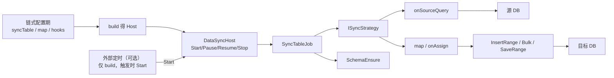
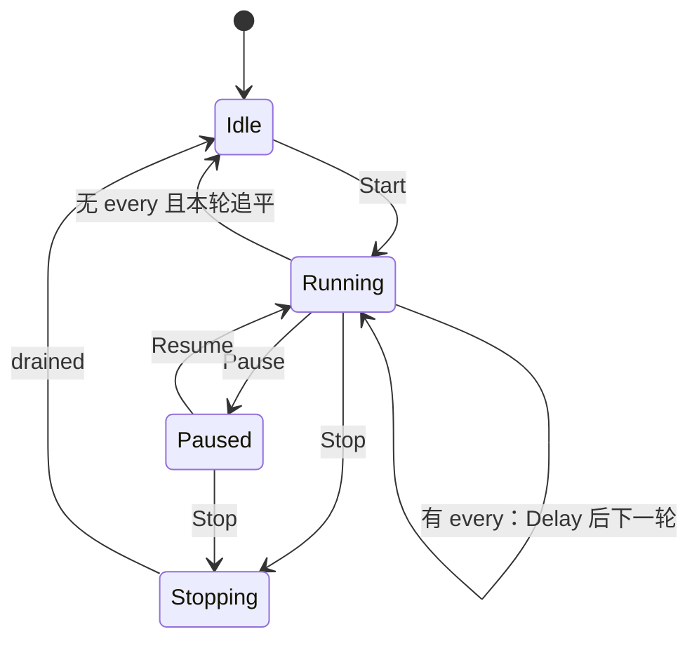
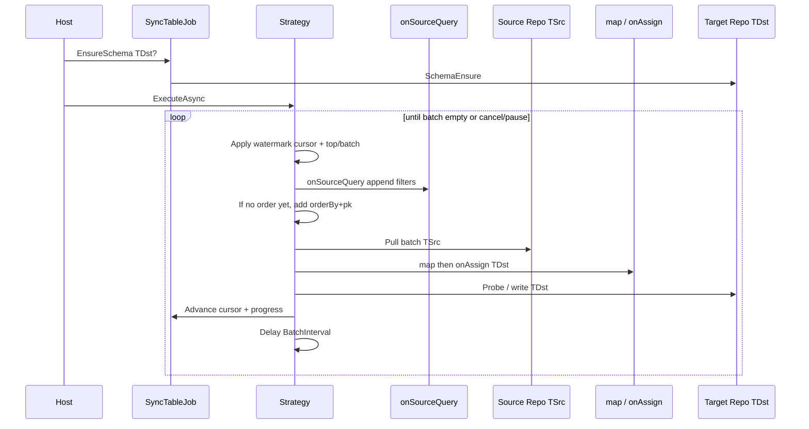

# 数据同步基类（DataSync）设计

> 面向 **使用者**（链式注册表、启停权柄）与 **开发人员**（同步策略、水位、写入内核、Host 生命周期）。  
> **结论先行**：在业务侧 `ContructDataSync`（建设库 1→3 增量 append）之上，于 mooSQL 建立 **通用数据同步基类 / 编排器**，保留「连接位 + 链式 `syncTable`」心智；**配置与执行分离**（`build` 后仅 **`Start`**，**废除 `run`/`RunOnce`**）；`Start` 按 **批大小 + 批次间歇**（或定制 `every`）连续跑；支持同构/异构 map、源读/写入钩子；**不做**双向 Sync/CDC；**零新增 NuGet**。  
> **依赖硬约束（本特性）**：**不得向 mooSQL 工程新增任何 NuGet 包**；凡能力需新依赖者，须在文档中 **显式决策（自研 / 复用存量 / 外置）或直接拒绝**。cron、AutoMapper、ETL 框架、调度框架等一律按此处理。  
> 样板参考：`bidaibuddy/.../Sync/ContructDataSync.cs`、`ContructSyncTool.cs`；结构同步复用 [`SyncMode`](../../../../pure/src/adoext/richRepo/schema/SyncMode.cs) / `SchemaEnsure`；写入复用 [`批量写入性能优化`](../仓储/批量写入性能优化.md) / Bulk。

**状态**：设计稿（未落地） · **建议命名空间**：`mooSQL.data`（门面）/ `mooSQL.data.sync`（实现，一层子空间，符合[命名空间规范](../../命名空间规范.md)）

---

## 1. 概述

| 项 | 说明 |
|----|------|
| **定位** | 库表 → 库表的 **单向** 同步编排；**同构 `T` 为主**，**异构 `TSrc`→`TDst` 经映射 Func** |
| **入口风格** | 对齐 `DBTableCreator.createTable<T>()`：链式注册、过程日志、小写方法名 |
| **连接模型** | 复用 mooSQL **连接位 position**（`DBCash` / `MooClient`），不新造连接字符串体系 |
| **核心抽象** | Builder 配置 → `build()` → `DataSyncHost`；Job + Strategy；可选 map / 钩子 |
| **生命周期** | **仅** `Start` / `Pause` / `Resume` / `Stop`；**无** `run` / `RunOnce` / 注册即跑 |
| **读写自由度** | 源：追加条件钩子；`orderBy` **仅当查询尚未排序时由框架补上**；写：`onAssign` |
| **连续运行** | `Start` 后按 **BatchSize + BatchInterval** 拉批；可选 **`every(TimeSpan)`** 控制轮次间歇 |
| **调度边界** | 富定时外置：可只 `build`，触发时再 `Start`；库内不做 cron |
| **依赖边界** | **零新增 NuGet**；钩子只暴露已有 SQLBuilder / SQLClip / Repo kit |
| **非目标** | 新增包；`run`/`Eager`；cron 内置；列名映射 DSL；双向/CT/HTTP/CDC |

### 1.1 依赖策略（硬约束）

> **规则**：本功能规划与落地 **禁止** 为 mooSQL（`pure` / `ext` 等相关 csproj）**新增 NuGet 引用**。调研中的开源库仅作语义对标，**不**作为实现依赖引入。

| 诉求 | 若引入新包 | **决策** |
|------|------------|----------|
| cron 表达式 | Cronos / NCrontab / Quartz | **拒绝**；富定时外置；内置仅 `TimeSpan` + `Task.Delay` |
| 作业调度宿主 | Hangfire / Quartz.NET | **拒绝**入库；业务侧自选，对已 `build` 的 Host 调 `Start` / `Stop` |
| 对象映射 | AutoMapper / Mapster | **拒绝**；异构用调用方注册的 `Func` / `mapBatch` |
| ETL / Sync 框架 | EtlKit / ETLBox / Dotmim.Sync | **拒绝**引入；只借鉴模式，自研薄编排 |
| 并行管道 | TPL Dataflow 额外包（视 TFM） | **拒绝**新包；用 `SemaphoreSlim` + `Task` / 已有并行 API |
| CDC | MsSqlCdc 等 | **拒绝**本期；后置若做须再开依赖评审 |
| 实现手段 | — | **只允许**：BCL、现有 mooSQL 程序集与其 **已引用** 的包 |

发现「不做某能力就几乎必须加包」时：**砍能力或外置到业务工程**，不在库内开例外。业务工程自行引用 Hangfire 等 **不** 算违反本约束（只要 mooSQL 包图不变）。



---

## 2. 背景与现状

### 2.1 业务样板：`ContructDataSync`

建设库当前实现要点：

| 能力 | 现状 |
|------|------|
| 来源/目标 | 构造时固定 `sourcePosition` / `targetPosition` |
| 链式 API | `Create(...).syncTable<T>(orderByColumn)...`，**注册即同步** |
| 增量语义 | 目标 `max(orderCol)` 作水位；`(time, pk)` 复合游标拉批；目标侧按 PK 探活后 **仅插入缺失行** |
| 批大小 | 默认 2000；`InsertRange` 写入 |
| 建表 | **不负责**（依赖 `ContructDBInitTool.createTable` 预建） |
| 启停/调度 | 无；由外部定时调用 `ContructSyncTool.SyncDB()` |
| 并行/异步 | 无；表间串行、批内同步 |
| 更新/覆盖 | 无；已存在 PK **跳过**（append-only + 判重） |

痛点：能力绑死在业务工程；策略单一；无启停权柄；大数据量未强制 Bulk；无自动建表与覆盖式同步。

### 2.2 mooSQL 已可复用积木

| 积木 | 用途 |
|------|------|
| 连接位 / `useRepo` / `useSQL` | 源读、目标写 |
| `DBTableCreator` / `SchemaEnsure` + `SyncMode` | 目标自动建表 / 补列（与数据同步的 `SyncMode` **不同概念**，见 §4.3 命名） |
| `InsertRange` / Bulk / `BatchWriteOptions` | 高性能插入 |
| `SaveRange`（探活分流） | 按主键存在则更新、否则插入（Upsert 雏形） |
| 主从 `SlaveCmdWorker` 队列模型 | **参考**异步队列与消费者，**不**把本功能混入主从复制 |

> 注意：现有枚举 `mooSQL.data.SyncMode` 表示 **表结构** 同步模式。数据同步策略建议使用 **`DataSyncMode`**（或 `RowSyncMode`），避免同名冲突。

---

## 3. 开源能力调研（对标与取舍）

| 项目 | 定位 | 可借鉴（语义） | 决策（§1.1） |
|------|------|-----------------|--------------|
| **[EtlKit](https://www.etlkit.org/)**（原 ETLBox Classic 开源线） | 代码优先 ETL；`DbMerge`；Checkpoint | **MergeMode**、批写、水位思路 | **拒绝引入包**；自研薄编排 |
| **ETLBox 2.x DbMerge** | 商业续作 | Full / Delta / InsertsOnly 等模式名 | **拒绝**（许可 + 新依赖） |
| **[Dotmim.Sync](https://dotmimsync.readthedocs.io/)** | 多端双向同步 | 批、方向、`SynchronizeAsync` 心智 | **拒绝引入包**；不做双向/CT |
| **[sql-bulk-copy-merge](https://github.com/stevekirks/sql-bulk-copy-merge)** | SQL Server Bulk+MERGE / CopyLatest | 水位追加、临时表+MERGE 思路 | **拒绝引入包**；用自有 Bulk/方言 |
| **MsSqlCdc / CDC 工具** | 引擎级变更捕获 | 「变更源」扩展点构想 | **拒绝本期**；若未来要做须依赖评审 |

**对标结论**：

1. 业务样板 ≈ EtlKit/sql-bulk-copy-merge 的 **InsertsOnly + watermark（CopyLatest）**。  
2. 增强点中的「按修改时间更新或插入」≈ **Delta / Upsert by key + modified column**。  
3. 「覆盖更新（替换式）」≈ **Full / Truncate+Bulk** 或 **staging MERGE**。  
4. 调度外置；库内 **仅 `Start` + BatchInterval / 可选 `every`**；**拒绝 cron 与新 NuGet**（§1.1）。对标只借语义。

---

## 4. 设计目标与能力矩阵

### 4.1 目标

1. **配置来源/目标连接位**（可全局默认，可 per-table 覆盖）。  
2. **链式配置 → `build()` → Host**（**非**注册即跑）。  
3. **唯一启动口 `Start`**（废除 `run` / `RunOnce`）；另有 `Pause` / `Resume` / `Stop`。  
4. **连续运行**：`Start` 后按 **BatchSize + BatchInterval** 拉写；可选 **`every(TimeSpan)`** 作为轮次间歇。  
5. **多线程 / 异步**：表间可并行；批循环可 async；写入走现有批量内核。  
6. **自动建表**（委托 `SchemaEnsure`，按 **目标** 类型）。  
7. **多种行同步策略**（见下表）。  
8. **高性能插入**（Bulk / 多行 VALUES，阈值可配）。  
9. **可观测**：进度日志、计数、水位、取消原因。  
10. **异构映射**：`syncTable<TSrc, TDst>(…, map)` 等。  
11. **源读自由度**：`onSourceQuery` 追加条件；**orderBy 未加才自动补**。  
12. **写入自由度**：`onAssign` 等。

### 4.1.1 配置 / 启动 / 调度（已决）

| 层 | 职责 | 不做 |
|----|------|------|
| **配置期** | `Create` → 链式 `syncTable` / 钩子 / `every` → **`build()`** 得到 Host | 配置期执行任何同步 |
| **DataSyncHost** | **`Start`** 连续运行；`Pause`/`Resume`/`Stop` | **`run` / `RunOnce` / Eager** |
| **连续节奏** | 内置 **BatchSize + BatchInterval**；或配置 **`every(TimeSpan)`** 控制「一轮结束后的间歇」 | cron / 每表独立调度 |
| **外部托管** | 可只 `build`，定时触发时再 `Start`（未 `every` 时追平一轮后 Idle，可再次 Start） | 库内引用调度框架 |
| **mooSQL 包图** | 零新增 | 新增 PackageReference → 违规 |

### 4.2 行同步策略 `DataSyncMode`

| 模式 | 语义 | 典型实现 | 对应开源概念 |
|------|------|----------|--------------|
| `AppendOnly` | 仅插入目标不存在的 PK；可配水位游标 | 现 `ContructDataSync` | InsertsOnly + CopyLatest |
| `AppendWatermark` | 严格按水位拉取，**目标不做 PK 探活**（假设源单调追加且目标干净） | `max(order)+pk` 游标 + InsertRange/Bulk | CopyLatest 极简版 |
| `UpsertByModified` | 按 PK：不存在插入；存在且源修改时间 **≥** 目标则更新 | 批探活 + InsertRange/UpdateRange 或方言 MERGE | Delta / Upsert |
| `ReplaceFull` | 目标与源对齐：清空或 staging 后整表替换（可选删除源已不存在行） | Truncate+Bulk 或 Temp+MERGE | Full / UseTruncateMethod |
| `MirrorKeys`（二期） | 全量键集合对比后删目标多余行 | 需全量或键扫描 | Full merge deletes |

默认建议：`AppendOnly`（兼容建设库行为）。

### 4.3 与结构 `SyncMode` 的关系

| 层 | 类型 | 何时 |
|----|------|------|
| 结构 | `SchemaEnsure` + `SyncMode`（CreateIfMissing / AddMissingColumns…） | 任务开始前可选 `EnsureTargetSchema=true`（**目标**实体） |
| 数据 | `DataSyncMode` | 每批拉取与写入 |

### 4.4 同构与异构

| 形态 | API | 拉取 / 水位 / 源 PK 游标 | 建表 / 探活 / 写入 |
|------|-----|-------------------------|-------------------|
| **同构** | `syncTable<T>(…)` | `T` | `T`（`map = Identity`） |
| **异构** | `syncTable<TSrc, TDst>(…, map)` | **源** `TSrc` | **目标** `TDst`（映射后） |

职责拆分：

- **源侧**：实体/`Repo` 拉批、`orderBy` 与复合游标（时间 + 源 PK）；可选 **`onSourceQuery` 追加条件**。  
- **映射**：`Func<TSrc, TDst>` / `mapBatch`；同构可省略。  
- **写入前**：可选 **`onAssign`** 对目标实体赋字段（在 map 之后、探活/写入之前）。  
- **目标侧**：`EnsureSchema<TDst>`、PK 探活、Insert/Update/Bulk/`SaveRange`。  
- **策略用的 PK / Modified**：以 **map + onAssign 之后** 的目标行为准。

水位默认仍读 **目标表** 聚合列；异构可用 `watermarkOnTarget`。

**不做（本期）**：纯字符串列映射表；**拒绝** AutoMapper/Mapster；源为任意 SQL 无实体（可后置 `fromSql` + map，仍零新包）。

### 4.5 源读钩子与写入赋值钩子

#### 源读：`onSourceQuery`（追加条件）与 orderBy 规则

| 项 | 约定 |
|----|------|
| 时机 | 框架先施加 **水位游标**（及 `top/batch` 限额）；再调用钩子；再处理 **orderBy**（见下） |
| 语义 | 钩子 **追加**业务条件（`where` 等）；亦可在钩子内自行 `orderBy` |
| **orderBy（已决）** | 配置项 `orderBy("列")` 表示**默认排序列**。拉批时：若当前查询 **尚未带排序**，框架按该列（+ PK）**自动补上**；若用户在 `onSourceQuery`（或 `onSourceSql`）里 **已经加过 orderBy**，框架 **不再追加** |
| 暴露工具 | `Action<kit/SQLClip>`（对齐 Repo `GetList`）；可选 `onSourceSql(Action<SQLBuilder>)` |
| 每批调用 | **每一拉取批次**一次（注意线程安全） |
| 示例用途 | 租户/软删/业务类型过滤；自定义排序 |

```csharp
.syncTable<Order>(cfg => cfg
    .orderBy("ModifiedAt")   // 仅当钩子未排序时，框架补 orderBy ModifiedAt, Pk
    .onSourceQuery(kit =>
    {
        kit.where("TenantId", tenantId);
        kit.whereIsOrNull("IsDeleted", false);
        // 若此处 kit.orderBy(...)，框架不再自动加 orderBy
    }))
```

#### 写入：`onAssign`（实体字段赋值）

| 项 | 约定 |
|----|------|
| 时机 | `map`/`mapBatch` 之后（同构则直接对源拷入的目标行），**探活与 Insert/Update/Bulk 之前** |
| 语义 | `Action<TDst>` 或 `Action<TDst, TSrc>`（异构可带上源行上下文）；就地改字段，不替换整行引用（若需换实例用 `map`） |
| 与 `map` 分工 | **`map`**：形状转换 / 异构；**`onAssign`**：同步侧横切赋值（同步时间戳、默认值、环境常量），同构也常用 |
| 批版本 | 可选 `onAssignBatch(IList<TDst>)`（或带源列表），便于批量补字段 |
| 示例用途 | `SyncedAt = UtcNow`、写入目标库专用列、补齐非源字段 |

```csharp
.syncTable<Order>(cfg => cfg
    .orderBy("ModifiedAt")
    .onAssign(dst =>
    {
        dst.SyncedAt = DateTime.UtcNow;
        dst.SourceDb = "pos1";
    }))

// 异构：map 负责投影，onAssign 补环境字段
.syncTable<SrcRow, Order>(cfg => cfg
    .orderBy("src_modified")
    .map(s => new Order { Id = s.Id, Title = s.Name })
    .onAssign((dst, src) => { dst.RawPayload = src.Json; }))
```

**决策（§1.1）**：不引入表达式访问器包或第三方 Query Filter；钩子签名只用 BCL 委托 + mooSQL 已有 Builder/Clip 类型。

---

## 5. API 草图（使用者视角）

```csharp
using mooSQL.data;

// 统一心智：配置 → build → Start（无注册即跑，无 run）
var host = DataSync.Create(sourcePosition: 1, targetPosition: 3)
    .ensureSchema(true)
    .mode(DataSyncMode.AppendOnly)
    .useBulk(true)
    .batchSize(2000)                             // 内置可改：每批条数
    .batchInterval(TimeSpan.FromMilliseconds(0)) // 内置可改：批与批间歇
    .syncTable<Cg_Biaoduaninfo>("OPERATEDATE")
    .syncTable<Cg_Projectinfo>("operatedate")
    .onProgress(p => { /* WorkingProgress / 事件 */ })
    .build();

await host.StartAsync(ct);                       // 唯一启动：连续拉批直至追平后 Idle（未配置 every）
host.Pause();
host.Resume();
await host.StopAsync();

// 外部托管定时：只 build，触发时 Start
// timer => await host.StartAsync(ct);

// 内置轮次间歇：every = 一轮结束后的定制等待，再连续跑下一轮
var loop = DataSync.Create(1, 3)
    .batchSize(2000)
    .batchInterval(TimeSpan.FromMilliseconds(50))
    .every(TimeSpan.FromMinutes(5))              // 轮次间歇（非 cron）
    .syncTable<Order>("ModifiedAt")
    .build();
await loop.StartAsync(ct);                       // 追平 → Delay(5min) → 再追平 → …

// 异构 + 钩子（仍先 build 再 Start）
var hetero = DataSync.Create(1, 3)
    .ensureSchema(true)
    .syncTable<SrcOrderRow, OrderEntity>(cfg => cfg
        .orderBy("src_modified")
        .watermarkOnTarget("ModifiedAt")
        .mode(DataSyncMode.AppendOnly)
        .map(src => new OrderEntity
        {
            Id = src.BizId,
            Title = src.Name,
            ModifiedAt = src.SrcModified
        })
        .onSourceQuery(kit => kit.where("BizType", 1))
        .onAssign((dst, src) => dst.ImportBatchId = batchId))
    .build();
await hetero.StartAsync(ct);
```

设计要点：

- **配置 / 执行分离**：链式阶段只登记；**`build()`** 产出 Host；**只有 `Start`** 开始干活。  
- **废除** `run` / `RunOnce` / `SyncRunMode.Eager`。  
- **`Start` 连续运行**：按 BatchSize 拉写，批间 `BatchInterval`；有 `every` 则一轮结束后再 Delay。  
- **小写配置 API**；进度用 `WorkingProgress` / `onProgress`。  
- **同构 ≡ 异构 + Identity map**；钩子可选。  
- **无 cron**；多表不同节奏 → 多个 Host 或外部多次 `Start`。

---

## 6. 核心类型与职责

```
mooSQL.data
  DataSync                 // 静态工厂 Create(...)
  DataSyncHost             // 生命周期：仅 Start/Pause/Resume/Stop
  DataSyncBuilder          // 链式配置，build() → Host

mooSQL.data.sync
  SyncTableJob             // Source/Target、水位、模式、批、Map、SourceQueryHook、AssignHook
  SyncTableJob<T>          // 同构快捷
  SyncTableJob<TSrc,TDst>  // 异构 + map / mapBatch / onSourceQuery / onAssign
  ISyncStrategy            // pull(+hook) → map → onAssign → probe/write
  AppendOnlyStrategy
  AppendWatermarkStrategy
  UpsertByModifiedStrategy
  ReplaceFullStrategy
  SyncCursor / WatermarkStore
  SyncProgressEvent
  DataSyncOptions
```

### 6.1 `DataSyncHost` 状态机



- **Start（唯一启动）**：进入连续运行——按 **BatchSize** 拉写，批间 **BatchInterval**；所有注册表本轮追平后：若配置了 **`every`**，则 Delay 该时间再开下一轮；若**未**配置 `every`，则回到 **Idle**（外部可再次 `Start`）。  
- **Pause**：不再开新批；进行中批可完成或响应 CT；打断 `BatchInterval` / `every` 的 Delay。  
- **Stop**：取消并排空后 Idle。  
- **表级并行**：`SemaphoreSlim`；同表单飞。  
- **禁止**再提供 `run` / `RunOnce` 别名（避免双入口）。

### 6.2 单表批循环（通用）



游标与排序（**源侧**）：

- 水位：`DateTime`（可扩展）；条件 `(orderCol > @t) OR (orderCol = @t AND pkCol > @pk)` + `onSourceQuery`。  
- **orderBy**：配置给出默认列；**仅当钩子未排序时**框架补 `orderCol ASC, pkCol ASC`。  
- 标识符白名单防注入。  
- 目标水位初值：`max(watermarkColumn)`（异构可用 `watermarkOnTarget`）。  
- 批间：`BatchInterval`（可 0）。

### 6.3 各策略要点

#### AppendOnly（默认）

1. 读目标 `max(watermarkCol)`（及可选续跑游标）。  
2. 源拉批（水位 + **`onSourceQuery`**）→ **map** → **`onAssign`** → 目标按 **TDst PK** 探活 → `InsertRange`/`Bulk` 仅新行。  
3. PG 等类型差异：探活统一 text 比较（建设库经验沉淀为方言钩子）。

#### AppendWatermark

- 不做探活；依赖水位严格前进。适合只追加日志表。重复跑可能主键冲突 → 策略文档标明 **at-least-once 需幂等或唯一约束吞冲突**。  
- 异构时仍先 map 再写入；冲突以目标唯一约束为准。

#### UpsertByModified

- 配置：源 `orderBy`、目标 `modified`（可同名）、目标 PK。  
- 批内：map + **onAssign** 后，存在且最终行 `Modified >=` 目标行（可配 `>`）则更新，否则跳过；不存在则插入。  
- 写入：优先 `SaveRange` / 分拆 Insert+Update；二期方言 `MERGE`/`ON CONFLICT`。

#### ReplaceFull

- **小表**：`TRUNCATE`（或 `DELETE`）+ 全量 pull→map→Bulk。  
- **大表 / 需在线**：源→目标临时表（已是 TDst 形状）Bulk → 方言 MERGE/换表；可选 `deleteMissing=true`。  
- 危险操作需 `AllowDestructiveReplace=true` 闸门。

### 6.3.1 异构映射约定

| 项 | 约定 |
|----|------|
| 必选 | 异构任务必须提供 `map`（或 `mapBatch`）；缺省则配置期失败 |
| 空/过滤 | `map` 返回 `null` 可表示跳过该行（计入 skipped） |
| 异常 | 单行 map 抛错：默认中断本表本轮；可配 `continueOnMapError`（记 ERR，跳过行） |
| 性能 | 热路径优先 `mapBatch`，避免逐行委托开销过大 |
| 同构 | 不强制用户写 map；内部 Identity |

### 6.3.2 钩子实现要点

| 钩子 | 推荐签名（示意） | 约束 |
|------|------------------|------|
| `onSourceQuery` | `Action<TKit>`（同 Repo `GetList` kit） | 追加 where；**可**自写 orderBy → 则框架不补 |
| `onSourceSql` | `Action<SQLBuilder>` | 同上；列集自洽由调用方保证 |
| `onAssign` | `Action<TDst>` / `Action<TDst, TSrc>` | 探活前；最终实体参与判重 |
| `onAssignBatch` | `Action<IList<TDst>>` 等 | 可选 |

拉批默认 **Repo/SQLClip**；`onSourceSql` 为高级路径。**零新依赖**。

### 6.4 高性能写入

| 开关 | 行为 |
|------|------|
| `useBulk(true)` / `BatchWriteOptions` | 超阈值走 Bulk，失败降级多行 VALUES |
| `batchSize` | 每批条数（内置默认） |
| `batchInterval` | 批与批间歇（内置默认可 Zero） |
| 并行表 | 仅表间；注意连接池 |

关联实现以仓储批写文档为准，同步层 **不** 再实现一套 Bulk。

### 6.5 启动与连续运行（已决）

| API | 含义 |
|-----|------|
| `build()` | 结束配置，得到 Host；**不**执行同步 |
| **`Start`** | **唯一**启动；按 BatchSize + BatchInterval **连续**拉写 |
| `every(TimeSpan)` | 可选；**一轮追平后**的定制间歇，再下一轮 |
| 无 `every` | 本轮追平 → **Idle**；外部可再次 `Start` |
| `Pause` / `Resume` / `Stop` | 暂停 / 继续 / 停止 |

**废除**：`run`、`RunOnce`、`RunOnceAsync`、注册即跑、`SyncRunMode`。

**非目标**：cron 包、每表调度、`IScheduler`、EtlKit/AutoMapper 等新包。

多表不同节奏：多个 Host（可各带不同 `every`），或外部分别 `Start`。

---

## 7. 配置模型（逻辑）

```csharp
public sealed class DataSyncOptions
{
    public int SourcePosition { get; set; }
    public int TargetPosition { get; set; }
    public DataSyncMode DefaultMode { get; set; } = DataSyncMode.AppendOnly;
    public bool EnsureTargetSchema { get; set; }
    public SyncMode SchemaMode { get; set; } = SyncMode.CreateIfMissing; // 结构枚举
    public bool UseBulk { get; set; } = true;
    public int MaxDegreeOfParallelism { get; set; } = 1;
    public bool AllowDestructiveReplace { get; set; }
    /// <summary>每批条数（内置默认，如 2000）。</summary>
    public int BatchSize { get; set; } = 2000;
    /// <summary>批与批间歇（内置默认可为 Zero）。</summary>
    public TimeSpan BatchInterval { get; set; } = TimeSpan.Zero;
    /// <summary>可选；一轮追平后的轮次间歇。null = 追平后 Idle，等下次 Start。</summary>
    public TimeSpan? HostInterval { get; set; }
}

public sealed class SyncTableOptions
{
    public Type SourceType { get; set; }
    public Type TargetType { get; set; }            // 同构时与 SourceType 相同
    public string OrderByColumn { get; set; }       // 源侧游标列
    public string WatermarkColumnOnTarget { get; set; } // 空则同 OrderByColumn / 目标同名列
    public string ModifiedColumn { get; set; }      // Upsert：目标侧修改时间列
    public DataSyncMode? Mode { get; set; }
    public int? BatchSize { get; set; }
    public int? SourcePosition { get; set; }        // 覆盖全局
    public int? TargetPosition { get; set; }
    public Delegate Map { get; set; }               // Func<TSrc,TDst>；同构可空
    public Delegate MapBatch { get; set; }          // 可选批映射
    public Delegate OnSourceQuery { get; set; }     // Action<kit/SQLClip> 追加条件
    public Delegate OnSourceSql { get; set; }       // 可选 Action<SQLBuilder>
    public Delegate OnAssign { get; set; }          // Action<TDst> 或 Action<TDst,TSrc>
    public Delegate OnAssignBatch { get; set; }     // 可选批赋值
    // 无 Cron / Interval / SharedSchedule —— 调度不进表选项
}
```

水位存储默认：**隐式**（目标表聚合）；可选二期 `IWatermarkStore`（独立表记录 `table, cursorTime, cursorPk, updatedAt`），便于 Replace 后仍记住进度或跨物理表名。

---

## 8. 与建设库迁移路径

1. mooSQL 落地后，建设库改为 **配置 → build → Start**（不再「链式注册即跑」）：

```csharp
var host = DataSync.Create(1, 3)
    .batchSize(2000)
    .mode(DataSyncMode.AppendOnly)
    .syncTable<Cg_Biaoduaninfo>("OPERATEDATE")
    // ...
    .build();
await host.StartAsync(ct);   // 追平后 Idle；或挂 every 常驻
```

2. 行为兼容清单：复合游标、PK 探活跳过、首轮空目标优化、进度字段（pulled/inserted/skipped/watermark）。  
3. 建表仍可由 `DBInit` 负责，或 `ensureSchema(true)`。

---

## 9. 实施分期

| 阶段 | 内容 | 产出 |
|------|------|------|
| **P0** | Builder→`build`→Host；同构 `AppendOnly`；**仅 `Start`**；BatchSize/BatchInterval；批循环；进度；标识符安全 | 可替换建设库同步入口 |
| **P1** | `EnsureSchema`、`useBulk`、`AppendWatermark`、`UpsertByModified` | 同构策略完备 |
| **P1b** | `syncTable<TSrc,TDst>` + `map` / `mapBatch`、`watermarkOnTarget` | 异构 |
| **P1c** | `onSourceQuery` / `onSourceSql`；**orderBy 未加才补**；`onAssign` / `onAssignBatch` | 读写钩子 |
| **P2** | `Pause`/`Resume`；可选 `every` 轮次间歇；表间并行；进度事件 | 常驻；**无 run/cron** |
| **P3** | `ReplaceFull`、方言 MERGE/临时表、独立 `IWatermarkStore` | 覆盖式与大表 |
| **P4**（可选） | 显式 `key`、删除镜像、`fromSql` | 零新 NuGet；CDC 须依赖评审 |

---

## 10. 风险与约束

| 风险 | 缓解 |
|------|------|
| 水位回拨 / 时钟乱序 | 复合 `(time, pk)`；文档要求单调操作时间 |
| 并行同表双跑 | 单表互斥；分布式多实例需外部分布式锁（非一期） |
| Replace 误清数据 | `AllowDestructiveReplace` + 预览计数 |
| 跨方言 Bulk/MERGE 差异 | 写入只走现有方言能力；MERGE 按方言能力检测降级 |
| **偷偷加 PackageReference** | **硬约束 §1.1**：CR/实现检查 csproj；能力不足则砍范围或外置，不开例外 |
| 误加 cron / 映射 / ETL 包 | 文档与 API 均无对应入口；§1.1 决策表已 **拒绝** |
| 异构 map 与水位列不一致 | 文档要求目标水位列可写/可聚合；提供 `watermarkOnTarget` |
| map 后 PK 为空 | 计入 skipped；配置期可选校验样例行 |
| 用户自写 order 与水位列不一致 | 文档要求自定义 order 仍须保证游标单调；测试覆盖 |
| onAssign 改 PK | 探活前赋值；测试覆盖 |
| 误留 run/Eager API | 实现与公开面只保留 Start；CR 检查 |
| 与主从复制混淆 | DataSync=业务拉齐；Slave=同语句异步复制 |

---

## 11. 测试要点

1. 空目标首轮：全量插入，探活可跳过。  
2. 增量：仅新水位行；同秒多 PK 不丢不重。  
3. AppendOnly：目标已有 PK 记 skipped。  
4. Upsert：改时间前进才更新。  
5. `build` 后未 `Start` 无写入；`Start` 连续批处理；无 `every` 追平后 Idle 可再 Start；有 `every` 则轮次 Delay；`Pause`/`Stop` 生效。  
6. 并行多表：结果与串行一致（各自水位）。  
7. EnsureSchema：目标无表时 CreateIfMissing 后同步成功。  
8. ReplaceFull：闸门关闭时拒绝；开启后行集与源一致（抽样）。  
9. 异构：`TSrc≠TDst` + `map` 后目标列/PK 正确；`map` 返回 null 计 skipped；缺 `map` 配置失败。  
10. `onSourceQuery` 追加条件后结果集正确缩小，且水位游标仍生效。  
11. `onAssign` 写入目标列有预期值；与 `map` 同时注册时赋值发生在 map 之后。

---

## 12. 成功判据

1. 建设库同步可改为 ≤ 现有行数的链式调用且计数语义一致。  
2. 单表千万级追加场景，Bulk 开启后写入往返 ≪ 行数。  
3. 公开面 **无 run/RunOnce/Eager**；外部只 `build` + 触发时 `Start` 即可。  
4. 结构与数据模式枚举命名不冲突，公开 API 落在 `mooSQL.data`。  
5. 异构仅靠 `Func` 映射即可。  
6. csproj：**无新增 PackageReference**。  
7. `onSourceQuery` / `onAssign` 可用；**用户已 orderBy 则框架不重复加**。  
8. `Start` + BatchSize/BatchInterval（及可选 `every`）可连续运行。

---

## 13. 参考

- 样板：`bidaibuddy/api10/bidai/sln_contruct/Page/src/Sync/ContructDataSync.cs`  
- mooSQL：`SyncMode` / `SchemaEnsure`、`DBTableCreator`、批量写入 / BulkCopy 文档  
- 开源：EtlKit / ETLBox DbMerge、Dotmim.Sync、sql-bulk-copy-merge  

---

## 修订记录

| 日期 | 说明 |
|------|------|
| 2026-10-29 | 初稿：基于建设库同步样板 + 开源对标，定义 DataSync 基类能力与分期 |
| 2026-10-29 | 调度修订：**废弃 cron**；富定时外置；内置仅启停权柄 + 可选 Host 级 `TimeSpan` |
| 2026-10-29 | 异构：`syncTable<TSrc,TDst>` + 映射 `Func`/`mapBatch`；分期 **P1b**；不做列名 DSL |
| 2026-10-29 | **依赖硬约束**：本特性不得新增 NuGet；涉及项一律决策表自研/外置/**拒绝**（§1.1） |
| 2026-10-29 | 读写自由度：`onSourceQuery`/`onSourceSql` 追加条件；`onAssign`/`onAssignBatch` 写入前赋值；分期 **P1c** |
| 2026-10-29 | 已决：orderBy **未加才补**；配置→`build`→**仅 Start**（废 run）；BatchSize+BatchInterval / `every` 连续跑 |
