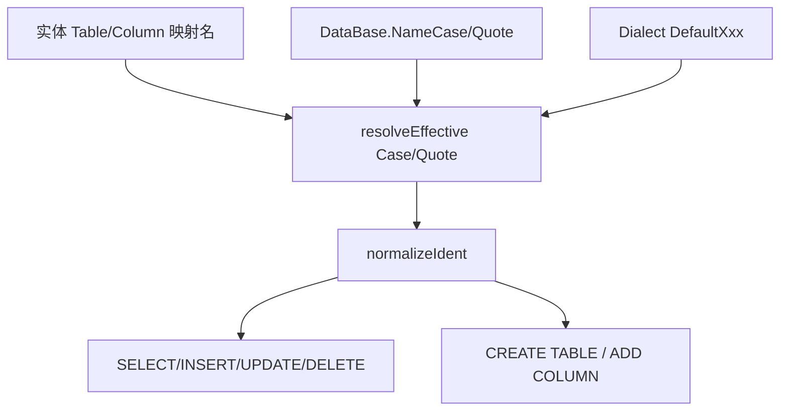

# 标识符大小写与包裹

> 面向 **使用者**（连接级如何配置表/列名大小写与引号）与 **开发人员**（统一规范化入口、方言默认、与 `StrictCase` 迁移）。  
> **结论先行**：在 `DataBase` 上用两个正交枚举（大小写策略 × 包裹策略）替代 `StrictCase`；枚举 `0 = None` 表示**未配置**，回退方言默认；显式“不转换”用 `Keep`。实体 SELECT/DML 与实体 DDL **共用**同一规范化管道。

---

## 1. 背景

### 1.1 各库对未加引号标识符的默认折叠

| 库族 | 未加引号时 | 加引号后 | 常见引号 |
|------|------------|----------|----------|
| SQL Server | 多数排序规则下大小写不敏感；`[]` 不改变匹配语义 | 按字面保留 | `[ident]` |
| PostgreSQL / CrateDB / openGauss / GaussDB / 金仓(PG 兼容) | **折成小写** | **严格区分大小写** | `"ident"` |
| Oracle / 达梦(偏 Oracle) | **折成大写** | 严格区分大小写 | `"ident"` |
| MySQL Family（含 MariaDB / TiDB 等） | 受 `lower_case_table_names` 等影响 | 按字面（反引号内） | `` `ident` `` |

C# 实体特性里表名/列名常写成 PascalCase（如 `UserInfo`），与库内实际物理名（PG 全小写、Oracle 全大写）并不总是一致。

### 1.2 现状问题

1. **实体→SELECT/DML** 经 `SQLExpression.wrapField` / `wrapTable` / `wrapKeyword`，多数方言对匹配“纯标识符”的名字 **一律加引号**。  
   - PostgreSQL 下属性 `UserInfo` → SQL `"UserInfo"`，而库中多为 `userinfo` → **找不到关系**。  
   - SQL Server 下 `[UserInfo]` 一般仍可用；加 `[]` 还有规避关键字的收益。
2. **`DataBase.StrictCase`** 仅作用于 **实体→DDL**（`DBTableCreator.LandIdent`）：`true` = 加方言引号保留大小写；`false`/未设 = 原样。  
   - **管不到 SELECT/DML**，无法解决上述 PG 查询报错。  
   - 把“是否保留大小写”与“是否加引号”绑成一个 bool，无法表达「转小写且不加引号」「保留大小写但仅关键字加引号」等组合。

### 1.3 目标

- 连接级可配置：**大小写**（不转 / 转大 / 转小）与 **包裹**（全加 / 仅关键字 / 全不加 / 按需）正交。  
- `None`（默认 0）= 空白未配 → **走方言默认**；业务要“明确不转”时用 `Keep`。  
- 去掉 `StrictCase`，DDL 与 DML 同一套规则。  
- 引号**字符**仍由方言决定；配置只决定**何时**包、**如何**改大小写。

---

## 2. 设计意图

```text
实体特性名 / 映射名
        │
        ▼
┌───────────────────────┐
│  resolveEffectiveMode │  DataBase 枚举 == None ?
│  (连接覆盖 ⊕ 方言默认) │  → 是：方言 DefaultXxx
└───────────┬───────────┘  → 否：用连接显式值
            │
            ▼
┌───────────────────────┐
│  normalizeIdent       │  ① 已带方言引号？→ 原样返回（不二次处理）
│  （统一入口）          │  ② 非纯标识符（表达式/函数）？→ 原样返回
│                       │  ③ 按段拆分 schema.table / a.col
│                       │  ④ 每段：Case → Quote
└───────────┬───────────┘
            │
            ▼
     落入 wrapTable / wrapField / DDL LandIdent / …
```

**处理顺序固定**：先大小写，再决定是否包裹。

---

## 3. 业务端外观特性

### 3.1 配置挂点

挂在 [`DataBase`](../../../../pure/src/ado/data/database/DataBase.cs)（连接配置，用户可直接实例化）：

| 属性 | 类型 | 默认 | 含义 |
|------|------|------|------|
| `NameCase` | `NameCaseMode` | `None` (0) | 未配置 → 方言默认大小写策略 |
| `NameQuote` | `NameQuoteMode` | `None` (0) | 未配置 → 方言默认包裹策略 |

可选链式 API（与现有 `setReadable` 等风格一致）：

```csharp
db.setNameCase(NameCaseMode.ToLower)
  .setNameQuote(NameQuoteMode.Never);
```

**移除**：`DataBase.StrictCase`、`DBTableCreator.StrictCase` / `strictCase()` / `ResolveStrictCase()`（见 §7 迁移）。

### 3.2 枚举定义（建议）

```csharp
/// <summary>标识符大小写策略。None = 未配置，回退方言默认。</summary>
public enum NameCaseMode
{
    /// <summary>空白：未在连接上指定，使用方言 DefaultNameCase。</summary>
    None = 0,
    /// <summary>显式保持特性/映射中的大小写，不做 ToUpper/ToLower。</summary>
    Keep = 1,
    /// <summary>转为大写（常见于 Oracle 未加引号约定）。</summary>
    ToUpper = 2,
    /// <summary>转为小写（常见于 PostgreSQL 未加引号约定）。</summary>
    ToLower = 3,
}

/// <summary>标识符包裹策略。None = 未配置，回退方言默认。引号字符由方言提供。</summary>
public enum NameQuoteMode
{
    /// <summary>空白：未在连接上指定，使用方言 DefaultNameQuote。</summary>
    None = 0,
    /// <summary>凡纯标识符一律加方言引号。</summary>
    Always = 1,
    /// <summary>仅当命中方言保留字时加引号。</summary>
    KeywordsOnly = 2,
    /// <summary>一律不加引号（依赖库的默认折叠规则）。</summary>
    Never = 3,
    /// <summary>
    /// 按需：保留字、含非法字符、或（在 Case 之后）仍需字面匹配时才加引号。
    /// 典型：关键字；或 Keep 下含大写且目标库未加引号会折叠导致失配时。
    /// </summary>
    IfNeeded = 4,
}
```

> **不要把 `None` 理解成 Keep。**  
> - `None`：配置槽为空，**委托方言**。  
> - `Keep`：业务明确要求「按特性原文大小写，不要帮我转」。

### 3.3 各数据库默认行为（连接 `NameCase`/`NameQuote` 均为 `None` 时）

由方言 `SQLExpression.DefaultNameCase` / `DefaultNameQuote` 决定。下表为**当前实现**（与代码一致）。

#### 按库种一览

| `DataBaseType` | 方言 Express | `DefaultNameCase` | `DefaultNameQuote` | 引号字形 | 折叠未加引号名 | 说明 |
|----------------|--------------|-------------------|--------------------|----------|----------------|------|
| **MSSQL** | `MSSQLExpress` | `Keep` | `Always` | `[ident]` | 否 | 基类默认；全包 `[]` |
| **PostgreSQL** | `NpgsqlExpress` | `ToLower` | `IfNeeded` | `"ident"` | 是→小写 | 普通名小写不加引号；保留字才包 |
| **CrateDB** | `CrateDBExpress` ← Npgsql | `ToLower` | `IfNeeded` | `"ident"` | 是→小写 | 继承 PG |
| **OpenGauss** | `OpenGaussExpress` ← Npgsql | `ToLower` | `IfNeeded` | `"ident"` | 是→小写 | 继承 PG |
| **GaussDB** | 同 OpenGauss 路径 | `ToLower` | `IfNeeded` | `"ident"` | 是→小写 | 与 openGauss 共用方言 |
| **KingBaseR3 / KingBaseR6** | `KingBaseExpress` ← Npgsql | `ToLower` | `IfNeeded` | `"ident"` | 是→小写 | PG 兼容倾向；Oracle 模式请连接上显式改 |
| **Oracle** | `OracleExpress` | `ToUpper` | `IfNeeded` | `"ident"` | 是→大写 | 如 `RowId`→`"ROWID"` |
| **DM**（达梦） | `DMExpress` | `ToUpper` | `IfNeeded` | `"ident"` | 是→大写 | 偏 Oracle |
| **Oscar**（南大通用） | `OscarExpress` | `ToUpper` | `IfNeeded` | `"ident"` | 是→大写 | 偏 Oracle |
| **MySQL** | `MySQLExpress` | `Keep` | `Always` | `` `ident` `` | 否* | 基类默认；全包反引号 |
| **MariaDB** | ← MySQL | `Keep` | `Always` | `` `ident` `` | 否* | 继承 MySQL |
| **TiDB** | ← MySQL | `Keep` | `Always` | `` `ident` `` | 否* | 继承 MySQL |
| **OceanBase** | `OBMySQLExpress` ← MySQL | `Keep` | `Always` | `` `ident` `` | 否* | MySQL 模式 |
| **OceanBaseOracle** | （若走 Oracle 方言） | 见 Oracle | 见 Oracle | `"ident"` | 是→大写 | 以实际挂载的 Express 为准 |
| **GBase8a** | `GBase8aExpress` ← MySQL | `Keep` | `Always` | `"ident"`† | 否 | Case/Quote 同 MySQL；†wrap 用双引号 |
| **SQLite** | `SQLiteExpress` | `Keep` | `Always` | `[ident]` | 否 | 基类默认 |
| **DuckDB** | `DuckDBExpress` | `Keep` | `Always` | `"ident"` | 否 | 基类默认 |
| **ClickHouse** | `ClickHouseExpress` | `Keep` | `Always` | `` `ident` `` | 否 | 基类默认 |
| **SonnetDB** | `SonnetDBExpress` | `Keep` | `Always` | `"ident"` | 否 | 基类默认 |
| **Taos** | `TaosExpress` | `Keep` | `Always` | `` `ident` `` | 否 | 基类默认 |
| **Access / Jet** | `JetSQLExpress` | `Keep` | `Always` | 方言 wrap | 否 | 基类默认 |
| **DB2 / 其它未覆盖** | 基类或 legacy | `Keep` | `Always` | 视 wrap | 否 | `SQLExpression` 基类默认 |

\* MySQL 族大小写还受服务器 `lower_case_table_names` 等影响；框架侧默认仍是 `Keep`+`Always`。

#### 按策略归类（便于记忆）

| 策略组合 | 适用库 |
|----------|--------|
| **`ToLower` + `IfNeeded`** | PostgreSQL、CrateDB、OpenGauss、GaussDB、KingBaseR3/R6 |
| **`ToUpper` + `IfNeeded`** | Oracle、DM、Oscar |
| **`Keep` + `Always`** | MSSQL、MySQL、MariaDB、TiDB、OceanBase(MySQL)、GBase8a、SQLite、DuckDB、ClickHouse、SonnetDB、Taos、Access 等 |

连接上显式设置 `NameCase`/`NameQuote`（非 `None`）时，**覆盖**上表方言默认。跨库同一套实体时，也可统一特性名与物理库一致后设 `Keep` + `Never`。

### 3.4 使用者可见效果（示例）

实体：`[SooTable("UserInfo")]`，列 `UserName`。

| 连接配置 | PG 生成片段（示意） | 说明 |
|----------|---------------------|------|
| 皆 `None`（PG 默认 `ToLower` + `IfNeeded`） | `userinfo` / `username` | 非保留字不加引号 |
| `Keep` + `Always` | `"UserInfo"` / `"UserName"` | 严格字面；库须同名同大小写 |
| `ToLower` + `Never` | `userinfo` / `username` | 强制不加引号 |
| Oracle 默认 `ToUpper` + `IfNeeded` | `USERINFO` / `USERNAME` | 非保留字不加引号；`RowId`→`"ROWID"` |

SQL Server 默认 `Keep` + `Always` → `[UserInfo]`，通常无感。

---

## 4. 内部触发逻辑

### 4.1 生效模式解析

```text
effectiveCase  = (config.NameCase  != None) ? config.NameCase  : dialect.DefaultNameCase
effectiveQuote = (config.NameQuote != None) ? config.NameQuote : dialect.DefaultNameQuote
```

解析时机：每次规范化标识符时读取当前 `DBInstance.config` + 当前方言（支持同进程多连接不同策略）。

### 4.2 `normalizeIdent` 算法

输入：裸名或已引用名；上下文：`IdentKind`（Table / Column / 可选 Alias）。

```text
1. null/空白 → 原样
2. 已是方言引号包裹（[], "", ``）→ 原样返回（不二次 Case、不二次 Quote）
3. 非整段纯标识符（含空格、括号、运算符等，沿用现 wrapField 正则思路）→ 原样返回
4. 若含 '.' → 按段拆分，每段递归 normalize，再 '.' 拼接
5. 单段：
   a. Case:
      Keep     → 不变
      ToUpper  → ToUpperInvariant
      ToLower  → ToLowerInvariant
   b. Quote:
      Always        → dialect.Quote(ident)
      Never         → ident
      KeywordsOnly  → IsReserved(ident) ? Quote(ident) : ident
      IfNeeded      → IsReserved || NeedsQuote(ident, dialect) ? Quote : ident
6. Alias 上下文：默认不做 Case（或仅 Quote=Always/Keywords/IfNeeded 时按规则包别名）；
   不把表名策略强加到 AS 别名（避免无意义改写）
```

`NeedsQuote`（IfNeeded）建议至少包括：

- 命中保留字；  
- 含非 `[A-Za-z0-9_]` 字符；  
- 以数字开头；  
- （可选，按方言）Case=`Keep` 且标识符含大写、而该方言未加引号会折叠 → 需要引号才能字面匹配。

### 4.3 调用位点（须共用）

| 路径 | 现状 | 改造后 |
|------|------|--------|
| `wrapField` / `wrapTable` / `wrapKeyword` | 多数方言一律加引号 | 内部先 `normalizeIdent`，再按 Quote 模式决定是否调用原 Quote 实现 |
| `EntityTranslator` 实体 SELECT/FROM | 调 `wrapField`/`wrapTable` | 自动吃到新策略 |
| `ClipProvider` / SQLClip 投影 | 同上 | 同上 |
| Repository / SooRichRepo 拼列名 | 部分直接拼 `DbColumnName` | 凡落入 SQL 的物理名应经 `wrapField`/`normalizeIdent`，避免绕过 |
| `DBTableCreator.LandIdent` | 仅看 `StrictCase` | 改为 `normalizeIdent`；删除 StrictCase |
| `DDLBuilder` | 标识符原样拼接（由落点决定） | 保持：实体落点已规范化后再传入 |

**禁止**在业务层手写第二套 ToLower/加引号；一律经方言表达式入口。

### 4.4 数据流（示意）



### 4.5 与结果集映射

生成 SQL 侧做 ToLower/ToUpper 后，读库列名映射实体属性应继续 **忽略大小写**（现有 OrdinalIgnoreCase 等路径保持），避免 DataTable 列名与属性对不上。

---

## 5. 设计要点

1. **`None` ≠ `Keep`**：`None` 委托方言；`Keep` 是显式业务选择。  
2. **正交两维**：Case × Quote；引号字形仍属方言。  
3. **DDL = DML 同一管道**：避免建表一套、查询另一套。  
4. **限定名按段处理**：`dbo.UserInfo`、`u.UserName` 分段 Case/Quote。  
5. **已引用输入短路**：已带 `[]`/`"`/`` ` `` 的视为字面量意图。  
6. **表达式不碰**：`COUNT(*)`、`FieldKind.Free`、函数调用等非纯标识符跳过（延续 `wrapField` 正则门闩）。  
7. **别名与物理名分离**：物理表/列走完整策略；别名谨慎处理。  
8. **KeywordsOnly / IfNeeded 依赖保留字表**：按方言维护；漏词会导致 KeywordsOnly 下踩关键字——文档与实现需承认该成本，MVP 可先实现 `Always`/`Never`/`Keep`/`ToUpper`/`ToLower`，`KeywordsOnly`/`IfNeeded` 分期。  
9. **方言默认可覆盖**：金仓/Gauss 等双模式库，以连接显式配置为准。  
10. **替换 StrictCase**：见 §7；旧 `true` ≈ 连接设 `Keep` + `Always`。  
11. **术语**：标识符用**双引号**（PG/Oracle）或 `[]` / 反引号；**单引号**是字符串字面量，配置与日志勿混用。  
12. **SQL Server 大小写敏感排序规则**：`Keep` + `Always` 仍是稳妥默认；敏感库须保证特性名与库内一致。

---

## 6. 使用 Demo

### 6.1 依赖方言默认（推荐起步）

```csharp
var db = new DataBase()
    .setName("pg")
    .setDBType(DataBaseType.PostgreSQL)
    .setConnection(connStr);
// NameCase / NameQuote 保持 None → PG 方言默认（如 ToLower + IfNeeded）
```

### 6.2 PostgreSQL：特性 PascalCase，库内全小写

```csharp
db.NameCase = NameCaseMode.ToLower;
db.NameQuote = NameQuoteMode.Never;
// 或
db.setNameCase(NameCaseMode.ToLower)
  .setNameQuote(NameQuoteMode.Never);

// 实体 [SooTable("UserInfo")] → SQL: ... FROM userinfo ...
```

### 6.3 PostgreSQL：库内确有大小写表（建表时也加了引号）

```csharp
db.NameCase = NameCaseMode.Keep;
db.NameQuote = NameQuoteMode.Always;
// → FROM "UserInfo"  —— 要求库中对象名大小写与特性一致
```

### 6.4 Oracle：对齐未加引号大写

```csharp
var oracle = new DataBase()
    .setDBType(DataBaseType.Oracle)
    .setConnection(oracleConn);
// None → 方言默认 ToUpper + IfNeeded/Never

// 显式：
oracle.NameCase = NameCaseMode.ToUpper;
oracle.NameQuote = NameQuoteMode.Never;
```

### 6.5 SQL Server：保持现有安全感

```csharp
var mssql = new DataBase()
    .setDBType(DataBaseType.MSSQL)
    .setConnection(mssqlConn);
// None → Keep + Always → [UserInfo]
```

### 6.6 同一实体多库

```csharp
// 映射名统一 PascalCase；各连接用不同 Case/Quote，无需改实体
pg.NameCase = NameCaseMode.ToLower;
pg.NameQuote = NameQuoteMode.Never;

ora.NameCase = NameCaseMode.ToUpper;
ora.NameQuote = NameQuoteMode.Never;

mssql.NameCase = NameCaseMode.Keep;
mssql.NameQuote = NameQuoteMode.Always;
```

### 6.7 实体 DDL 与查询一致

```csharp
// 连接已设 ToLower + Never 后：
db.useTableCreator().autoMode().createTable<User>();
// CREATE TABLE userinfo ( ... username ... )

var list = db.useRepository<User>().GetList(...);
// SELECT ... FROM userinfo  —— 与建表同一规范化结果
```

### 6.8 手写 SQLBuilder（纯标识符才会规范化）

```csharp
kit.from("UserInfo").select("UserName").where("Id", 1);
// 若 from/select 内部走 wrapTable/wrapField：按连接策略规范化
kit.select("COUNT(*) as cnt"); // 非纯标识符 → 不改写
```

---

## 7. 与 `StrictCase` 的迁移

| 旧 | 新 |
|----|----|
| `StrictCase == null/false`（DDL 不加引号） | 连接 `None` 用方言默认；或显式 `Never` / `IfNeeded` |
| `StrictCase == true`（DDL 加引号保留大小写） | `NameCase = Keep`，`NameQuote = Always` |
| SELECT 一律加引号（旧行为，PG 易踩坑） | 由方言默认或连接 Quote 模式约束；PG 默认不再 Always |

删除项：`DataBase.StrictCase`、`DBTableCreator` 上 StrictCase 相关 API；文档与示例改为上述枚举。

---

## 8. 实现分期（建议）

| 阶段 | 内容 |
|------|------|
| P0 | 枚举 + `DataBase` 属性；`normalizeIdent`；`wrapField`/`wrapTable` 接入；方言 Default；删 `StrictCase`；PG/MSSQL/Oracle 默认表 |
| P1 | DDL `LandIdent` 切齐；Repository 绕过路径清查；限定名分段；已引用短路单测 |
| P2 ✅ | 保留字表 + `KeywordsOnly` / `IfNeeded`；折叠类默认 `IfNeeded`；MERGE 路径 wrap |

---

## 9. 相关代码锚点（现状）

| 符号 | 路径 |
|------|------|
| `DataBase.NameCase` / `NameQuote` | `pure/src/ado/data/database/DataBase.cs` |
| `NameCaseMode` / `NameQuoteMode` | `pure/src/ado/builder/rend/SQLPart/BuilderEnums.cs` |
| `normalizeName` / `wrapField` / `wrapTable` | `pure/src/ado/data/dialect/SQLExpression.common.cs` |
| PG / MSSQL / Oracle 默认与包裹 | `ext/src/provides/dialect/Npgsql|MSSQL|Oracle/*Express.cs` |
| 实体 SELECT | `pure/src/adoext/clip/provider/EntityTranslator.cs`（经 `wrapField`/`wrapTable`） |
| DDL 落点 | `pure/src/adoext/ddl/DBTableCreator.cs`（`LandIdent` → `normalizeName`） |

> **实现状态**：  
> - **P0**：枚举与连接配置、`normalizeName`、方言默认、删除 `StrictCase`。  
> - **P2**：`SqlReservedWords` + 各方言 `GetReservedWords`；折叠类方言默认改为 `IfNeeded`；`KeywordsOnly`/`IfNeeded` 可用；SooRichRepo MERGE 路径经 `wrapField`/`wrapTable`。

---

## 10. 小结

- 用 **`NameCaseMode` × `NameQuoteMode`** 表达跨库标识符差异；**`None=0` 空白回退方言，`Keep` 显式不转大小写**。  
- 统一入口保证 **实体查询与建表行为一致**，并从根上避免 PostgreSQL 下 `"PascalCase"` 与库内小写对象失配。  
- 业务侧只配连接；引号字形与保留字仍属方言职责。
