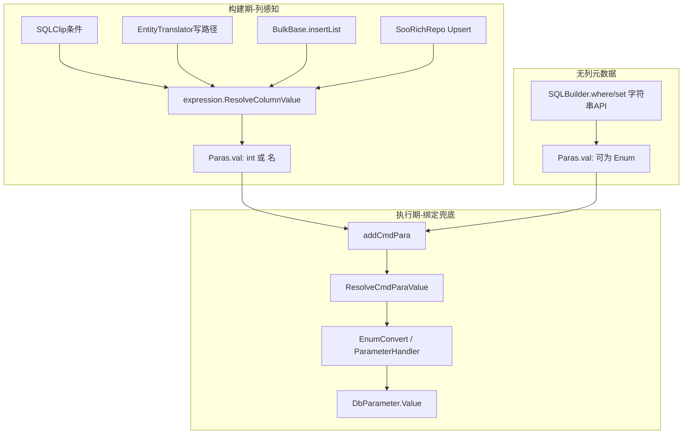

# 枚举列映射与参数转换

> 面向 **使用者**（实体列如何存枚举、全局绑定策略）与 **开发人员**（两层转换管道、方言入口、调用位点）。  
> **结论先行**：列感知转换统一经 `Dialect.expression.ResolveColumnValue`；ADO 绑定另有全局兜底 `SQLBuilderOption.EnumConvert`。裸字符串 SQLBuilder API（无 `EntityColumn`）不自动转换。

---

## 1. 概述

CLR 枚举进入数据库参数时，mooSQL 分 **两层** 处置：

| 层 | 时机 | 入口 | 驱动因素 | 默认行为 |
|----|------|------|----------|----------|
| **列感知（构建期）** | SQLClip 条件 / 实体 insert·update·delete 准备 | `SQLExpression.ResolveColumnValue` | `EntityColumn.DataType` / `DbType` | 无自定义类型 → 底层数值；显式字符类 → 枚举名 |
| **绑定兜底（执行期）** | `Paras` → `DbParameter` | `Dialect.ResolveCmdParaValue` | `SQLBuilderOption.EnumConvert` | `None`（不改 `Parameter.val`） |

列感知路径通常已把 `Paras` 写成 `int` / `"Btn"`，绑定层对非 `Enum` 值直接放行。



---

## 2. 概念与类型

| 术语 / 类型 | 位置 | 含义 |
|-------------|------|------|
| `ResolveColumnValue` | [`SQLExpression.mapping.cs`](../../../../pure/src/ado/data/dialect/SQLExpression.mapping.cs) | 方言成员：按列把枚举变成可绑定标量；可 override |
| `EnumColumnMapping` | [`EnumColumnMapping.cs`](../../../../pure/src/ado/mapping/EnumColumnMapping.cs) | 静态算法零件：DDL 推断、`HasCustomDataType`、`ToUnderlyingNumeric` 等 |
| `EnumParaConvert` | [`BuilderEnums.cs`](../../../../pure/src/ado/builder/rend/SQLPart/BuilderEnums.cs) | 绑定策略：`None` / `ToInt` / `ToName` / `ToIntString` |
| `SQLBuilderOption.EnumConvert` | [`SQLBuilderOption.cs`](../../../../pure/src/aop/SQLBuilderOption.cs) | 客户端级绑定策略，默认 `None` |
| `ResolveCmdParaValue` | [`Dialect.cs`](../../../../pure/src/ado/data/dialect/Dialect.cs) | 各方言 `AddCmdPara` 取 Value 时调用；**不修改** `Parameter.val` |

对齐意图：无自定义列类型时，枚举按底层整型落库（近似 EF Core 默认）；显式 `DataFam.VarChar` 等字符类则按名称字符串。

---

## 3. 列感知转换（`ResolveColumnValue`）

### 3.1 算法（默认实现）

```text
value == null          → null
value is not Enum      → 原样
HasCustomDataType(col) && IsCharacterDataType(fam)
                       → value.ToString()   // 枚举名，如 "Btn"
否则                   → ToUnderlyingNumeric(value)  // 如 int 2
```

- `fam` = `GetEffectiveDataType(col)`：优先 `col.DataType`，否则 `col.DbType.DataType`。
- `col == null` 或未自定义类型：走底层数值（与「默认 int 列」一致）。
- 字符类：`Char` / `VarChar` / `NChar` / `NVarChar` / `Text` / `NText` / `LongText`。

### 3.2 访问方式

| 场景 | 取 expression |
|------|----------------|
| SQLBuilder / EntityTranslator | `builder.Dialect.expression` |
| SQLClip | `Context.Builder.Dialect.expression` / Visitor 内 `Builder.Dialect.expression` |
| BulkBase | `DBLive.dialect.expression` |
| SooRichRepo | `_db.dialect.expression` |
| 单测 | `db.dialect.expression` / `kit.Dialect.expression` |

**禁止**再提供静态 `EnumColumnMapping.ResolveClipValue`（已删除）；业务与库内一律经方言成员。

### 3.3 方言 override

各方言可 override `ResolveColumnValue`（例如强制枚举一律存名）。override 后 **SQLClip 条件与实体写路径同时生效**。

---

## 4. 绑定兜底（`EnumConvert`）

### 4.1 模式

| `EnumParaConvert` | 效果 |
|-------------------|------|
| `None`（默认） | 原样写入 ADO |
| `ToInt` | 底层数值 |
| `ToName` | `enum.ToString()` |
| `ToIntString` | 数字的不变文化字符串（如 `"2"`） |

实现：`ParameterHandler.ApplyEnumParameterConvert`；测试门面：`EnumColumnMapping.ApplyEnumParameterConvert`。

### 4.2 配置示例

```csharp
client.builderOption.EnumConvert = EnumParaConvert.ToInt;
// 或 useSQLBuilderOption(...)
```

仅当 `Parameter.val` **仍是** `Enum` 时生效（典型：裸 `kit.where("type", MyEnum.Btn)`）。列感知路径已转换后，绑定层为 no-op。

### 4.3 与列感知的关系

| 路径 | Paras 内容 | `EnumConvert` 是否必要 |
|------|------------|------------------------|
| SQLClip / 实体写（有列） | 通常已是 int / 名 | 否（兜底） |
| 裸字符串 where/set | 可能仍是 Enum | 需要时再开全局策略 |

---

## 5. DDL：建表类型推断

自动建表时，枚举属性若未显式 `DataType`，用：

```csharp
EnumColumnMapping.TryMapClrTypeToDataFam(clrType)
// → 底层类型映射为 DataFam.Int32 / Long / …
```

挂点：[`DDLBuilder.entity.cs`](../../../../pure/src/ado/DDL/DDLBuilder.entity.cs)（约 `enumFam` 分支）。

实体示例（测试实体 `TestEnumMenu`）：

```csharp
[SooColumn("type")]
public TestMenuTypeEnum Type { get; set; }   // 默认 → 整型列

[SooColumn("status", DataType = DataFam.VarChar, Length = 32)]
public TestMenuTypeEnum Status { get; set; } // 显式 → 字符列，条件/写路径绑 "Btn"
```

---

## 6. 调用位点清单

### 6.1 SQLClip（条件）

| 文件 | 说明 |
|------|------|
| `SQLClip.Where.cs` | 类型化 `where` / `whereIn` / `whereNotIn` 等 |
| `ClipConditionVisitor.cs` | 布尔表达式比较两侧常量 |
| `ClipWhereMethodVisitor.cs` | `Equals` / `Contains` / `Like` / `InList` |

未转换：`clip.where(string key, object val, …)`（无列元数据，等同裸 SQLBuilder）。

### 6.2 实体写（EntityTranslator）

[`EntityTranslator.cs`](../../../../pure/src/adoext/clip/provider/EntityTranslator.cs) 在 `GetValue` 之后、`set`/`where` 之前调用 `ResolveColumnValue`：

- `prepareInsert` / `prepareUpdate` / `prepareUpdateMembers`
- `setPKWhere` / `setPKWhereRange`
- `updateByFieild`
- `prepareDeleteById` / `prepareDelete(..., ids)`
- `setCumulationFieldValue`（`delta` 为枚举时）

覆盖：`insert` / `update` / `save` / `toInsert` / `toUpdate`、Repository、UoW、`EnInsertable` / `EnUpdatable` 等凡走 Translator 的路径。钩子 `onInsertField` / `onUpdateField` 收到的是 **已转换** 值。

### 6.3 批量与富仓储

| 组件 | 说明 |
|------|------|
| `BulkBase.addList` | 写入 DataTable 前经 `ResolveColumnValue`（不再固定 `ToInt32`） |
| `SooRichRepo` Upsert | `CollectInsert/UpdateColumns`、约束 `where`、直接 `set`；走 `setPKWhere` / `prepareUpdateMembers` 的由 Translator 覆盖 |
| `saveBy` 存在性检查 | `SQLBuilderExtensions` 对键值先 `ResolveColumnValue` |

### 6.4 刻意不转换

- 裸 `SQLBuilder.where("col", enum)` / `set("col", enum)`（无 `EntityColumn`）
- 读映射 / 查询结果回填实体枚举（本文不涉及）

---

## 7. 使用者速查

### 7.1 默认（推荐）

- 枚举列不设 `DataType` → 库中为整型，Clip/实体写绑底层数值。
- 需要存名称 → `[SooColumn(..., DataType = DataFam.VarChar, Length = n)]`。

### 7.2 全局绑定兜底

仅对仍以 `Enum` 进入 `Paras` 的路径有意义（多为手写字符串 API）：

```csharp
// 构建器快捷配置（BaseClientBuilder / DBClientBuilder）
new DBClientBuilder()
    .useEnumConvert(EnumParaConvert.ToInt)
    // ...
    .doBuild();

// 等价于：
client.builderOption.EnumConvert = EnumParaConvert.ToInt;
// 或 useSQLBuilderOption(o => o.EnumConvert = EnumParaConvert.ToInt);
```

### 7.3 行为对照

| API | `Type`（默认枚举列） | `Status`（VarChar 枚举列） |
|-----|----------------------|----------------------------|
| `clip.where(() => m.Type, Btn)` | Paras: `2` | — |
| `clip.where(() => m.Status, Btn)` | — | Paras: `"Btn"` |
| `kit.toInsert(entity)` | Paras: `2` | Paras: `"Btn"` |
| `kit.where("type", Btn)` | Paras: 仍为 `TestMenuTypeEnum` | — |

---

## 8. 关键源码索引

| 职责 | 路径 |
|------|------|
| 方言入口 | `pure/src/ado/data/dialect/SQLExpression.mapping.cs` |
| 算法零件 / DDL | `pure/src/ado/mapping/EnumColumnMapping.cs` |
| 绑定策略枚举 | `pure/src/ado/builder/rend/SQLPart/BuilderEnums.cs` → `EnumParaConvert` |
| 客户端选项 | `pure/src/aop/SQLBuilderOption.cs` → `EnumConvert` |
| 绑定钩子 | `pure/src/ado/data/dialect/Dialect.cs` → `ResolveCmdParaValue` |
| 绑定实现 | `pure/src/ado/typeHandle/paramter/ParameterHandler.cs` |
| 实体写 | `pure/src/adoext/clip/provider/EntityTranslator.cs` |
| Clip 条件 | `pure/src/adoext/clip/SQLClip.Where.cs` 及 `visitor/Clip*Visitor.cs` |

---

## 9. 测试

| 文件 | 覆盖 |
|------|------|
| `Tests/.../SQLClip/EnumColumnMappingTests.cs` | `ResolveColumnValue`、DDL preview、Clip where/in/VarChar、裸 SQLBuilder 仍持枚举 |
| `Tests/.../SQLBuilder/EntityEnumWriteTests.cs` | `toInsert` / `toUpdate` Paras：int + 名 |
| `Tests/.../SQLBuilder/EnumParameterConvertTests.cs` | `EnumConvert` 各模式、`AddCmdPara` 不改写 `Paras` |

夹具：`TestMenuTypeEnum` / `TestEnumMenu`（`Tests/.../TestHelpers/TestEntity.cs`）。

---

## 10. 兼容与非目标

**有意行为变化**

- 实体 insert/update 的 `Paras` 从「可能持 CLR 枚举」变为「int 或枚举名」（与 SQLClip 一致）。

**非目标（本期）**

- 查询结果 → 实体枚举属性的读侧转换策略文档化/改造。
- 为裸字符串 SQLBuilder API 引入列推断（无元数据则无法列感知）。
- Ext LINQ 栈内另一套 `ConvertEnum`（与 Pure Clip/实体写管道独立，不在本文范围）。

**风险提示**

- 依赖「参数字典里仍是 `Enum` 类型」的外部代码，在实体写路径上会失效；应改为依赖绑定后的标量，或仅使用裸字符串 API + `EnumConvert`。
