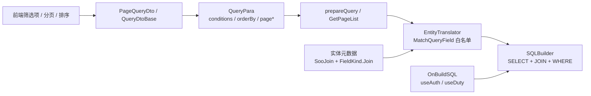

# 列表查询契约：读模型 · QueryPara · 数据权限

本文描述 mooSQL 在**业务列表页**上已经落地、可直接当产品能力使用的闭环：

1. **声明式读模型**：`[SooJoin]` + `[SooColumn(Kind = FieldKind.Join)]`，查询时自动 JOIN 并投影关联字段  
2. **前端动态条件**：`QueryPara` / `QueryCondition`，经仓储 `GetPageList(para)` 解析，字段须落在实体元数据上  
3. **服务端权限接缝**：`para.OnBuildSQL` 中挂载 `useAuth` / `useDuty`（或等价扩展），与前端条件 AND 合并  

三者合在一起，就是「前端可传筛选项、后端可验字段、权限可织入」的标准列表查询协议。复杂手写 SQL、SQLClip、LINQ 仍可并行使用，**不替代**本契约。

相关源码：

| 能力 | 位置 |
|------|------|
| `QueryPara` / `QueryCondition` | `pure/src/adoext/dto/QueryPara.cs` |
| 条件解析与字段白名单 | `pure/src/adoext/clip/provider/EntityTranslator.cs`（`PatchSQLByQueryPara` / `MatchQueryField`） |
| 仓储入口 | `SooRepository<T>.GetPageList(QueryPara)` / `GetList(QueryPara)` |
| Join 声明 | `SooJoinAttribute`、`SooColumn.Kind`、`DBTableType.Select` |
| 数据权限 | [权限体系总览](../auth/README.md) |

---

## 1. 总览：推荐闭环



典型业务写法（示意）：

```csharp
[HttpPost("hr/human/qlist")]
public PageOutput<BCHRHumanRow> queryBCHRHumanEntity([FromBody] PageQueryDto input)
{
    var para = input.ToQueryPara();          // 前端 conditions / page / order
    para.OnBuildSQL(kit =>
    {
        kit.useAuth(this, "ao")              // 服务端权限，不走前端反序列化
           .useDuty(resp =>
           {
               resp.useHROrgIsField("mtb.HR_Organize_FK")
                   .useHROrgLikeField("H.O_ClassCode")
                   .useUseOIDFK("mtb.SYS_CreatedBy");
           })
           .Build();
    });
    return humanService.LoadHumanListPageList(para);  // 内部 GetPageList(para)
}
```

约定：

| 来源 | 通道 | 是否信任 |
|------|------|----------|
| 前端筛选项 | `para.conditions` / `orderBy` / `pageSize` / `pageNum` | 否：字段必须匹配实体列，操作符走白名单 |
| 服务端固定条件 | `para.OnBuildSQL`、`para.SuckWhere(...)` | 是：由服务端代码写入，可自由拼 SQL / 权限 |

---

## 2. 声明式读模型（Join 字段）

### 2.1 何时用

列表页需要「主表 + 组织名 / 地点层次码 / 关联字典」等**只读投影**时，用 `DBTableType.Select` 的查询实体（常见命名 `*Row`），而不是在每个 Service 里手写 `left join`。

写路径继续用真正的表实体（`DBTableType.Table`）做 Insert/Update；读路径用 Select 读模型。这是**约定分层**，不必再拆一套独立 View ORM。

### 2.2 声明方式

```csharp
[SooTable(Name = "HR_Human", Alias = "mtb", Type = DBTableType.Select, Caption = "人力人员")]
[SooJoin(Type = JoinKind.Left, To = "HR_Organize", As = "H",
         OnA = "mtb.HR_Organize_FK", OnB = "H.HR_OrganizeOID")]
public class BCHRHumanRow
{
    [SooColumn(Name = "HR_HumanOID", Kind = FieldKind.Base, IsPrimaryKey = true)]
    public Guid? HR_HumanOID { get; set; }

    [SooColumn(Name = "H_Name", Kind = FieldKind.Base)]
    public string H_Name { get; set; }

    // 关联表字段：Kind=Join；前端筛选/排序用 Alias
    [SooColumn(Kind = FieldKind.Join, SrcField = "H.O_ClassCode", Alias = "O_ClassCode", Asc = true)]
    public string O_ClassCode { get; set; }

    [SooColumn(Kind = FieldKind.Join, SrcField = "H.O_OrgName", Alias = "O_OrgName")]
    public string O_OrgName { get; set; }
}
```

要点：

| 项 | 说明 |
|----|------|
| `SooTable.Type = Select` | 表示复合查询结果，不是物理单表 |
| `[SooJoin]` | 可多个；`OnA`/`OnB` 或完整 `On` |
| `FieldKind.Base` | 主表列，筛选时可用列名或 Alias |
| `FieldKind.Join` | 外表列；`MatchQueryField` **按 Alias 匹配**，解析为 `SrcField`（或 `SrcTable.SrcField`） |
| `FieldKind.Free` | 表达式/聚合等自由 SQL；Alias 可作筛选项名，须自行保证安全 |

仓储 `GetPageList(QueryPara)` 会按实体元数据生成 `FROM` + `JOIN` + `SELECT`，再套用条件与分页。

### 2.3 与手写 JOIN 的分工

| 场景 | 推荐 |
|------|------|
| 标准列表、关联展示列、按关联列筛选 | Select 读模型 + `QueryPara` |
| 偶发复杂多表、动态联表、报表 | `SQLBuilder` / `SQLClip` |
| 导航子集合加载 | [导航加载与保存](./navigation.md)（`includeNav` 等） |

---

## 3. QueryPara：前端动态条件协议

### 3.1 结构

```csharp
public class QueryPara
{
    public int? pageSize { get; set; }
    public int? pageNum { get; set; }
    public List<QueryCondition> conditions { get; set; }
    public List<QueryOrderBy> orderBy { get; set; }
    public List<SummaryField> sumFields { get; set; }

    // 仅服务端赋值，勿当作 Web 模型字段自动绑定
    public List<EntityWhere> suckWheres { get; }   // SuckWhere(...)
    public Action<SQLBuilder> onBuildingSQL { get; }
    public QueryPara OnBuildSQL(Action<SQLBuilder> onBuild);
}
```

单条条件：

```csharp
public class QueryCondition
{
    public int? sink { get; set; }   // SinkType：条件组左开（AND/OR/...）
    public bool? rise { get; set; }  // 条件组右闭
    public string field { get; set; }
    public string op { get; set; }
    public object value { get; set; }
    public string vtype { get; set; }
}
```

业务层常用 `QueryDtoBase` / `PageQueryDto` 承接 HTTP Body，再 `ToQueryPara()` 转换（应用项目内扩展即可）。

### 3.2 安全边界（产品级承诺）

`EntityTranslator.PatchConditionWhere` / `MatchQueryField`：

1. **字段白名单**：`field` 必须能在当前实体 `Columns` 中匹配（Base 列名/Alias、Join 的 Alias、Free 的 Alias）；匹配失败则**静默忽略**该条件。  
2. **禁止任意列名直通**：前端不能靠传 `1=1;--` 式字段名扩大查询面。  
3. **操作符白名单**（大小写不敏感的特殊 op；比较符原样匹配）：

| op | 行为 |
|----|------|
| `=` `<>` `>` `<` `>=` `<=` | 参数化比较 |
| `in` / `notin` | 集合；字符串可用 `,` `;` `\|` 分隔 |
| `like` / `likes` / `notlike` | 模糊 |
| `likeleft` / `likelefts` | 左模糊（层次码等） |
| `isnull` / `notnull` | 空值判断 |
| `between` | 区间（值内两个边界） |

未识别的 `op` 不会写入 WHERE。  
4. **`suckWheres` / `OnBuildSQL`**：明确设计为服务端通道；注释约定「不允许自动通过接口接收 web 参数赋值」。权限、租户、逻辑删除等放这里。

> 本契约覆盖的是**扁平 field / op / value**（加 sink/rise 分组）的列表筛选。若产品需要「嵌套表达式树、前端可传函数/算术/EXISTS」级别的 DSL，应另立扩展 IR，而不是放开 `conditions` 拼 raw SQL。

### 3.3 仓储入口

```csharp
var repo = db.useRepo<BCHRHumanRow>();
var page = repo.GetPageList(para);   // 分页
var list = repo.GetList(para);       // 全量（仍走同一套条件解析）
```

解析顺序（简化）：

1. 按实体生成 SELECT / FROM / JOIN  
2. `fireBuildSQL`（`OnBuildSQL`，含权限）  
3. `suckWheres` → `conditions`  
4. `orderBy` + 实体默认排序  
5. `pageSize` / `pageNum` → 分页  

`OnBuildSQL` 可多次 `+=` 注册（多轮叠加）。

---

## 4. 与数据权限的接缝

权限引擎本身见 [数据权限体系](../auth/README.md)。列表契约侧只需固定一种拼法：

```csharp
para.OnBuildSQL(kit =>
{
    kit.useAuth(this, "ao")   // 或 useAuthor / 业务封装名
       .useDuty(resp => { /* 绑定组织层次码、创建人等字段 */ })
       .Build();
});
```

| 层次 | 职责 |
|------|------|
| `conditions` | 用户可见筛选项（姓名、状态、时间范围…） |
| `OnBuildSQL` + Auth | 当前登录人数据范围，与用户条件 **AND** |
| 读模型 Join 列 | 权限字段可直接引用外表别名（如 `H.O_ClassCode`），与 Join 声明一致 |

不要把权限条件塞进前端 `conditions`：既易被篡改，也破坏「服务端可信通道」边界。

---

## 5. 能力边界与选型

| 需求 | 用本契约 | 改用其它入口 |
|------|----------|--------------|
| 列表分页 + 动态筛选项 + 关联展示列 | ✅ | — |
| 数据权限织入列表 | ✅ `OnBuildSQL` | — |
| 复杂报表、多段 CTE/MERGE | — | SQLBuilder |
| 强类型多表拼装 | — | SQLClip |
| 标准 IQueryable / Includes | — | Ext LINQ / Fast LINQ |
| 嵌套表达式 JSON（函数树） | ❌ 当前非目标 | 另立 DSL（若产品明确需要） |

---

## 6. 检查清单（接入新列表页）

1. 是否定义了 `DBTableType.Select` 读模型，关联列是否为 `FieldKind.Join` 且 Alias 稳定？  
2. 前端筛选项的 `field` 是否等于实体列名或 Join Alias？  
3. `op` 是否落在白名单内？  
4. 权限是否只挂在 `OnBuildSQL`，且 Join 别名与 Auth 字段绑定一致？  
5. 写操作是否仍走表实体 / 仓储 Save，而不是对 Select 读模型误更新？  

按上述五点接入，即可复用与现网业务（如列表 BPO）相同的产品路径，而无需再引入另一套「视图 ORM / 表达式树序列化」框架。
