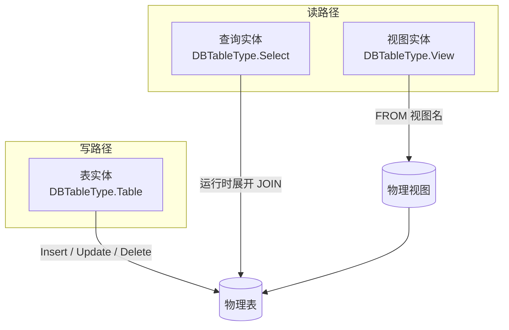

# 查询实体（Select 读模型）

> **一句话**：用 `[SooTable(Type = Select)]` + `[SooJoin]` + `FieldKind` 把「多表 JOIN 的扁平结果」声明成一个类；查询时用法与普通表实体相同，**不必**再建物理视图。

列表页产品闭环（`QueryPara` / 权限）见 **[列表查询契约](./query-contract.md)**。本文只讲**查询实体本身**的概念、声明与引擎行为。

---

## 1. 概念：三种「实体」

`[SooTable].Type`（`DBTableType`）区分物理形态与查询形态：

| Type | 含义 | 典型用途 | 写（Insert/Update） |
|------|------|----------|---------------------|
| **Table** | 真实表 | 领域表实体、聚合根持久化 | ✅ |
| **View** | 数据库视图 | 已有库视图、跨库只读、DBA 维护的投影 | ❌（只读） |
| **Select** | **查询实体**（复合查询结果，无物理对象） | 列表读模型、`*Row`、引擎宽行投影 | ❌（只读约定） |



**查询实体** = 元数据里声明的「主表 + JOIN + 列投影」。  
它**不是**库里的对象：没有 `CREATE VIEW`，没有独立 schema；每次查询由 `EntityTranslator` / `SQLClip` 按元数据生成 SQL。

对标直觉：

| 其它生态 | mooSQL 对应 |
|----------|-------------|
| MyBatis `resultMap` + 多表 `select` | Select 查询实体 + 自动 JOIN |
| 手写 DTO + 手写 JOIN SQL | Select 声明后走仓储 / Clip，少拼 SQL |
| DB View + 映射类 | `DBTableType.View`（可选）；多数列表场景用 Select 即可 |

---

## 2. 为何优先 Select，而不是 View

| 维度 | Select 查询实体 | 物理 View |
|------|-----------------|-----------|
| 部署 | 随代码发布，无 DDL 视图步骤 | 需 init-db / 迁移建视图；方言差异多 |
| 演进 | 改特性即可；自连接、换列随时调 | 视图定义与实体易漂移（名/列不一致） |
| 调试 | SQL 日志直接看到展开 JOIN | 一层间接；SQLite 等也不物化 |
| 调用 | `from<T>` / `findRowById` / `GetPageList` 与表实体同形 | 同上，但依赖库对象存在 |
| 适用 | 业务列表、引擎读模型、宿主 BC `*Row` | 跨系统共用投影、DBA 强制视图、已有遗留视图 |

经验法则：**应用内只读宽行 → Select**；**库外已有视图或必须库内共享 → View**。

---

## 3. 声明方式

### 3.1 最小形态（列表 BC）

```csharp
using mooSQL.data;
using mooSQL.data.model;

[SooTable(Name = "HR_Human", Alias = "mtb", Type = DBTableType.Select, Caption = "人力人员")]
[SooJoin(Type = JoinKind.Left, To = "HR_Organize", As = "H",
         OnA = "mtb.HR_Organize_FK", OnB = "H.HR_OrganizeOID")]
public class BCHRHumanRow
{
    [SooColumn(Name = "HR_HumanOID", Kind = FieldKind.Base, IsPrimaryKey = true)]
    public Guid? HR_HumanOID { get; set; }

    [SooColumn(Name = "H_Name", Kind = FieldKind.Base)]
    public string H_Name { get; set; }

    // Join 列：筛选/排序认 Alias；结果列名也用 Alias 映射
    [SooColumn(Kind = FieldKind.Join, SrcTable = "H", SrcField = "O_OrgName", Alias = "O_OrgName")]
    public string O_OrgName { get; set; }
}
```

### 3.2 宽行读模型（多 Inner + 自连接）

主表任务 ⋈ 活动 ⋈ 流程，再 left join 主活动取「主活动状态」——典型引擎待办明细：

```csharp
[SooTable(Name = "sf_task", Alias = "t", Type = DBTableType.Select, Caption = "任务明细读模型")]
[SooJoin(Type = JoinKind.Inner, To = "sf_act_instance", As = "ai",
         OnA = "t.tk_act_instance_id", OnB = "ai.ai_id")]
[SooJoin(Type = JoinKind.Inner, To = "sf_proc_instance", As = "pi",
         OnA = "t.tk_proc_instance_id", OnB = "pi.pi_id")]
[SooJoin(Type = JoinKind.Left, To = "sf_act_instance", As = "mai",
         OnA = "ai.ai_m_act_instance_id", OnB = "mai.ai_id")]
public class TaskViewEntity
{
    [SooColumn(Name = "tk_id", Kind = FieldKind.Base, IsPrimaryKey = true)]
    public string TaskId { get; set; }

    [SooColumn(Name = "tk_sign_id", Kind = FieldKind.Base)]
    public string SignId { get; set; }

    [SooColumn(Kind = FieldKind.Join, SrcTable = "pi", SrcField = "pi_process_state",
               Name = "pi_process_state", Alias = "pi_process_state")]
    public short? ProcessState { get; set; }

    [SooColumn(Kind = FieldKind.Join, SrcTable = "ai", SrcField = "ai_activity_state",
               Name = "ai_activity_state", Alias = "ai_activity_state")]
    public short? ActivityState { get; set; }

    // 自连接：同一物理表第二次 As = mai，Alias 必须区别于 ai 上的同名列
    [SooColumn(Kind = FieldKind.Join, SrcTable = "mai", SrcField = "ai_activity_state",
               Name = "ai_mn_activity_state", Alias = "ai_mn_activity_state")]
    public short? MainActivityState { get; set; }
}
```

命名习惯（业务侧常见）：

| 场景 | 类名 |
|------|------|
| 平台 BC 列表 | `BC_*Row` / `BCXxxRow` |
| 引擎 / 宿主读模型 | `*ViewEntity`、`*ReadRow` |
| 仅表 CRUD | 表名实体，`Type = Table`（不要用 Select） |

---

## 4. 字段种类 `FieldKind`

| Kind | 来源 | SELECT 行为 | 条件白名单（QueryPara） |
|------|------|-------------|-------------------------|
| **Base** | 主表（`SooTable.Name`） | `alias.列`；可加 `Alias` | 列名或 Alias |
| **Join** | `[SooJoin]` 外表 | `SrcTable.SrcField [AS Alias]` | **按 Alias**（须稳定） |
| **Free** | 表达式 / 聚合 | `FreeSQL [AS Alias]` | Alias；SQL 自担安全 |
| **Fake** | 纯内存 | 不进 SQL | — |

要点：

- Join 列务必给 **Alias**（并建议 `Name` 与结果列一致），否则结果映射 / 筛选易对不上。  
- 自连接时两路同名物理列必须用**不同 Alias**（上例 `ai_activity_state` vs `ai_mn_activity_state`）。  
- 主键放在主表 Base 上，便于 `findRowById`。

---

## 5. 用起来：与普通实体同形

声明完成后，**不要**再手写一遍 JOIN：

```csharp
// 仓储
var page = db.useRepo<BCHRHumanRow>().GetPageList(para);

// 按主键（Select：扁平 BuildSelectFrom + WHERE 主键；显式 Alias，非 SELECT *）
var one = kit.findRowById<TaskViewEntity>(taskId);

// SQLClip：Select 包成子查询后再挂外层 WHERE/ORDER
var clip = kit.useClip();
clip.from<TaskViewEntity>(out var t)
    .where(() => t.SignId, userId)
    .where(() => t.ProcessState, (short)2);
var list = clip.select(t).take(20).queryList();
```

调用方感知：`T` 仍是一个「实体类型」；差异只在元数据是 Select 还是 Table。Clip 与 `findRowById` 展开形态不同（子查询 vs 扁平），见 §6。

---

## 6. 引擎如何展开（心智模型）

### 6.1 仓储 / `findRowById` / `BuildSelectFrom`（扁平展开）

对 `DBTableType.Select`，`EntityTranslator.BuildSelectFrom` 大致：

1. 按列生成 `SELECT`（Base / Join / Free；Join/Free 须带稳定 **Alias**）  
2. `FROM 主表 AS alias`  
3. 按 `[SooJoin]` 顺序拼 `INNER/LEFT/... JOIN`

`findRowById`、`GetById`、`GetPageList(QueryPara)` 走这条**扁平**路径（一层 SQL，不包子查询）。  
自连接时必须靠 Alias 区分同名物理列；禁止空投影落成 `SELECT *`（否则 `ai`/`mai` 同名列会后写覆盖）。

### 6.2 SQLClip `from<T>`（子查询包裹）

`ClipProvider` 对 Select：**先**用上面规则生成完整 SELECT，再包成：

```sql
SELECT t.* FROM ( /* BuildSelectFrom 的 SQL */ ) AS t
WHERE t.ai_activity_state = @p ...
```

- 外层 where/order/select 作用在子查询**结果列**上：Base 用物理列名，Join/Free 用 **Alias**（`EntityColumn.GetProjectedName()`）。  
- `from<T>(tbname, …)` 分表：内层主表名走 `loadName`，仍包子查询，不裸挂物理表名。

### 6.3 View

`DBTableType.View`：`FROM` 直接用视图名，**不**展开 `[SooJoin]`（Join 声明一般用于 Select）。建视图可用 DDL / `ViewSQL`，见 [建表与 DDL](../../moohelp/sqlbasis/tableddl.md)。

---

## 7. 读写分层（约定）

| 操作 | 用谁 |
|------|------|
| Insert / Update / Delete / Save | **表实体**（`DBTableType.Table`） |
| 列表、待办明细、带关联展示列 | **查询实体**（`Select`） |
| 已有物理视图 | **View** 实体或 Select（二选一，勿双轨同名） |

对 Select 实体调用写 API 不是产品路径：列可能来自多表，主键语义也只在主表上清晰。业务上保持「读 Select、写 Table」。

---

## 8. 与手写 JOIN / View 的选型

| 场景 | 推荐 |
|------|------|
| 标准列表、关联列筛选、权限挂外表别名 | **查询实体** + [列表查询契约](./query-contract.md) |
| 偶发复杂多表、动态联表、报表 CTE | `SQLBuilder` / `SQLClip` 手写 |
| 导航子集合 | [导航加载与保存](./navigation.md) |
| 库内强制共享投影、遗留视图 | `DBTableType.View` |
| 无元数据的临时 DTO 映射 | `query<T>()` + 手写 select（README 旧例）；新代码优先声明查询实体 |

---

## 9. 检查清单

1. `Type = Select`，主表 `Name` + 稳定 `Alias`。  
2. 每个关联一张 `[SooJoin]`；自连接必须不同 `As`。  
3. 主表列 `FieldKind.Base`；外表列 `Join` 且 **Alias 稳定**。  
4. 读用 `GetPageList` / `from<T>` / `findRowById`；写走表实体。  
5. 不需要再 `EnsureXxxView` / `CREATE VIEW`（除非刻意选 View）。  
6. 列表筛选项 `field` 对齐 Base 列名或 Join Alias（见查询契约）。

---

## 10. 相关文档

| 文档 | 内容 |
|------|------|
| [列表查询契约](./query-contract.md) | QueryPara、权限、列表产品闭环 |
| [仓储](./repository.md) | `GetPageList` / `GetList` |
| [SQLClip](./sqlclip.md) | 类型安全多表；Select 子查询包装 |
| [建表与 DDL](../../moohelp/sqlbasis/tableddl.md) | 物理 View 的创建 / `ViewSQL` |
| [多表查询](../../moohelp/query/joinquery.md) | 手写 join 基础 |
